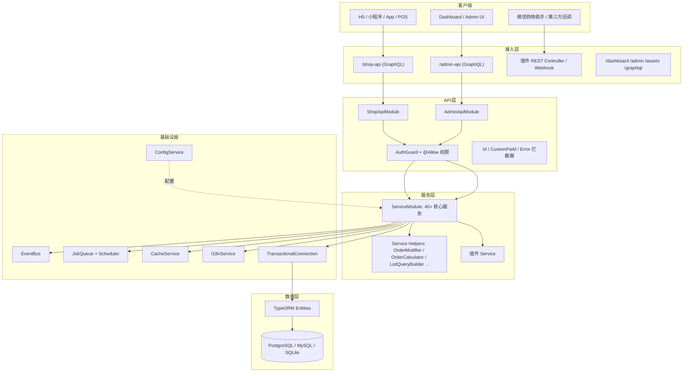
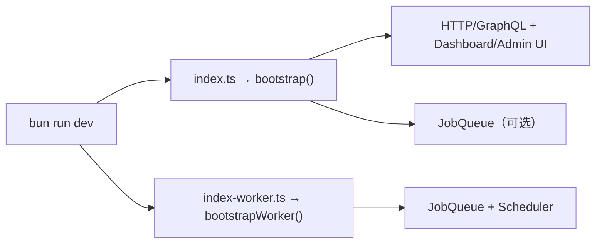
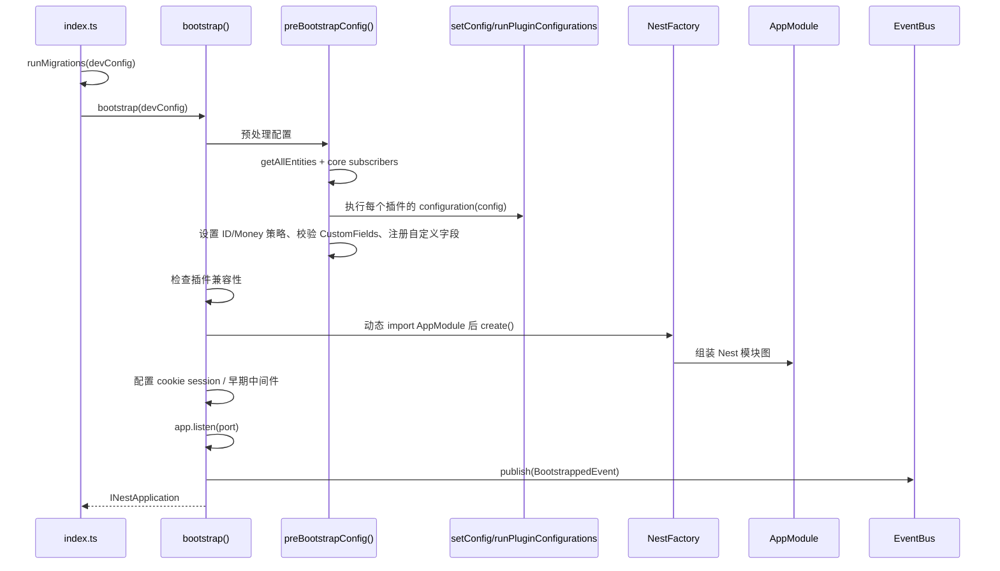
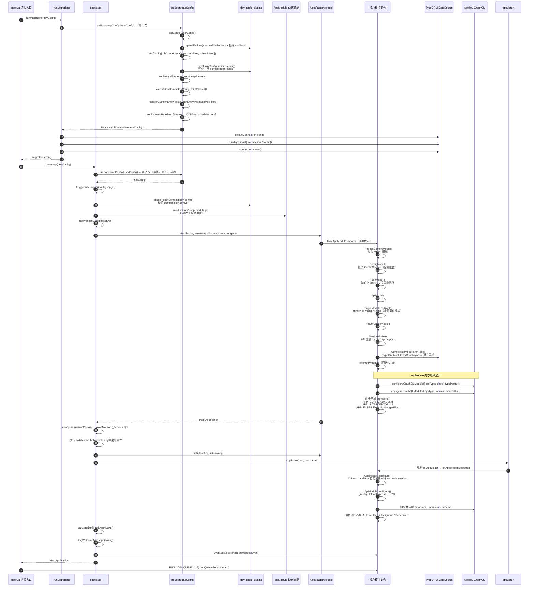
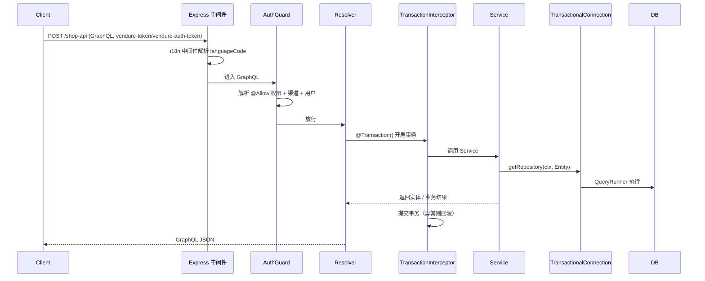
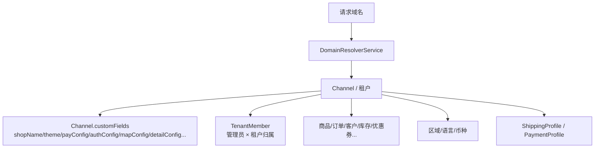

# 01 · 整体架构

> 相关代码入口：`packages/core/src/bootstrap.ts`、`packages/core/src/app.module.ts`、`packages/core/src/api/api.module.ts`、`packages/dev-server/dev-config.ts`、`packages/dev-server/index.ts`

---

## 1. 分层架构



**核心特征**

- API 层只做参数解析、权限校验、事务边界；业务逻辑集中在 Service 层。
- Service 层不直接持有 TypeORM Connection，而是通过 `TransactionalConnection` + `RequestContext` 获取仓储。
- 跨模块副作用通过 `EventBus` / `JobQueue` 解耦。
- 插件是 NestJS Module 的超集，可以注入实体、服务、Resolver、REST Controller、配置钩子。

---

## 2. 运行时进程模型

Vendure 支持两种进程：

| 进程 | 入口 | 职责 |
|---|---|---|
| Server | `bootstrap()` / `packages/dev-server/index.ts` | HTTP + GraphQL API、Admin/Dashboard 静态资源、部分任务 |
| Worker | `bootstrapWorker()` / `packages/dev-server/index-worker.ts` | 只跑后台任务（JobQueue、Scheduler），不监听 HTTP |

本仓库的特殊点：

- `packages/dev-server/package.json` 的 `dev` 脚本用 `concurrently` 同时启动 **dev:server + dev:worker**。
- 生产单进程部署时，`schedulerOptions.runTasksInWorkerOnly = false`，让计划任务在 server 进程执行（`dev-config.ts` 有详细注释与踩坑记录）。
- `ProcessContext` 会标记当前进程是 `server` 还是 `worker`，插件可据此跳过静态资源/中间件注册。



---

## 3. 启动链路

### 3.1 Server 启动



关键源码：

- `bootstrap()`：`packages/core/src/bootstrap.ts`（约 L190-L229）
- `preBootstrapConfig()`：同文件（约 L287-L326）
- `runMigrations()`：`packages/core/src/migrate.ts`
- dev-server 入口：`packages/dev-server/index.ts`

`preBootstrapConfig()` 做了这些「必须在 AppModule 加载前完成」的事情：

1. 合并 core + 插件实体、core subscribers。
2. 依次执行插件的 `configuration(config)`。
3. 设置 `EntityIdStrategy`（默认自增 ID）与 `MoneyStrategy`（默认整数分存储）。
4. 校验 CustomFields 配置，非法直接退出。
5. 注册自定义实体字段、执行 entity metadata modifiers、设置暴露响应头。
6. 最后才动态 `import('./app.module.js')`，因为 `AppModule` 的装饰器在模块求值时就依赖已确定的实体集合。

### 3.2 Worker 启动

`bootstrapWorker()`：

- 同样执行 `preBootstrapConfig()`；
- 调用 `disableSynchronize()`，Worker **不会**自动同步数据库结构；
- 加载 `WorkerModule`，创建 `NestApplicationContext`（无 HTTP）；
- `validateDbTablesForWorker()` 校验表结构是否就绪；
- 发布 `BootstrappedEvent`，返回 `VendureWorker`，由调用方启动 JobQueue。

### 3.3 从入口到核心模块初始化的完整调用链

下图把 §3.1 展开到「AppModule 内部各核心模块如何被 Nest 逐个初始化」的粒度。



#### 调用链速查（文本版）

```text
index.ts
└─ runMigrations(devConfig)
   └─ preBootstrapConfig()            # 第 1 次
      ├─ setConfig → getAllEntities → setConfig(dbConnectionOptions)
      ├─ runPluginConfigurations()    # 插件 configuration() 逐个执行
      ├─ setEntityIdStrategy / setMoneyStrategy
      ├─ validateCustomFieldsConfig → registerCustomEntityFields
      └─ runEntityMetadataModifiers → setExposedHeaders
   └─ createConnection → runMigrations → close
└─ bootstrap(devConfig)
   └─ preBootstrapConfig()            # 第 2 次
   ├─ Logger.useLogger → checkPluginCompatibility
   ├─ import('./app.module.js')       # 实体确定后才能求值 AppModule 装饰器
   ├─ setProcessContext('server')
   └─ NestFactory.create(AppModule)
      ├─ ProcessContextModule
      ├─ ConfigModule                  → ConfigService
      ├─ I18nModule                    → i18next
      ├─ ApiModule
      │  ├─ ServiceModule              → 40+ Service
      │  ├─ ConnectionModule.forRoot() → TypeOrmModule.forRootAsync → DataSource
      │  ├─ DataImportModule
      │  ├─ ApiSharedModule / AdminApiModule / ShopApiModule
      │  ├─ configureGraphQLModule('shop' / 'admin')
      │  └─ APP_GUARD(AuthGuard) + APP_INTERCEPTOR × 3 + APP_FILTER
      ├─ PluginModule.forRoot()        → imports: config.plugins
      ├─ HealthCheckModule
      ├─ ServiceModule
      ├─ ConnectionModule
      └─ TelemetryModule
   ├─ configureSessionCookies（cookie tokenMethod）
   ├─ beforeListen 中间件 → app.listen()
   │  └─ onModuleInit → onApplicationBootstrap
   │     ├─ AppModule.configure()      → i18next + 自定义中间件 + cookie session
   │     ├─ ApiModule.configure()      → graphqlUploadExpress
   │     └─ 插件订阅者 / JobQueue / Scheduler 启动
   └─ enableShutdownHooks → logWelcomeMessage → publish(BootstrappedEvent)
```

#### 关键模块初始化职责

| 模块 | 初始化时机 | 职责 | 关键产物 |
| --- | --- | --- | --- |
| `ProcessContextModule` | `NestFactory.create` 解析 imports 时 | 标记 `server` / `worker` | `ProcessContext`（`isWorker`） |
| `ConfigModule` | 同上 | 暴露全局配置 | `ConfigService` |
| `I18nModule` | 同上 | 初始化 i18next 与语言中间件 | `I18nService.handle()` |
| `ConnectionModule` | 同上（`forRoot()` 只在首次创建 DynamicModule） | 建立 TypeORM 连接、注册事务设施 | `TransactionalConnection`、`TransactionSubscriber`、`TransactionWrapper` |
| `ServiceModule` | 同上 | 注册全部业务 Service 与 helpers | 订单/商品/支付/履约等 Service |
| `ApiModule` | 同上 | 组装双 API、GraphQL schema、全局守卫/拦截器/过滤器 | `/shop-api`、`/admin-api` |
| `PluginModule.forRoot()` | 同上 | 把 `config.plugins` 作为 Nest 模块全部 import | 插件 providers/entities/扩展生效 |
| `HealthCheckModule` | 同上 | 提供 `/health` 检查 | Terminus 健康检查 |
| `TelemetryModule` | 同上 | 可选 OTel 初始化 | traces / logs |
| `AppModule.configure()` | `app.listen()` 触发的模块初始化阶段 | 注册 HTTP 中间件 | i18next、cookie session、自定义 middleware |
| `ApiModule.configure()` | 同上 | 注册文件上传中间件 | `graphqlUploadExpress` |

> **为什么 `preBootstrapConfig()` 要执行两次**：`runMigrations()` 内部自己会调用一次（拿到实体与迁移配置），随后 `bootstrap()` 再调用一次（拿到最终运行时配置）。这也是为什么插件的 `configuration()` **必须幂等** —— 例如 customFields 必须按字段名去重合并，否则第二次执行会产生重复字段。详见 [11-development-guide.md](./11-development-guide.md#2-customfields-规范)。

> **为什么 `AppModule` 必须动态 import**：`@Module({ imports: [...] })` 在类定义求值时就执行，而 `ApiModule`/`ConnectionModule` 的 `forRoot()` 会读取 `getConfig()`。因此必须等 `preBootstrapConfig()` 把实体、插件配置都写入全局 config 之后，才能加载 `app.module.js`。


---

## 4. AppModule 模块图

`packages/core/src/app.module.ts`：

| 模块 | 作用 |
|---|---|
| `ProcessContextModule` | 标记 server/worker，提供 `ProcessContext` |
| `ConfigModule` | 全局配置 `ConfigService` |
| `I18nModule` | i18next 初始化与请求级语言处理器 |
| `ApiModule` | Shop/Admin GraphQL 与 REST 中间件、全局守卫/拦截器/过滤器 |
| `PluginModule.forRoot()` | 把 `config.plugins` 全部 import 进 Nest 模块图 |
| `HealthCheckModule` | `/.well-known/health-check` 等健康检查 |
| `ServiceModule` | 核心服务与 helpers 的唯一实例 |
| `ConnectionModule` | TypeORM DataSource / TransactionalConnection |
| `TelemetryModule` | OpenTelemetry 集成点 |

`AppModule.configure()` 负责把 i18n 中间件、cookie session、用户自定义 middleware 按 route 分组挂载。

### ApiModule

`packages/core/src/api/api.module.ts`：

- 导入 `ServiceModule`、`ConnectionModule.forRoot()`、`DataImportModule`、`I18nModule`、`ApiSharedModule`、`AdminApiModule`、`ShopApiModule`；
- 用 `configureGraphQLModule()` 分别创建 shop/admin 两个 Apollo GraphQL 模块；
- 全局提供：
  - `APP_GUARD` → `AuthGuard`（权限）
  - `APP_INTERCEPTOR` → `IdInterceptor`（ID 编解码）、`CustomFieldProcessingInterceptor`、`TranslateErrorResultInterceptor`
  - `APP_FILTER` → `ExceptionLoggerFilter`
- `configure()` 为两个 API 路径挂载 `graphqlUploadExpress`（文件上传，大小取 `assetOptions.uploadMaxFileSize`）。

---

## 5. 一次请求的完整生命周期



### 请求上下文

`RequestContextService.fromRequest()` 从请求中解析：

- `channelToken`：查询参数或请求头，默认键 `vendure-token`（`apiOptions.channelTokenKey`）；
- `languageCode`：查询参数 `languageCode` → Channel 默认语言 → 全局默认语言；
- `currencyCode`：查询参数/请求头 → Channel 默认币种；
- `session`：从 cookie / bearer / api-key 认证结果中获取；
- `apiType`：`shop` / `admin`；
- 权限：`requiredPermissions` 与用户权限比对，支持 `Permission.Owner` 的「仅本人数据」语义。

### 事务

- Resolver 上使用 `@Transaction()`（`packages/core/src/api/decorators/transaction.decorator.ts`）。
- 默认 `auto`：方法成功即提交，抛错即回滚。
- `manual`：手动 `startTransaction()` / `commitOpenTransaction()`，异常仍自动回滚。
- 事务 QueryRunner 挂在 `RequestContext` 上，因此**所有服务必须接收并透传 `ctx`**。

---

## 6. 双 API 与资源路径

| 能力 | Shop API | Admin API |
|---|---|---|
| 默认路径 | `/shop-api` | `/admin-api` |
| Schema 目录 | `packages/core/src/api/schema/shop-api` | `packages/core/src/api/schema/admin-api` |
| Resolver 目录 | `packages/core/src/api/resolvers/shop` | `packages/core/src/api/resolvers/admin` |
| 插件扩展字段 | `shopApiExtensions` | `adminApiExtensions` |
| 典型场景 | 商品浏览、购物车、下单、C 端查询 | 商品/订单/客户/配置管理 |

其它 HTTP 入口：

- `/dashboard`：React Dashboard，`DashboardPlugin` 提供静态文件或代理 Vite。
- `/admin`：Angular Admin UI，`AdminUiPlugin` 提供静态文件或代理。
- `/assets`：`AssetServerPlugin` 资源服务。
- `/graphiql/shop`、`/graphiql/admin`：`GraphiqlPlugin`。
- 插件 REST Controller：路径由 Nest Controller 前缀决定；本仓库观察到 admin 路由常挂在 `/<pluginName><route.path>` 下（如 MeiliSearch）。

---

## 7. 插件装配顺序

`packages/dev-server/dev-config.ts` 的 `plugins` 数组就是实际运行配置。装配顺序有三类影响：

1. **配置钩子覆盖**：后执行的 `configuration(config)` 会覆盖先执行的结果。
   - 典型：`DisableSellerSplitPlugin` 必须放最后，把 `orderSellerStrategy` 重置为 `DefaultOrderSellerStrategy`，避免 Marketplace 产生幽灵子单。
2. **策略竞争**：多个插件都设置 `stockLocationStrategy` 时，最后注册者生效。
   - 典型：`LogisticsPlugin` 必须在 `MarketplacePlugin` 之后，用 `PhysicalAwareStockLocationStrategy` 覆盖组合策略。
3. **依赖顺序**：插件可能 import 另一个插件的服务/实体。
   - 如 `CouponPlugin` 依赖 `MerchantPlugin`、`RechargeCardPlugin`、`WechatpayPlugin`；
   - `PointsMallPlugin` 依赖 `MemberLevelPlugin` 与 `WechatpayPlugin`。

> 修改 `plugins` 顺序前，先阅读 [05-plugin-system.md](./05-plugin-system.md) 的依赖表与 `dev-config.ts` 中的注释。

---

## 8. 多租户架构（本仓库的关键差异）

Vendure 原生只有 `Channel`（渠道）。本仓库把 Channel 提升为**租户**，由 `cjk-plugin` 补齐：



关键能力：

| 能力 | 代码位置 | 说明 |
|---|---|---|
| 域名 → 租户 | `packages/cjk-plugin/src/tenant/domain-resolver.service.ts` | 根据访问域名/路径解析 Channel |
| 租户成员 | `packages/cjk-plugin/src/tenant/tenant-member.entity.ts` | `Administrator` × `Channel`，支持启停、首登改密、核销档案白名单 |
| 租户配置 | `packages/cjk-plugin/src/admin/tenant-config-admin.resolver.ts` 及各 config service | 基本配置、支付配置、地图配置、多语言、服务通知 |
| 租户初始化 | `tenant-setup.service.ts`、`seed/default-data.service.ts` | 创建渠道、默认支付/配送/分类等 |
| 租户鉴权 | `auth/auth-config.service.ts`、`sso-provider.service.ts`、`tenant-enabled.guard.ts` | 每租户登录方式、SSO、启停 |
| 数据隔离 | 所有 `ChannelAware` 实体 + `ChannelService` | 查询自动按当前 Channel 过滤 |
| 敏感配置加密 | `packages/cjk-plugin/src/auth/crypto.ts`、`payment/pay-config.service.ts` | AES-256-GCM，密钥来自 `authSecret` |

**注意**：本仓库**不是** Vendure 官方 Marketplace 的多商户模型。`MarketplacePlugin` 虽被装配，但 `DisableSellerSplitPlugin` 会关闭 Seller 拆单，实际以「租户渠道」为隔离单位。详见 [06-business-domains.md](./06-business-domains.md)。

---

## 9. 配置体系

`VendureConfig` 顶层键（`packages/core/src/config/vendure-config.ts`）：

| 键 | 作用 |
|---|---|
| `apiOptions` | 端口、API 路径、CORS、middleware、playground、trustProxy |
| `authOptions` | token 方式、cookie、session、自定义权限 |
| `dbConnectionOptions` | TypeORM DataSourceOptions |
| `entityOptions` | ID 策略、Money 策略、entity metadata modifiers |
| `customFields` | 各实体的自定义字段 |
| `catalogOptions` / `orderOptions` / `paymentOptions` / `promotionOptions` / `shippingOptions` / `taxOptions` | 领域策略与处理器 |
| `jobQueueOptions` / `schedulerOptions` | 任务队列与计划任务 |
| `assetOptions` / `importExportOptions` | 资源与导入导出 |
| `systemOptions` | 系统级开关（错误隐藏、健康检查等） |
| `settingsStoreFields` | 3.6 的 SettingsStore 字段注册 |

配置合并顺序：

1. `defaultConfig`（`packages/core/src/config/default-config.ts`）
2. 用户配置（`devConfig`）
3. 各插件 `configuration()` 依次修改
4. 生成 `RuntimeVendureConfig`（所有必填项已补齐）

本仓库 dev-config 还额外注册了：

- `Channel` 的店铺装修/主题/订单详情/页面配置等大量 customFields；
- `Collection` 的楼层装修字段；
- `ReadonlySettingsTestPlugin` 的 SettingsStore 示例；
- 宽松的 `ArrangingPayment` 守卫（`RelaxArrangingPaymentGuardPlugin`），适配无物流的服务类商品与 H5 收银台直付。

---

## 10. 关键设计取舍与坑位

| 主题 | 结论 |
|---|---|
| 数据库同步 | 开发 `synchronize: true`；PostgreSQL 生产可 `DB_SYNC=0` 关闭同步，避免列数上限/漂移 |
| Dashboard 构建 | 必须清理 `packages/dev-server/dist`，否则旧 Vite chunk 会干扰 `window.schemaInfo`（见 AGENTS.md） |
| Dashboard 开发代理 | `DashboardPlugin` 检测到 5173 有 Vite 就代理；确认没有残留 dev server |
| 生产构建 | 全部在本地构建，服务器只 `git pull` + `pm2 restart`，不在服务器编译 |
| 单进程任务 | 生产 server 单进程时必须 `runTasksInWorkerOnly: false`，否则超时补偿/清理任务不执行 |
| 插件实体类型 | SQLite 不支持 `timestamp`，插件实体多用 `datetime`；PG 原生 SQL 在 SQLite 不可用 |
| 租户头 | 默认 `vendure-token`；前端若用别的头名且 nginx 不转换，会恒落默认渠道 |

---

## 11. 代码索引

| 关注点 | 文件 |
|---|---|
| 启动 | `packages/core/src/bootstrap.ts`、`packages/dev-server/index.ts` |
| 根模块 | `packages/core/src/app.module.ts` |
| API 模块 | `packages/core/src/api/api.module.ts` |
| GraphQL 配置 | `packages/core/src/api/config/configure-graphql-module.ts` |
| 默认配置 | `packages/core/src/config/default-config.ts` |
| 配置合并 | `packages/core/src/config/merge-config.ts` |
| 插件装饰器 | `packages/core/src/plugin/vendure-plugin.ts` |
| 插件模块 | `packages/core/src/plugin/plugin.module.ts` |
| 服务注册 | `packages/core/src/service/service.module.ts` |
| 事务连接 | `packages/core/src/connection/transactional-connection.ts` |
| 事件总线 | `packages/core/src/event-bus/event-bus.ts` |
| 实际装配 | `packages/dev-server/dev-config.ts` |
| 多租户入口 | `packages/cjk-plugin/src/plugin.ts`、`packages/cjk-plugin/src/types.ts` |
