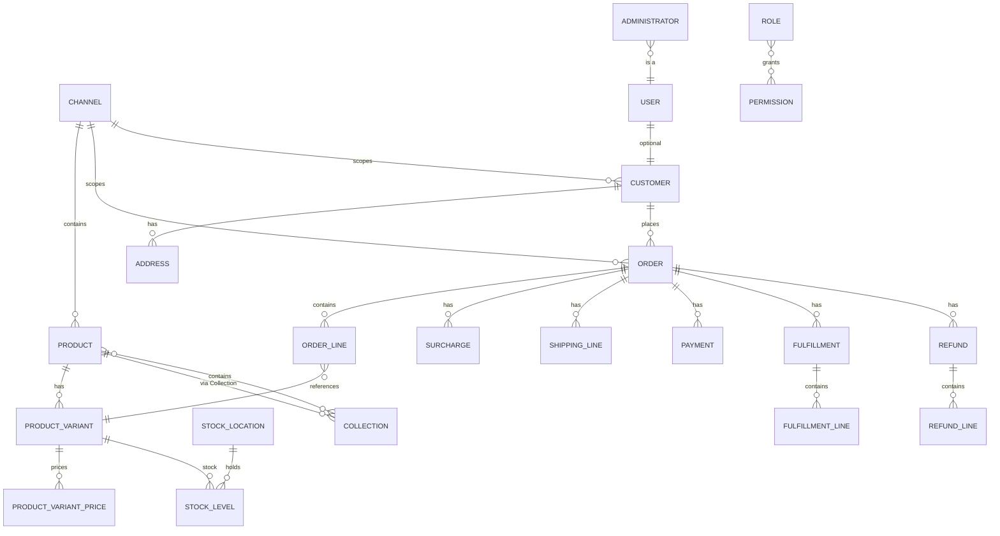

# 03 · 数据模型

> 核心实体：`packages/core/src/entity/`
> 插件实体：各 `packages/*-plugin/src/**/*.entity.ts`
> 迁移：`packages/core/src/migration-utils/`、`packages/dev-server/migrations/`、各插件 `src/migrations/`

---

## 1. 实体总览（核心）

| 领域 | 实体 | 说明 |
|---|---|---|
| 基础 | `VendureEntity`（`entity/base/base.entity.ts`） | 所有核心实体基类：`id`、`createdAt`、`updatedAt` |
| | `Channel` | 渠道 / 本仓库的租户边界 |
| | `GlobalSettings` | 全局设置（含自定义字段） |
| | `SettingsStoreEntry` | SettingsStore 键值 |
| | `Session` / `AnonymousSession` / `AuthenticatedSession` | 会话 |
| 用户权限 | `User`、`Administrator`、`Role`、`ApiKey` | 登录主体、管理员、角色、API Key |
| 客户 | `Customer`、`CustomerGroup`、`Address` | 客户、分组、地址 |
| 商品目录 | `Product`、`ProductTranslation`、`ProductAsset` | 商品、翻译、资源关联 |
| | `ProductVariant`、`ProductVariantTranslation`、`ProductVariantPrice`、`ProductVariantAsset` | 变体、价格（渠道×币种）、资源 |
| | `ProductOptionGroup`、`ProductOption`（含 translation） | 选项组/选项 |
| | `Collection`、`CollectionTranslation`、`CollectionAsset` | 分类树、翻译、资源 |
| | `Facet`、`FacetValue`（含 translation） | 分面 |
| | `Asset`、`AssetTranslation`、`OrderableAsset` | 资源、翻译、可排序资源基类 |
| | `Tag` | 标签 |
| 订单 | `Order`、`OrderLine` | 订单、订单行 |
| | `Surcharge` | 附加费（含促销折扣） |
| | `ShippingLine` | 运费行 |
| | `Payment`、`PaymentMethod` | 支付、支付方式 |
| | `Fulfillment`、`FulfillmentLine` | 履约、履约行 |
| | `Refund`、`RefundLine` | 退款、退款行 |
| | `OrderLineReference`、`OrderModificationLine` | 改单/履约/退款的行引用 |
| 库存 | `StockLevel`、`StockLocation`、`StockMovement` 及子类（`Allocation`、`Sale`、`Cancellation`、`Release`、`StockAdjustment`） | 库存与库存流水 |
| 区域/税 | `Zone`、`Country`、`TaxCategory`、`TaxRate` | 区域、国家、税类、税率 |
| 配送 | `ShippingMethod` | 配送方式（计算器/资格检查器为配置策略） |
| 营销 | `Promotion` | 促销（条件/动作/优惠券码） |
| 渠道 | `Channel` | 商品/订单/客户/资源/促销/配送/支付/库位的渠道归属 |
| | `Seller` | 官方多卖家模型（本仓库实际以 Channel 租户替代） |
| 历史 | `HistoryEntry` | 管理操作历史 |

---

## 2. 核心关系图



> 说明：`Channel` 与商品/订单/客户/资源/促销/配送方式/支付方式/库位等是 `ChannelAware` 多对多或外键关联，查询由 `ChannelService` / `TransactionalConnection` 自动附加渠道过滤。

---

## 3. 状态机

### 订单状态（默认 OrderProcess）

```text
AddingItems
  → ArrangingPayment
  → PaymentAuthorized
  → PaymentSettled
  → PartiallyShipped → Shipped → PartiallyDelivered → Delivered → Completed
（任意阶段可 → Cancelled；改单时进入 Modifying → ArrangingAdditionalPayment）
```

### 支付状态

```text
Created → Authorized → Settled
        ↘ Declined / Cancelled / Error
```

### 履约状态

```text
Pending → Shipped → Delivered
        ↘ Cancelled
```

### 退款状态

```text
Pending → Settled
        ↘ Failed / Cancelled
```

> 实际允许的状态集合由 `OrderProcess`、`PaymentMethodHandler`、`FulfillmentHandler` 与插件共同决定（例如本仓库对 `ArrangingPayment` 守卫做了放宽）。

---

## 4. 渠道（租户）与数据隔离

### 4.1 渠道感知实体

| 实体 | 关联方式 |
|---|---|
| `Product` / `ProductVariant` | `channels` 多对多 |
| `Collection` | `channels` 多对多 |
| `Asset` | `channels` 多对多 |
| `Promotion` | `channels` 多对多 |
| `ShippingMethod` | `channels` 多对多 |
| `PaymentMethod` | `channels` 多对多 |
| `StockLocation` | `channels` 多对多 |
| `Order` | `channel` 外键（下单时确定） |
| `Customer` | `channels` 多对多 |
| `Seller` | `channel` 外键 |
| `Role` | `channels` 多对多（可跨渠道） |

### 4.2 本仓库的租户扩展

| 实体 | 文件 | 作用 |
|---|---|---|
| `TenantMember` | `packages/cjk-plugin/src/tenant/tenant-member.entity.ts` | 管理员 × 租户（Channel）归属、启停、首登强改密、核销配送档案白名单 |
| `ShippingProfile` / `ShippingProfileMethod` | `packages/cjk-plugin/src/shipping/` | 租户级配送档案与配送方式绑定 |
| `PaymentProfile` / `PaymentProfileMethod` / `PaymentTemplate` | `packages/cjk-plugin/src/payment/` | 租户级支付档案/模板 |
| `Wallet` | `packages/cjk-plugin/src/wallet/wallet.entity.ts` | 租户/客户钱包 |
| `MerchantSettlementLedger` | `packages/cjk-plugin/src/order/merchant-settlement-ledger.entity.ts` | 商家结算流水 |
| `VariantLocationBinding` | `packages/cjk-plugin/src/inventory/` | 变体 × 物理仓绑定 |
| `PickupLocation` / `EmployeeCustomer` | `packages/cjk-plugin/src/pickup/` | 自提点、企业客户 |
| `HotelRoomDay` / `HotelBooking` / `HotelRatePlan` / `RoomTemplate` | `packages/cjk-plugin/src/hotel/` | 酒店库存与预订 |

### 4.3 租户级敏感配置

租户支付、登录、地图、SSO 等配置存放在 **Channel 的 customFields**，敏感字段用 AES-256-GCM 加密：

- `authConfig`：登录方式、微信/抖音/手机/SSO 凭证
- `payConfig`：微信支付商户号、证书、回调地址；支付宝配置
- `mapConfig`：高德/腾讯地图 Key
- `serviceNotifyConfig`：服务通知配置

相关代码：`packages/cjk-plugin/src/auth/auth-config.service.ts`、`auth/crypto.ts`、`payment/pay-config.service.ts`、`map/map-config.service.ts`、`tenant/service-notify-config.service.ts`。

---

## 5. CustomFields 体系

### 5.1 字段定义

```ts
config.customFields = {
    Product: [
        { name: 'customLabel', type: 'string', public: true, nullable: true },
        { name: 'specs', type: 'struct', list: true, fields: [
            { name: 'key', type: 'string' },
            { name: 'value', type: 'string' },
        ] },
    ],
};
```

| 属性 | 说明 |
|---|---|
| `type` | `string` / `int` / `float` / `boolean` / `datetime` / `text` / `localeString` / `struct` / `relation` |
| `list` | 是否数组 |
| `nullable` | 是否允许空 |
| `defaultValue` | 默认值 |
| `public` | 是否暴露到 Shop/Admin API |
| `label` / `description` | 支持多语言数组 |
| `ui` | 后台控件配置（组件名、选项） |
| `validate` | 校验函数 |
| `internal` | 仅内部使用，不暴露 API |

### 5.2 本仓库实际注册的字段（`packages/dev-server/dev-config.ts`）

**Channel（店铺装修/租户配置）**

| 字段 | 类型 | 用途 |
|---|---|---|
| `displayTemplate` | string | 店铺模板标识 |
| `themeId` | string | 主题 |
| `shopName` / `shopLogo` / `shopIntro` / `servicePhone` | string | 店铺资料 |
| `shopContent` | text | 装修 JSON（3.6 无 json 类型，用 text 存序列化 JSON） |
| `detailConfig` | text | 商品详情页装修 JSON |
| `orderDetailConfig` | text | 订单详情页装修 JSON |
| `orderListConfig` | text | 订单列表版式 JSON |
| `pageCategoryConfig` / `pageCartConfig` / `pageProfileConfig` | text | 分类/购物车/我的页面装修 |
| `promoSchemes` / `serviceSchemes` | text | 促销/服务方案库 |
| `balanceMinWithdrawalAmount` | int | 余额提现起提金额（分） |
| `lotteryFixedCost` | int | 抽奖固定积分消耗 |

**Collection（楼层装修）**：`floorEnabled`、`floorTitle`、`floorSubtitle`、`floorLayout`、`floorSortOrder`、`floorMaxScreens`、`floorTheme`（struct）、`floorItemConfig`（struct list）、`floorSchedule`（struct）。

**其它核心实体**：`Customer`、`Fulfillment`、`Order`、`Product`、`Promotion` 均预留为空数组，供插件继续追加。

### 5.3 插件追加字段的方式

插件在 `configuration(config)` 中合并：

```ts
config.customFields = {
    ...config.customFields,
    Customer: [...(config.customFields.Customer ?? []), { name: 'wechatOpenid', type: 'string', nullable: true }],
};
```

**注意**：CustomFields 在 bootstrap 前统一校验，字段名冲突、类型非法会直接启动失败。

---

## 6. 插件实体总表

> 「已装配」= 出现在 `packages/dev-server/dev-config.ts` 的 `plugins` 中。

### 6.1 多租户 / 基础能力

| 插件 | 实体 | 已装配 |
|---|---|---|
| `cjk-plugin` | `PickupLocation`、`EmployeeCustomer`、`ShippingTemplate`、`ShippingProfile`、`ShippingProfileMethod`、`PaymentProfile`、`PaymentProfileMethod`、`PaymentTemplate`、`RoomTemplate`、`RoomTemplateControl`、`HotelRoomDay`、`HotelBookingLock`、`HotelRatePlan`、`HotelBooking`、`TenantMember`、`Wallet`、`MerchantSettlementLedger`、`VariantLocationBinding`、`DeliveryRecord`、`ReconciliationBatch`、`ReconciliationOrderLine`、`StockDoc`/`StockDocItem`、`InventoryAlertRule`、`StockReservation`/`StockReservationItem`、`PickBatch`/`PickBatchOrder`、`StorageZone`/`StorageBin` | ✅ |
| `address-plugin` | `DeliveryAddress`、`DeliveryRange` | ❌ |
| `shop-plugin` | `Shop` | ✅ |
| `shop-template-plugin` | `ShopTemplate`、`ShopGlobalConfig`、`ShopTemplateVersion` | ✅ |
| `oss-plugin` | 无（存储策略） | 条件装配 |

### 6.2 认证 / 支付

| 插件 | 实体 | 已装配 |
|---|---|---|
| `phone-auth-plugin` | 无 | ✅ |
| `wechat-auth-plugin` | 无 | 条件装配 |
| `douyin-auth-plugin` | 无 | 条件装配 |
| `alipay-plugin` | 无 | 条件装配 |
| `wechatpay-plugin` | 无 | ✅ |
| `bill-pay-plugin` | `BillPayOrder`、`MerchantAgreement`、`BillPaySettlement`、`BillPayChannelConfigEntity` | ✅ |
| `installment-plugin` | `InstallmentPlan` | ✅ |
| `payment-schedule-plugin` | `OrderPaymentSchedule`、`OrderScheduleItem` | ✅ |
| `recharge-card-plugin` | `RechargeCard`、`RechargeCardBatch`、`CustomerBalance`、`BalanceTransaction`、`RechargeOrder`、`BalanceWithdrawalRequest` | ✅ |
| `vcash-pos-plugin` | `PosTerminal`、`PosSession`、`MemberPriceRule`、`PromotionRule` | ✅ |
| `vcash-offline-plugin` | `OfflineSyncQueue` | ✅ |

### 6.3 营销 / 会员 / 分销

| 插件 | 实体 | 已装配 |
|---|---|---|
| `coupon-plugin` | `CouponTemplate`、`CustomerCoupon`、`ProductCouponBinding`、`InStoreBill`、`CouponSaleOrder`、`CouponBundle`、`CouponBundleItem`、`CouponSettlementOrder`、`CouponSettlementReconcileDiff`、`CouponFissionRecord`、`CouponGrantBatch`、`CouponDailyClaimRecord`、`CouponStoreBinding`、`CouponRedemption` | ✅ |
| `group-buy-plugin` | `GroupBuyActivity`、`GroupBuyOrder` | ✅ |
| `flash-sale-plugin` | `FlashSaleActivity` | ✅ |
| `lottery-plugin` | `LotteryPrize`、`LotteryRecord` | ✅ |
| `checkin-plugin` | `CheckinRecord`、`TaskRecord` | ✅ |
| `member-level-plugin` | `MemberPointsHistory`、`MemberTier` | ✅ |
| `points-mall-plugin` | `ProductFavorite`、`PointsProduct`、`PointsOrder`、`PointsOrderPayment` | ✅ |
| `distribution-plugin` | `Distributor`、`CommissionRecord`、`WithdrawalRequest` | ✅ |
| `affiliate-plugin` | `Affiliate`、`AffiliateRelation`、`AffiliateCommissionEntry`、`AffiliateWithdrawal` | ❌ |
| `community-plugin` | `CommunityLeader`、`CommunityActivity`、`CommunityActivityItem`、`CommunityParticipation`、`CommunityCommissionEntry` | ❌ |
| `live-streaming-plugin` | `LiveRoom`、`LiveRoomProduct`、`LiveRoomPlatform` | ✅ |
| `pre-sale-plugin` | `PreSaleActivity` | ✅ |
| `review-plugin` | `Review` | ✅ |
| `favorite-plugin` | `Favorite` | ✅ |
| `shopping-circle-plugin` | `CirclePost`、`CircleLike`、`CircleFavorite` | ✅ |

### 6.4 履约 / 配送 / 售后

| 插件 | 实体 | 已装配 |
|---|---|---|
| `delivery-plugin` | 无 | ✅ |
| `delivery-gateway-plugin` | `DeliveryOrder` | ✅ |
| `logistics-plugin` | `LogisticsTrack`、`OrderPackage` | ✅ |
| `logistics-api-plugin` | 无（快递100） | 条件装配 |
| `pickup-plugin` | `PickupRedemption` | ✅ |
| `after-sales-plugin` | `AfterSalesRequest`、`AfterSalesStateHistory`、`AfterSalesMessage`、`AfterSalesTimeoutTask` | ✅ |
| `order-timeout-plugin` | `OrderTimeoutTask` | ✅ |
| `campus-delivery-plugin` | `CampusZone`、`CampusBuilding`、`RiderEarning`、`CampusFulfillmentConfig`、`DeliverySlot`、`RiderCreditLog`、`RiderWithdrawalRequest`、`PaymentTimeoutTask`、`CampusAddressChange`、`CampusSupportTicket`、`CampusRiderAppeal`、`CampusBlacklist`、`CampusRiderShift`、`CampusRiderSession`、`CampusRiderReview`、`CampusRiderLocation` | ✅ |

### 6.5 商家 / 结算 / 进销存

| 插件 | 实体 | 已装配 |
|---|---|---|
| `merchant-plugin` | `Merchant`、`MerchantStore`、`MerchantStoreChannel`、`MerchantStoreStaff` | ✅ |
| `marketplace-plugin` | `MarketplaceInventoryLedger` | ✅（拆单被关闭） |
| `settlement-plugin` | `MerchantAccount`、`SettlementEntry`、`WithdrawalRequest` | ❌ |
| `sales-plugin` | 无（销售员管理） | ✅ |
| `inventory-plugin` | `OrderStockLedger`、`StockInOrder`/`Line`、`StockOutOrder`/`Line`、`StockMoveOrder`/`Line`、`StocktakeOrder`/`Line`、`Supplier`、`PurchaseOrder`/`Line` | ✅ |

### 6.6 行业方案 / 内容

| 插件 | 实体 | 已装配 |
|---|---|---|
| `tcm-clinic-plugin` | `TcmClinic`、`TcmClinicStaff`、`TcmPatientProfile`、`TcmEncounter`、`TcmMedicalRecord`、`TcmMedicalRecordRevision`、`TcmAuditLog`、`TcmWellnessPlan`、`TcmPlanItem`、`TcmFollowUpTask` | ✅ |
| `campus-jianghu-plugin` | `JianghuProfile`、`JianghuTask`、`JianghuRecord`、`JianghuIntel`、`JianghuEvent`、`JianghuClue` | ✅ |
| `diy-plugin` | `DiyCategory`、`DiyMaterial`、`DiyTemplate`、`DiyPlan` | ✅ |
| `rental-plugin` | `RentalPlan` | ✅ |
| `subscription-plugin` | `SubscriptionPlan`、`Subscription`、`SubscriptionOccurrence` | ❌ |
| `voucher-plugin` | `ServiceVoucher`、`VoucherBooking` | ❌ |
| `message-plugin` | `Message`、`MessageDelivery` | ✅ |
| `notification-plugin` | `InboxMessage` | ✅ |
| `feedback-plugin` | `FaqEntry`、`Feedback` | ✅ |
| `wechat-shopping-assistant-plugin` | `WechatShoppingSession`、`WechatProcessedMessage`、`WechatSupportTicket` | 条件装配 |
| `wechat-subscribe-message-plugin` | `SubscribeMessageLog` | ✅ |
| `operation-plugin` | `OperationSection`、`OperationItem` | ❌ |
| `operations-plugin` | `ContentItem` | ✅ |
| `product-survey-plugin` | 无 | ✅ |

### 6.7 基础设施

| 插件 | 实体 | 已装配 |
|---|---|---|
| `invoice-plugin` | `Invoice`、`InvoiceTitle` | ✅ |
| `invoice-pdf-plugin` | 无 | ✅ |
| `redis-stock-plugin` | 无 | 条件装配 |
| `meilisearch-plugin` | 无 | ✅ |
| `eco-plugin` | 无 | ✅ |
| `diy-calc` | 无（计算库） | 依赖 |

---

## 7. 数据访问与迁移

### 7.1 开发环境

```ts
// packages/dev-server/dev-config.ts
dbConnectionOptions: {
    synchronize: false,           // 外层默认 false
    migrations: [path.join(devServerDir, 'migrations/*.ts')],
    ...getDbConfig(),             // mysql/postgres/sqlite 各自覆盖
}
```

| DB | 配置 |
|---|---|
| `DB=mysql` / 不设置 | MariaDB 驱动，`127.0.0.1:3306`，`vendure/vendure-dev`，`synchronize: true` |
| `DB=postgres` | `localhost:5432`，`vendure/vendure-dev`，`synchronize: DB_SYNC !== '0'` |
| `DB=sqlite` | `better-sqlite3`，`packages/dev-server/vendure.sqlite`，`synchronize: true` |
| `DB=sqljs` | sql.js，自动保存到 `vendure.sqlite` |

### 7.2 生产

- 本仓库生产使用 PostgreSQL。
- `INSTALL.md` 说明生产以 `synchronize=true` 首次自动建表；如需关闭，改 `getDbConfig()` 或 `DB_SYNC=0`。
- 插件新增实体应同时提供 migration，避免长期依赖自动同步。
- e2e 缓存目录 `packages/<name>/e2e/__data__/` 在 schema 变化后必须删除。

### 7.3 实体设计约定

1. 所有实体继承 `VendureEntity`。
2. 金额统一用整数分（`MoneyStrategy`），字段名常以 `Amount` / `Price` 结尾。
3. 渠道隔离实体实现 `ChannelAware` 或加 `channel` 外键。
4. 多语言字段使用 `Translation` 实体或 `localeString` customField。
5. SQLite 兼容：时间字段优先 `datetime`，避免 PG 原生 SQL。
6. 状态字段用枚举字符串 + 状态机，不要散落布尔标志。
