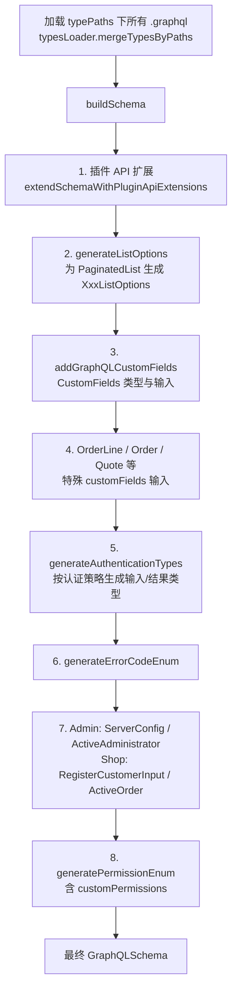
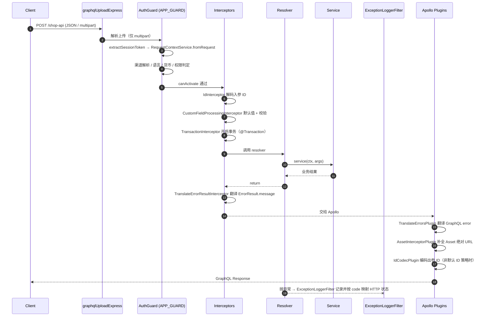

# 04 · API 层：Shop / Admin GraphQL、权限、事务与错误

> 本文覆盖「请求如何进入 Vendure 并变成业务结果」，包括双 API、schema 组装、resolver 组织、认证授权、Header 约定、错误体系、分页、ID 编解码、CustomFields、文件上传、插件 REST 路由。
>
> 前置阅读：[01-architecture.md](./01-architecture.md)、[02-core-modules.md](./02-core-modules.md)、[03-data-model.md](./03-data-model.md)

---

## 1. 一句话理解 API 层

Vendure 的 API 层是一个**薄适配层**：GraphQL resolver 只负责「解析参数 → 调用 Service → 返回结果」，真正的业务规则在 `packages/core/src/service/` 与各插件 service 中。API 层自身主要做四件事：

1. **组装 schema**（核心 SDL + CustomFields + 插件扩展）
2. **建立请求上下文**（`RequestContext`：渠道、语言、货币、会话、权限）
3. **执行横切逻辑**（鉴权、事务、ID 编解码、CustomFields 校验、错误翻译、资源 URL 补全）
4. **把异常/结果翻译成客户端可读的形式**（`ErrorResult` union 或 GraphQL error）

---

## 2. 双 API 总览

| 维度 | Shop API | Admin API |
|---|---|---|
| 路径（默认） | `/shop-api` | `/admin-api` |
| 面向 | C 端消费者 / 游客 / 会员 | 后台管理员 / 运营 / 租户成员 |
| 根 SDL | [shop.api.graphql](file:///d:/zhao/vendure/packages/core/src/api/schema/shop-api/shop.api.graphql) | [admin-api 目录](file:///d:/zhao/vendure/packages/core/src/api/schema/admin-api) |
| Resolver 模块 | `ShopApiModule` | `AdminApiModule` |
| Resolver 目录 | [resolvers/shop](file:///d:/zhao/vendure/packages/core/src/api/resolvers/shop) | [resolvers/admin](file:///d:/zhao/vendure/packages/core/src/api/resolvers/admin) |
| 认证策略 | `authOptions.shopAuthenticationStrategy` | `authOptions.adminAuthenticationStrategy` |
| 列表上限 | `shopListQueryLimit`（默认 100） | `adminListQueryLimit`（默认 1000） |
| Playground | `shopApiPlayground`（默认 false，已弃用，改用 GraphiQL 插件） | `adminApiPlayground`（同上） |
| 典型操作 | `activeOrder`、`addItemToOrder`、`addPaymentToOrder`、`login`、`me` | `products`、`orders`、`createProduct`、`updateOrder`、`refundOrder` |

**关键点**：两个 API 共享同一 Service 层和同一数据库，差异只在 **schema 暴露面** 与 **权限策略**。因此「同一段业务逻辑在 Shop 和 Admin 行为不同」通常通过 `ctx.apiType` 或不同 resolver 实现，而不是两套 service。

源码入口：

- [api.module.ts](file:///d:/zhao/vendure/packages/core/src/api/api.module.ts)
- [configure-graphql-module.ts](file:///d:/zhao/vendure/packages/core/src/api/config/configure-graphql-module.ts)
- [constants.ts](file:///d:/zhao/vendure/packages/core/src/api/constants.ts)

---

## 3. Schema 组织与组装流程

### 3.1 静态 SDL 目录

```text
packages/core/src/api/schema/
├── shop-api/     # Shop 根 Query/Mutation + 专属类型 + shop ErrorResult
├── admin-api/    # Admin 根 Query/Mutation + 各资源 .api.graphql / .type.graphql
└── common/       # 双 API 共享类型、枚举、标量、分页接口、通用错误
```

`typePaths` 由 [constants.ts](file:///d:/zhao/vendure/packages/core/src/api/constants.ts) 给出：分别加载 `shop-api + common` 或 `admin-api + common` 下所有 `*.graphql`。

### 3.2 运行时组装顺序

`getFinalVendureSchema()` 按固定顺序逐层扩展 schema，顺序本身会影响最终类型：



对应源码：[get-final-vendure-schema.ts](file:///d:/zhao/vendure/packages/core/src/api/config/get-final-vendure-schema.ts)、[generate-list-options.ts](file:///d:/zhao/vendure/packages/core/src/api/config/generate-list-options.ts)。

**插件扩展的位置**：插件通过 `@VendurePlugin({ shopApiExtensions / adminApiExtensions })` 注册 SDL 与 resolver。这些扩展在 **CustomFields 注入之前** 合并，因此插件可以定义自己的类型，但不能依赖核心 CustomFields 生成结果。

### 3.3 动态生成的 resolver

除手写 resolver 外，`generateResolvers()` 还会为以下场景自动生成 resolver：

- `ErrorResult` union 的 `__resolveType`
- `StockMovement` 子类型的 `__resolveType`
- `Money` / `DateTime` / `JSON` 等标量
- `relation` 类型 CustomFields 的字段解析
- 带权限控制的 CustomField 字段解析

源码：[generate-resolvers.ts](file:///d:/zhao/vendure/packages/core/src/api/config/generate-resolvers.ts)。

---

## 4. Resolver 组织

| 目录 | 职责 | 示例 |
|---|---|---|
| [resolvers/shop](file:///d:/zhao/vendure/packages/core/src/api/resolvers/shop) | Shop 根 Query/Mutation | `shop-order.resolver.ts`、`shop-products.resolver.ts`、`shop-auth.resolver.ts` |
| [resolvers/admin](file:///d:/zhao/vendure/packages/core/src/api/resolvers/admin) | Admin 根 Query/Mutation | `product.resolver.ts`、`order.resolver.ts`、`customer.resolver.ts` |
| [resolvers/entity](file:///d:/zhao/vendure/packages/core/src/api/resolvers/entity) | 实体字段级 `@ResolveField` | `order-entity.resolver.ts`、`product-entity.resolver.ts` |
| [resolvers/base](file:///d:/zhao/vendure/packages/core/src/api/resolvers/base) | 共享认证逻辑 | `base-auth.resolver.ts` |

典型写法（Shop）：

```ts
@Resolver()
export class ShopOrderResolver {
    constructor(private orderService: OrderService, private activeOrderService: ActiveOrderService) {}

    @Query()
    @Allow(Permission.Owner)
    async activeOrder(@Ctx() ctx: RequestContext): Promise<Order | undefined> {
        return this.activeOrderService.getActiveOrder(ctx, undefined);
    }

    @Transaction()
    @Mutation()
    @Allow(Permission.Owner)
    async addItemToOrder(
        @Ctx() ctx: RequestContext,
        @Args() args: MutationAddItemToOrderArgs,
    ): Promise<ErrorResultUnion<UpdateOrderItemsResult, Order>> {
        const order = await this.activeOrderService.getOrCreateActiveOrder(ctx, undefined);
        return this.orderService.addItemToOrder(ctx, order.id, args.productVariantId, args.quantity);
    }
}
```

要点：

- `@Query()` / `@Mutation()` / `@ResolveField()` 来自 `@nestjs/graphql`，方法名必须与 SDL 字段名一致。
- `@Ctx()` 取出 `RequestContext`；**任何 service 调用都必须透传 `ctx`**。
- `@Args()` 参数类型由 `@vendure/common/lib/generated-types` / `generated-shop-types` 提供，schema 变更后需重新 codegen。
- `@Transaction()` 包住写操作。
- `@Allow()` 声明权限（见下节）。
- `@Relations(Entity)` 根据 GraphQL 选择集自动推导需要 join 的关系路径，避免 N+1 与过度 join。

---

## 5. 一次请求的完整管线



过滤器与拦截器的注册顺序见 [api.module.ts](file:///d:/zhao/vendure/packages/core/src/api/api.module.ts)：

```ts
providers: [
    { provide: APP_GUARD, useClass: AuthGuard },
    { provide: APP_INTERCEPTOR, useClass: IdInterceptor },
    { provide: APP_INTERCEPTOR, useClass: CustomFieldProcessingInterceptor },
    { provide: APP_INTERCEPTOR, useClass: TranslateErrorResultInterceptor },
    { provide: APP_FILTER, useClass: ExceptionLoggerFilter },
]
```

---

## 6. 认证与权限

### 6.1 装饰器：`@Allow()`

源码：[allow.decorator.ts](file:///d:/zhao/vendure/packages/core/src/api/decorators/allow.decorator.ts)

```ts
@Allow(Permission.ReadProduct)              // 需要该权限
@Allow(Permission.ReadProduct, Permission.ReadCatalog) // 满足任意一个即可（OR）
```

- 多个权限之间是 **OR** 逻辑。
- 未加 `@Allow()` 的顶层操作默认**公开**（仍可能受 `Permission.Owner` 的资源归属校验影响）。
- 可用于 GraphQL 顶层字段、字段 resolver，也可用于 REST controller 路由。

### 6.2 `Permission.Owner`

`Owner` 不是普通权限，而是「资源归属」语义：

- 任何标了 `@Allow(Permission.Owner)` 的操作，在**没有会话**时会自动创建一个**匿名 session**（`sessionService.createAnonymousSession()`）。
- 真正的归属判断由 `EntityAccessControlStrategy.canAccess(ctx, permissions)` 完成，通常结合 `ctx.activeUserId` 与实体 owner 字段。
- 因此 `activeOrder`、`activeCustomer`、`orderByCode` 这类操作可以在未登录时使用，但只能访问自己的资源。

### 6.3 `AuthGuard` 做了什么

源码：[auth-guard.ts](file:///d:/zhao/vendure/packages/core/src/api/middleware/auth-guard.ts)

1. **字段 resolver 短路**：字段级请求若未声明权限，直接放行（复用顶层请求已建立的 `ctx`）。
2. **提取 token**（按优先级）：
   - Cookie（`tokenMethod` 含 `cookie`）
   - `Authorization: Bearer <token>`（含 `bearer`）
   - `vendure-api-key`（含 `api-key`）
3. **ApiKey 特殊处理**：校验 lookupId + 哈希；若 session 丢失则自动重建，保证 API Key 可用。
4. **构建 `RequestContext`**：`RequestContextService.fromRequest(req, info, permissions, session)`。
5. **渠道切换**：session 的 `activeChannelId` 与当前渠道不一致时，更新 session，并在必要时把 Customer 分配到当前 Channel。
6. **权限校验**：`EntityAccessControlStrategy.canAccess(ctx, permissions)`，失败抛 `ForbiddenError`。
7. `authOptions.disableAuth === true` 时直接放行（仅开发/特殊场景使用）。

### 6.4 权限模型

- 权限来源：`User → Roles → Role.channels → Channel.permissions`，即**同一用户在不同 Channel 可有不同权限**。
- `ctx.userHasPermissions([...])` 是 OR 逻辑；`ctx.userHasAllPermissions([...])` 是 AND 逻辑（3.6 新增）。
- 自定义权限：通过 `authOptions.customPermissions` 声明，最终由 `generatePermissionEnum()` 注入 GraphQL `Permission` 枚举。
- 本仓库多租户场景下，`cjk-plugin` 还叠加了**租户成员**（`TenantMember`）与租户级配置校验，见 [03-data-model.md](./03-data-model.md) 与 [06-business-domains.md](./06-business-domains.md)。

---

## 7. Header 与查询参数约定

| 名称 | 位置 | 默认值 | 作用 |
|---|---|---|---|
| `vendure-token` | Header 或 Query | `DEFAULT_CHANNEL_TOKEN_KEY` | **渠道/租户 token**，决定 `activeChannel`。多店切换必须带对 |
| `vendure-auth-token` | Response Header / 客户端保存 | `DEFAULT_AUTH_TOKEN_HEADER_KEY` | 会话 token（非 cookie 模式） |
| `vendure-api-key` | Header | `DEFAULT_APIKEY_HEADER_KEY` | 服务端到服务端认证 |
| `Authorization` | Header | — | `Bearer <token>` |
| Cookie `session` | Cookie | `DEFAULT_COOKIE_NAME` | cookie 模式的会话 |
| `languageCode` | Query | Channel.defaultLanguageCode | 语言，格式校验 `/^[a-zA-Z0-9_-]+$/` |
| `currencyCode` | Query | Channel.defaultCurrencyCode | 货币，必须是 Channel 可用货币之一 |

行为细节：

- 渠道 token 优先从 **query** 读取，其次 **header**（[request-context.service.ts](file:///d:/zhao/vendure/packages/core/src/service/helpers/request-context/request-context.service.ts#L124-L134)）。
- `languageCode` 用**格式校验**而非枚举校验，允许自定义语言码。
- `currencyCode` 不在渠道可用列表内会抛 `UserInputError('error.currency-not-available-in-channel')`。
- 自定义键名：`apiOptions.channelTokenKey`、`authOptions.authTokenHeaderKey`、`authOptions.apiKeyHeaderKey`。

> 常见坑：前端若把渠道头写成 `vendure-channel-token` 且网关未转换，所有请求都会落到默认渠道，表现为「多店切换失效」。

---

## 8. 错误体系

### 8.1 两类错误

| 类型 | 用途 | 客户端表现 |
|---|---|---|
| **GraphQL Error（`I18nError` 子类）** | 系统级/权限级错误，无法作为正常业务结果返回 | `errors[]`，带 `extensions.code` |
| **ErrorResult（schema union）** | 可预期的业务失败，如库存不足、优惠券无效 | `data` 中的具名类型，如 `InsufficientStockError` |

### 8.2 `I18nError`

[errors.ts](file:///d:/zhao/vendure/packages/core/src/common/error/errors.ts) 中的核心子类：

| 类 | `code` | HTTP 映射 |
|---|---|---|
| `InternalServerError` | 默认 500 | 500 |
| `UserInputError` | `USER_INPUT_ERROR` | 400 |
| `IllegalOperationError` | `ILLEGAL_OPERATION` | 400 |
| `UnauthorizedError` | `UNAUTHORIZED` | 401 |
| `ForbiddenError` | `FORBIDDEN` | 403 |
| `ChannelNotFoundError` | — | 500 |
| `EntityNotFoundError` | — | 500 |

`I18nError` 构造参数：`message`（i18n key）、`variables`、`code`、`logLevel`。消息 key 对应 `packages/core/src/i18n/messages/<languageCode>.json`。

### 8.3 ErrorResult union

- SDL 中定义 `interface ErrorResult { errorCode: ErrorCode! message: String! }`，各错误类型 `implements ErrorResult`。
- Shop 专属错误：[shop-error-results.graphql](file:///d:/zhao/vendure/packages/core/src/api/schema/shop-api/shop-error-results.graphql)
- 通用错误：[common-error-results.graphql](file:///d:/zhao/vendure/packages/core/src/api/schema/common/common-error-results.graphql)
- 生成代码：[generated-graphql-admin-errors.ts](file:///d:/zhao/vendure/packages/core/src/common/error/generated-graphql-admin-errors.ts)、[generated-graphql-shop-errors.ts](file:///d:/zhao/vendure/packages/core/src/common/error/generated-graphql-shop-errors.ts)
- 判定函数：[error-result.ts](file:///d:/zhao/vendure/packages/core/src/common/error/error-result.ts) 的 `isGraphQlErrorResult()`

```ts
const result = await this.orderService.addItemToOrder(ctx, orderId, variantId, qty);
if (isGraphQlErrorResult(result)) {
    // 业务失败：直接作为 union 返回给客户端
    return result;
}
return result; // Order
```

### 8.4 错误翻译链路

1. **服务层**返回 `ErrorResult` 实例（如 `InsufficientStockError`）。
2. [TranslateErrorResultInterceptor](file:///d:/zhao/vendure/packages/core/src/api/middleware/translate-error-result-interceptor.ts) 在出参阶段把 `message` 翻译成当前语言（`i18nService.translateErrorResult`）。
3. **抛出的 `I18nError`** 由 [TranslateErrorsPlugin](file:///d:/zhao/vendure/packages/core/src/api/middleware/translate-errors-plugin.ts) 在 Apollo `willSendResponse` 阶段翻译。
4. [ExceptionLoggerFilter](file:///d:/zhao/vendure/packages/core/src/api/middleware/exception-logger.filter.ts) 记录日志、映射 HTTP 状态码，并转发给 `systemOptions.errorHandlers`（可接入监控/告警）。
5. REST 上下文必须由 filter 显式写出响应，否则请求会挂起；GraphQL 上下文则把错误交回 Apollo。

---

## 9. 分页与列表查询

### 9.1 类型

- `interface PaginatedList { items: [T!]!, totalItems: Int! }`
- 各实体对应 `ProductList`、`OrderList`、`CustomerList` 等（[common-types.graphql](file:///d:/zhao/vendure/packages/core/src/api/schema/common/common-types.graphql)）
- `XxxListOptions` 是**运行时生成**的（`generateListOptions`），包含：
  - `skip` / `take`
  - `sort`：`XxxSortParameter`
  - `filter`：`XxxFilterParameter`
  - `filterOperator`：`LogicalOperator`（AND / OR）

### 9.2 过滤操作符（输入类型）

`schema/common/common-types.graphql` 定义了：

- `StringOperators`：`eq/notEq/contains/notContains/in/notIn/regex`
- `IDOperators`：`eq/notEq/in/notIn`
- `BooleanOperators`
- `NumberOperators` + `NumberRange`
- `DateOperators` + `DateRange`

### 9.3 `ListQueryBuilder`

源码：[list-query-builder.ts](file:///d:/zhao/vendure/packages/core/src/service/helpers/list-query-builder/list-query-builder.ts)

```ts
const qb = this.listQueryBuilder.build(Product, options, {
    ctx,
    relations: ['facetValues'],
    channelId: ctx.channelId,
    where: { enabled: true },
});
const [items, totalItems] = await qb.getManyAndCount();
```

关键行为：

- `take` 会按 `ctx.apiType` 应用 `shopListQueryLimit` / `adminListQueryLimit` 上限；`extendedOptions.ignoreQueryLimits` 可绕过。
- 根据 `filter` 自动 join 关系（`filterObjectHasProperty`）。
- 支持 `customPropertyMap`，把 GraphQL 过滤字段映射到关联实体列。
- 对 `Collection` 这类树形实体做特殊 join 处理，避免 TypeORM 重复 join。
- 自动 join `@Calculated()` 列所需关系。

---

## 10. ID 编解码

Vendure 允许通过 `entityIdStrategy` 改变实体 ID 形式（自增 / UUID / 自定义）。API 层对此完全透明：

| 环节 | 组件 | 作用 |
|---|---|---|
| 入参 | [IdInterceptor](file:///d:/zhao/vendure/packages/core/src/api/middleware/id-interceptor.ts) | 把 GraphQL `ID` / `IDOperators` 值解码为数据库 ID |
| 出参 | [IdCodecPlugin](file:///d:/zhao/vendure/packages/core/src/api/middleware/id-codec-plugin.ts) | 把响应中的 `ID` 与 JSON 里的 `paymentId` 等编码 |
| 编解码器 | [IdCodecService](file:///d:/zhao/vendure/packages/core/src/api/common/id-codec.service.ts) | 包装 `EntityIdStrategy` |
| 性能开关 | `isUsingDefaultEntityIdStrategy()` | 默认自增/UUID 策略时不挂 `IdCodecPlugin`，避免遍历响应 |

> 自定义 ID 策略时，插件 resolver 若手写返回原始实体 ID，需确认是否已被编码；通常走正常 GraphQL `ID` 字段即可。

---

## 11. CustomFields 在 API 层的处理

CustomFields 不是简单的数据库列，它会在 API 层产生三类行为：

1. **Schema 生成**  
   `addGraphQLCustomFields()` 把 `config.customFields` 注入为实体类型字段与 `CreateXxxInput` / `UpdateXxxInput`。特殊实体（Order / OrderLine / ShippingMethodQuote / PaymentMethodQuote / Administrator / Customer）有专门处理。

2. **默认值与校验**  
   [CustomFieldProcessingInterceptor](file:///d:/zhao/vendure/packages/core/src/api/middleware/custom-field-processing-interceptor.ts) 在 **mutation** 阶段：
   - create 输入中字段显式为 `null` 且配置了 `defaultValue` → 填入默认值
   - 按字段类型校验值（`validateCustomFieldValue`）
   - 同时处理实体自身的 `customFields` 与 `translations[].customFields`
   - 特判 `OrderLineCustomFieldsInput`：`addItemToOrder` 视为 create（应用默认值），`adjustOrderLine` 视为 update（不应用）

3. **读取权限**  
   `relation` 类型字段由 `CustomFieldRelationResolverService` 解析；字段级权限由 `userHasPermissionsOnCustomField()` 控制，未授权字段返回 `null` 或抛错。

字段类型与 `defaultValue` / `nullable` / `public` / `readonly` 等配置见 [03-data-model.md](./03-data-model.md) 的 CustomFields 章节。

---

## 12. 文件上传与资源 URL

### 12.1 上传

- Apollo 内置上传被关闭：`uploads: false`。
- 由 [api.module.ts](file:///d:/zhao/vendure/packages/core/src/api/api.module.ts#L78-L86) 在 `admin-api` / `shop-api` 路由上挂载 `graphqlUploadExpress({ maxFileSize: assetOptions.uploadMaxFileSize })`。
- SDL 中的 `scalar Upload` 由 `graphql-upload` 提供。

### 12.2 资源 URL 补全

[AssetInterceptorPlugin](file:///d:/zhao/vendure/packages/core/src/api/middleware/asset-interceptor-plugin.ts) 在响应阶段遍历选择集，对 `Asset` / `SearchResultAsset` 的 `preview` 与 `source` 调用 `AssetStorageStrategy.toAbsoluteUrl(req, url)`，把相对路径补成绝对 URL（兼容多域名/租户）。

---

## 13. 事务：`@Transaction()`

- 装饰器：[transaction.decorator.ts](file:///d:/zhao/vendure/packages/core/src/api/decorators/transaction.decorator.ts)
- 模式：
  - `'auto'`（默认）：若请求尚未开启事务，则由 `TransactionInterceptor` 开启；已在外层事务中则复用。
  - `'manual'`：由业务代码显式 `connection.withTransaction()` 控制。
- 事务管理器通过 `TRANSACTION_MANAGER_KEY` Symbol 挂在 `RequestContext` 上；`RequestContext` 会被存到 `req` 的两个槽位（default / withTransactionManager），保证同一 handler 内取到正确上下文。
- `TransactionalConnection` 的 `getRepository(ctx, entity)` 会自动使用当前事务的管理器。

> 规则：**写操作必须 `@Transaction()`；service 内禁止直接用 `connection.rawConnection` 写库**。

---

## 14. 插件的 REST Controller 与 Webhook

插件不只能扩展 GraphQL，也可以注册普通 NestJS Controller。仓库中实际存在的 REST 端点：

| 插件 | 路由 | 方法 | 用途 |
|---|---|---|---|
| `wechatpay-plugin` | `POST /wechatpay/notify` | Webhook | 微信支付回调 |
| `wechatpay-plugin` | `GET /wechatpay/dev-pay`、`POST /wechatpay/dev-notify` | 开发辅助 | 本地模拟支付 |
| `alipay-plugin` | `POST /alipay/notify` | Webhook | 支付宝回调 |
| `alipay-plugin` | `GET /alipay-auth/callback` | OAuth | 支付宝授权回调 |
| `wechat-auth-plugin` | `GET /wechat-auth/callback` | OAuth | 微信网页授权 |
| `wechat-auth-plugin` | `GET|POST /wechat/message` | Webhook | 微信公众号消息 |
| `wechat-auth-plugin` | `GET /wechat-auth/jssdk-signature` | REST | JS-SDK 签名 |
| `douyin-auth-plugin` | `GET /douyin-auth/callback` | OAuth | 抖音授权回调 |
| `delivery-gateway-plugin` | `POST /delivery-gateway/meituan/webhook` | Webhook | 美团配送状态 |
| `delivery-gateway-plugin` | `POST /delivery-gateway/dada/webhook` | Webhook | 达达配送状态 |
| `campus-delivery-plugin` | `POST /feishu/event` | Webhook | 飞书事件回调 |
| `wechat-shopping-assistant-plugin` | `POST /wechat-assistant/handle` | REST | 微信购物助手消息入口 |
| `marketplace-plugin` | `GET /merchant-api/settlement`、`/orders` | REST | 商户结算/订单查询 |
| `product-survey-plugin` | `GET /product-survey/candidates` | REST | 调研候选商品 |
| `eco-plugin` | `POST /eco/events` | REST | 外部事件接入 |
| `core` | `GET /health` | REST | 健康检查 |

注意事项：

- REST 路由**同样经过全局 `AuthGuard`**。需要公开访问的回调必须在 handler 上显式跳过鉴权（或配置 `authOptions.disableAuth` / 使用插件自定义 guard），否则会被 `ForbiddenError` 拦截。
- REST 上下文没有 GraphQL `info`，`parseContext()` 会走 HTTP 分支；`ExceptionLoggerFilter` 必须显式写响应。
- Webhook 需自行验签，不要依赖 Vendure 的会话认证。

---

## 15. Dashboard / Admin UI 的 API 扩展

- **Dashboard（React）** 通过 `@vendure/dashboard` 的 Vite 插件生成类型安全 GraphQL 客户端，默认指向 `/admin-api`；开发态可代理到 `5173`。[DashboardPlugin](file:///d:/zhao/vendure/packages/dashboard/plugin/dashboard.plugin.ts) 还通过 `SettingsStore` 注册全局设置视图。
- **Admin UI（Angular，已弃用）** 由 [AdminUiPlugin](file:///d:/zhao/vendure/packages/admin-ui-plugin/src/plugin.ts) 托管，并提供 `metricSummary` 查询。
- 插件可同时扩展两套前端，但新功能应优先只做 Dashboard 扩展。

前端细节见 [07-frontend.md](./07-frontend.md)。

---

## 16. 常用请求示例

### 16.1 Shop：登录并加购

```graphql
mutation Login {
  login(username: "customer@example.com", password: "secret") {
    __typename
    ... on CurrentUser { id identifier }
    ... on ErrorResult { errorCode message }
  }
}

mutation AddItem {
  addItemToOrder(productVariantId: "42", quantity: 2) {
    __typename
    ... on Order { id code totalWithTax { value } }
    ... on ErrorResult { errorCode message }
  }
}
```

```bash
curl -s http://localhost:3000/shop-api \
  -H "Content-Type: application/json" \
  -H "vendure-token: <channelToken>" \
  -d '{"query":"query { activeOrder { id code state } }"}'
```

### 16.2 Admin：分页查询商品

```graphql
query Products {
  products(options: {
    take: 20
    skip: 0
    sort: { updatedAt: DESC }
    filter: { name: { contains: "shirt" } }
  }) {
    totalItems
    items { id name slug enabled }
  }
}
```

请求头：

```http
Authorization: Bearer <adminToken>
vendure-token: <channelToken>
Content-Type: application/json
```

### 16.3 上传资源

```graphql
mutation Upload($file: Upload!) {
  createAssets(input: [{ file: $file }]) {
    ... on Asset { id preview source }
    ... on ErrorResult { errorCode message }
  }
}
```

使用 `multipart/form-data`，字段名遵循 GraphQL multipart 规范（`operations` / `map` / `file`）。

---

## 17. 代码索引

| 关注点 | 文件 |
|---|---|
| API 模块与全局 provider | [api.module.ts](file:///d:/zhao/vendure/packages/core/src/api/api.module.ts) |
| GraphQL 动态模块 | [configure-graphql-module.ts](file:///d:/zhao/vendure/packages/core/src/api/config/configure-graphql-module.ts) |
| Schema 最终组装 | [get-final-vendure-schema.ts](file:///d:/zhao/vendure/packages/core/src/api/config/get-final-vendure-schema.ts) |
| 列表输入生成 | [generate-list-options.ts](file:///d:/zhao/vendure/packages/core/src/api/config/generate-list-options.ts) |
| 动态 resolver | [generate-resolvers.ts](file:///d:/zhao/vendure/packages/core/src/api/config/generate-resolvers.ts) |
| 鉴权守卫 | [auth-guard.ts](file:///d:/zhao/vendure/packages/core/src/api/middleware/auth-guard.ts) |
| 权限装饰器 | [allow.decorator.ts](file:///d:/zhao/vendure/packages/core/src/api/decorators/allow.decorator.ts) |
| 事务装饰器 | [transaction.decorator.ts](file:///d:/zhao/vendure/packages/core/src/api/decorators/transaction.decorator.ts) |
| 请求上下文 | [request-context.ts](file:///d:/zhao/vendure/packages/core/src/api/common/request-context.ts) |
| 上下文创建 | [request-context.service.ts](file:///d:/zhao/vendure/packages/core/src/service/helpers/request-context/request-context.service.ts) |
| 错误基类 | [i18n-error.ts](file:///d:/zhao/vendure/packages/core/src/i18n/i18n-error.ts)、[errors.ts](file:///d:/zhao/vendure/packages/core/src/common/error/errors.ts) |
| ErrorResult 工具 | [error-result.ts](file:///d:/zhao/vendure/packages/core/src/common/error/error-result.ts) |
| 异常过滤 | [exception-logger.filter.ts](file:///d:/zhao/vendure/packages/core/src/api/middleware/exception-logger.filter.ts) |
| ID 编解码 | [id-interceptor.ts](file:///d:/zhao/vendure/packages/core/src/api/middleware/id-interceptor.ts)、[id-codec-plugin.ts](file:///d:/zhao/vendure/packages/core/src/api/middleware/id-codec-plugin.ts) |
| CustomFields 处理 | [custom-field-processing-interceptor.ts](file:///d:/zhao/vendure/packages/core/src/api/middleware/custom-field-processing-interceptor.ts) |
| 资源 URL 补全 | [asset-interceptor-plugin.ts](file:///d:/zhao/vendure/packages/core/src/api/middleware/asset-interceptor-plugin.ts) |
| 列表查询构建 | [list-query-builder.ts](file:///d:/zhao/vendure/packages/core/src/service/helpers/list-query-builder/list-query-builder.ts) |
| 共享常量 | [shared-constants.ts](file:///d:/zhao/vendure/packages/common/src/shared-constants.ts) |

---

## 18. 本章要点回顾

1. **双 API 共用 Service 层**，差异在 schema 暴露面与权限。
2. **schema 是运行时拼装的**：静态 SDL → 插件扩展 → ListOptions → CustomFields → 认证类型 → 权限枚举。
3. **`@Allow()` 是 OR 逻辑**；`Permission.Owner` 会触发匿名 session，归属由 `EntityAccessControlStrategy` 判定。
4. **渠道由 `vendure-token` 决定**，语言/货币走 query，均可配置键名。
5. **可预期业务失败用 `ErrorResult` union，系统错误用 `I18nError`**；两者都有独立翻译链路。
6. **分页输入是生成的**，上限按 API 类型区分（Shop 100 / Admin 1000）。
7. **写操作必须 `@Transaction()`**，所有 DB 访问透传 `ctx`。
8. **插件 REST 路由同样经过全局鉴权**，Webhook 要显式处理公开访问与验签。
