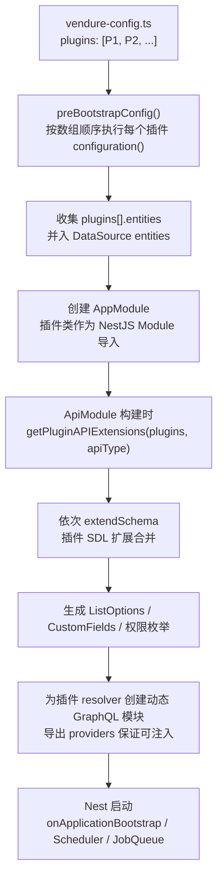
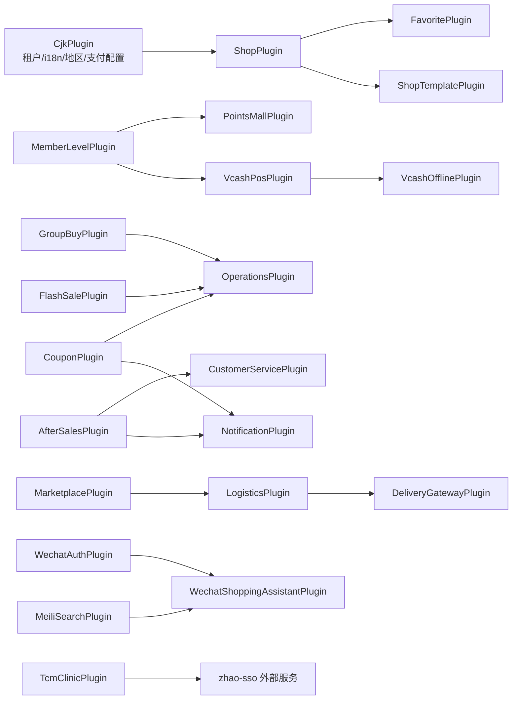

# 05 · 插件系统与插件清单

> 本文解释 Vendure 的 `@VendurePlugin` 机制、插件从声明到装配的完整生命周期、插件间依赖与顺序约束，并给出本仓库全部插件的清单与状态。
>
> 前置阅读：[01-architecture.md](./01-architecture.md)、[02-core-modules.md](./02-core-modules.md)、[04-api-layer.md](./04-api-layer.md)

---

## 1. 一句话理解插件系统

**插件 = NestJS Module + Vendure 元数据**。它不是「钩子脚本」，而是编译期/启动期就被合并进应用的功能单元：可以声明实体、Provider、Controller、GraphQL 扩展、配置修改，以及 Dashboard 扩展。

核心源码：

- [vendure-plugin.ts](file:///d:/zhao/vendure/packages/core/src/plugin/vendure-plugin.ts)
- [plugin-metadata.ts](file:///d:/zhao/vendure/packages/core/src/plugin/plugin-metadata.ts)

---

## 2. `@VendurePlugin` 元数据字段

`VendurePluginMetadata` 继承 NestJS 的 `ModuleMetadata`，因此天然支持 `imports / providers / controllers / exports`。

| 字段 | 类型 | 作用 |
|---|---|---|
| `configuration` | `(config: RuntimeVendureConfig) => config` | 启动前修改 Vendure 配置（注册策略、customFields、支付方式等） |
| `shopApiExtensions` | `{ schema, resolvers, scalars }` | 扩展 Shop GraphQL |
| `adminApiExtensions` | `{ schema, resolvers, scalars }` | 扩展 Admin GraphQL |
| `entities` | `Type[] \| () => Type[]` | 声明 TypeORM 实体，启动时并入 DataSource |
| `dashboard` | `string \| { location: string }` | 指向 Dashboard 扩展入口（如 `../dashboard/index.tsx`） |
| `compatibility` | `string`（semver） | 声明兼容的 Vendure 核心版本 |
| `imports` | NestJS `imports` | 通常包含 `PluginCommonModule` |
| `providers` | NestJS `providers` | 服务、策略、Provider token |
| `controllers` | NestJS `controllers` | REST 路由 |
| `exports` | NestJS `exports` | 对外暴露的 Provider |

`GraphQL` 扩展对象 `APIExtensionDefinition`：

```ts
{
    schema?: DocumentNode | ((schema?: GraphQLSchema) => DocumentNode | undefined);
    resolvers?: Type[] | (() => Type[]);
    scalars?: Record<string, GraphQLScalarType> | (() => Record<string, GraphQLScalarType>);
}
```

---

## 3. 装饰器内部做了什么

`VendurePlugin(metadata)` 的实现只有三步：

1. 把 Vendure 专属元数据写入 `Reflect`（key 见 `PLUGIN_METADATA`）。
2. 用 `pick()` 取出 NestJS 模块元数据。
3. **自动把 `providers` 追加到 `exports`**，但排除全局 provider（`APP_INTERCEPTOR`、`APP_FILTER`、`APP_GUARD`、`APP_PIPE`），最后调用 `Module()`。

为什么自动 export：插件的 resolver 会被放进**动态创建的 GraphQL 模块**中，如果 resolver 依赖插件自己的 service，该 service 必须可被注入。

```ts
// 简化示意
export function VendurePlugin(meta: VendurePluginMetadata): ClassDecorator {
    return target => {
        Object.values(PLUGIN_METADATA).forEach(key => {
            if (meta[key] != null) Reflect.defineMetadata(key, meta[key], target);
        });
        const nestMeta = pick(meta, Object.values(MODULE_METADATA));
        nestMeta.exports = [...(nestMeta.exports ?? []), ...filterGlobalProviders(nestMeta.providers ?? [])];
        Module(nestMeta)(target);
    };
}
```

---

## 4. 插件生命周期（从声明到生效）



### 4.1 `configuration()` 的执行顺序

- 按 `plugins` 数组**从前到后**执行。
- 后面的插件会覆盖前面的配置（例如 `stockLocationStrategy`、`orderItemPriceCalculationStrategy`、`sellerStrategy`）。
- 因此本仓库有明确的顺序约束（见第 7 节）。

### 4.2 实体收集

`getEntitiesFromPlugins()` 支持 `entities` 为数组或函数（懒加载），统一展开后交给 TypeORM。

### 4.3 GraphQL 扩展

`getPluginAPIExtensions()` 只取对应 API 类型的扩展；`schema` 可以是 `DocumentNode` 或接收当前 schema 的函数。扩展在 **CustomFields 注入之前**合并，因此插件不能依赖核心动态生成的 CustomField 类型。

### 4.4 动态 GraphQL 模块

核心会为每个插件的 resolver 创建动态模块（参见 `createDynamicGraphQlModulesForPlugins`），并把插件模块的 `exports` 作为可注入来源。这就是装饰器自动 export providers 的原因。

---

## 5. `PluginCommonModule`

几乎所有业务插件都会写：

```ts
@VendurePlugin({
    imports: [PluginCommonModule],
    providers: [MyService],
})
export class MyPlugin {}
```

`PluginCommonModule` 是核心提供的「插件公共依赖包」，通常导出：

- `EventBus`
- `TransactionalConnection`
- `ConfigService`
- `ChannelService`
- `RequestContextService`
- `ListQueryBuilder`
- `EntityHydrator`
- 其他常用 helper

作用：避免每个插件重复 `imports` 一堆核心模块。

---

## 6. 插件开发最小骨架

```ts
// src/plugin.ts
import { PluginCommonModule, VendurePlugin } from '@vendure/core';
import gql from 'graphql-tag';
import { MyEntity } from './my.entity';
import { MyService } from './my.service';
import { MyAdminResolver } from './my-admin.resolver';

@VendurePlugin({
    compatibility: '^3.6.0',
    imports: [PluginCommonModule],
    entities: [MyEntity],
    providers: [MyService],
    adminApiExtensions: {
        schema: () => gql`
            extend type Query {
                myThings: [MyThing!]!
            }
            type MyThing implements Node {
                id: ID!
                name: String!
            }
        `,
        resolvers: [MyAdminResolver],
    },
    configuration: config => {
        config.customFields.Order = [
            ...(config.customFields.Order ?? []),
            { name: 'myFlag', type: 'boolean', defaultValue: false, public: true },
        ];
        return config;
    },
})
export class MyPlugin {}
```

完整开发规范见 [11-development-guide.md](./11-development-guide.md)。

---

## 7. 装配顺序与依赖约束（本仓库实际）

`packages/dev-server/dev-config.ts` 中 `plugins` 数组的顺序具有语义。已明确的硬约束：

| 顺序约束 | 原因 |
|---|---|
| `LogisticsPlugin` **必须在** `MarketplacePlugin` **之后** | 两者都设置 `stockLocationStrategy`，后者注册的策略需要被 Logistics 的 `PhysicalAwareStockLocationStrategy` 覆盖 |
| `DeliveryGatewayPlugin` **必须在** `LogisticsPlugin` **之后** | 依赖物流策略/配送单模型已就绪 |
| `DiyPlugin` 必须在设置 `orderItemPriceCalculationStrategy` 的插件/配置**之后** | DIY 价格包装器需要委托 `original` 策略 |
| `MemberLevelPlugin` 在 `VcashPosPlugin` 之前 | POS 会员价依赖会员等级/积分账户 |
| `ShopPlugin` 在 `FavoritePlugin` 之前 | 收藏/关注依赖 `Shop` 实体 |
| `CjkPlugin` 在业务插件之前 | 提供多租户、i18n、地区、支付/地图/租户配置等基础能力 |
| `RelaxArrangingPaymentGuardPlugin`、`DisableSellerSplitPlugin` **必须最后** | 覆盖 `MarketplacePlugin` 的 Seller 拆分，避免租户渠道产生幽灵配送子单 |

### 7.1 依赖关系图（核心业务插件）



### 7.2 条件装配（按环境变量）

| 插件 | 条件 |
|---|---|
| `AlipayPlugin` | `ALIPAY_NOTIFY_URL` 存在，或 `DEV_BYPASS_ALIPAY=true` |
| `WechatAuthPlugin` | `WECHAT_AUTH_APP_ID` 存在，或 `DEV_BYPASS_WECHAT=true` |
| `WechatShoppingAssistantPlugin` | 同 `WechatAuthPlugin` |
| `DouyinAuthPlugin` | `DOUYIN_AUTH_APP_ID` 存在，或 `DEV_BYPASS_DOUYIN=true` |
| `OssPlugin` | `OSS_ACCESS_KEY_ID` 存在 |
| `RedisStockPlugin` | `REDIS_URL` 存在 |
| `LogisticsApiPlugin` | `KUAIDI100_CUSTOMER` 存在 |
| `TelemetryPlugin` | `IS_INSTRUMENTED=true` |
| `devOnlyPlugins` | 非生产环境（Reviews / FloorBuilder / NavModifier 测试插件） |

`WechatpayPlugin` 与 `PhoneAuthPlugin` **无条件注册**：支付/短信凭据按渠道/环境变量运行时取，未配置时降级而不崩溃。

---

## 8. 全量插件清单

> 状态说明：
> - **已装配**：在 `dev-config.ts` 的 `plugins` 数组中
> - **条件装配**：满足环境变量才装配
> - **未装配**：仓库中存在但未接入 dev-server（可能是独立产品线/待启用）
> - **框架工具**：非业务插件（CLI、测试工具等）

### 8.1 官方框架插件

| 包 | 状态 | 作用 |
|---|---|---|
| `@vendure/core` 内置 `DefaultSearchPlugin` | 已装配 | 基于 DB 的默认全文搜索 |
| `DefaultJobQueuePlugin` | 已装配 | 基于 DB 的默认任务队列 |
| `DefaultSchedulerPlugin` | 已装配 | Cron 计划任务 |
| `@vendure/asset-server-plugin` | 已装配 | 本地静态资源配置服务（`/assets`） |
| `@vendure/email-plugin` | 已装配 | 邮件事件监听、模板、开发邮箱（`/mailbox`） |
| `@vendure/graphiql-plugin` | 已装配 | GraphiQL 调试页（`/graphiql/shop`、`/graphiql/admin`） |
| `@vendure/admin-ui-plugin` | 已装配 | Angular 旧后台托管（`/admin`，端口 5001） |
| `@vendure/dashboard`（DashboardPlugin） | 已装配 | React 新后台托管（`/dashboard`） |
| `@vendure/telemetry-plugin` | 条件装配 | OpenTelemetry 链路追踪 |
| `@vendure/job-queue-plugin` | 未装配（代码中注释） | BullMQ 任务队列（依赖 Redis，调试用） |
| `@vendure/harden-plugin` | 未装配 | GraphQL 查询复杂度限制、隐藏校验细节、关闭 introspection/playground |
| `@vendure/testing` | 框架工具 | e2e 测试工具与 MockServer |
| `@vendure/ui-devkit` | 框架工具 | Angular Admin UI 扩展编译 |
| `@vendure/create` / `@vendure/cli` | 框架工具 | 脚手架 / CLI |

### 8.2 多租户与店铺基础

| 包 | 状态 | 作用 / 关键内容 |
|---|---|---|
| `cjk-plugin` | 已装配 | **本仓库最重要的基础插件**。多租户、i18n、地区、支付配置、配送档案、酒店、库存、钱包、自提、拣货、对账、盘点、税务、地图等。31k+ 行，见 06 |
| `shop-plugin` | 已装配 | `Shop` 实体、商户权限、店铺 customFields |
| `shop-template-plugin` | 已装配 | 风格模板库 + 全局配置（四级风格体系的 L2/L3 后端） |
| `favorite-plugin` | 已装配 | 商品收藏 / 店铺关注（`ProductFavorite`） |
| `address-plugin` | **未装配** | 配送范围（`DeliveryRange`）+ 地址（`DeliveryAddress`）+ 范围运费计算器/资格检查器 |
| `operation-plugin` | **未装配** | 运营内容区块（`OperationSection` / `OperationItem`），与 `operations-plugin` 不同 |

### 8.3 认证、支付与资金

| 包 | 状态 | 作用 |
|---|---|---|
| `phone-auth-plugin` | 已装配 | 手机号验证码登录/注册/重置密码，短信 Provider + Redis 限流 |
| `wechat-auth-plugin` | 条件装配 | 微信网页授权、公众号消息回调、JS-SDK 签名 |
| `douyin-auth-plugin` | 条件装配 | 抖音授权登录回调 |
| `wechatpay-plugin` | 已装配 | 微信支付（JSAPI/APP/H5 等），按渠道 `payConfig` 支持多商户与多支付 method |
| `alipay-plugin` | 条件装配 | 支付宝支付回调 + 支付宝授权 |
| `recharge-card-plugin` | 已装配 | 充值卡、客户余额、余额流水、余额提现、充值订单 |
| `bill-pay-plugin` | 已装配 | 代买单（`BP-` 前缀委托单 + 微信回调结算） |
| `installment-plugin` | 已装配 | 分期方案（`InstallmentPlan`） |
| `payment-schedule-plugin` | 已装配 | 订单分期付款计划（`OrderPaymentSchedule` / `OrderScheduleItem`） |
| `vcash-pos-plugin` | 已装配 | 门店收银 POS、会员价、促销引擎、聚合支付、退款、报表 |
| `vcash-offline-plugin` | 已装配 | POS 离线同步 |

### 8.4 营销与会员

| 包 | 状态 | 作用 |
|---|---|---|
| `coupon-plugin` | 已装配 | 优惠券模板/领取/兑换/核销/退款返还/过期、券销售与结算（14 实体） |
| `group-buy-plugin` | 已装配 | 拼团（超时未成团自动退款） |
| `flash-sale-plugin` | 已装配 | 秒杀（库存/时间窗口/超时释放） |
| `lottery-plugin` | 已装配 | 抽奖（奖品、消耗积分、抽奖记录） |
| `checkin-plugin` | 已装配 | 签到（渠道配置、签到记录、任务记录、积分奖励） |
| `points-mall-plugin` | 已装配 | 积分商城（积分兑换、混合价支付、积分订单支付/退款） |
| `member-level-plugin` | 已装配 | 会员等级、积分账户、积分流水、积分过期与订单回滚 |
| `distribution-plugin` | 已装配 | 分销（分销员、佣金记录、提现） |
| `affiliate-plugin` | **未装配** | 联盟/推荐分销与佣金（`affiliate.plugin.ts`） |
| `live-streaming-plugin` | 已装配 | 直播带货（直播间、商品货架、归属佣金、回放） |
| `pre-sale-plugin` | 已装配 | 预售（定金/尾款两阶段、全款、分档定价、到货释放库存） |
| `review-plugin` | 已装配 | 商品评价 |
| `feedback-plugin` | 已装配 | 意见反馈 + FAQ |
| `shopping-circle-plugin` | 已装配 | 购物圈子/社区内容 |
| `community-plugin` | **未装配** | 社区活动、团长、参与记录、佣金（`CommunityActivity` 等） |
| `product-survey-plugin` | 已装配 | 选品调研只读 REST 接口（`GET /product-survey/candidates`） |
| `voucher-plugin` | **未装配** | 本地生活服务券：到店核销（`ServiceVoucher` / `VoucherBooking`） |

### 8.5 履约、配送与售后

| 包 | 状态 | 作用 |
|---|---|---|
| `pickup-plugin` | 已装配 | 自提闭环（`PickupRedemption`、自提点、访客订单） |
| `delivery-plugin` | 已装配 | 配送员管理、配送事件、配送权限 |
| `campus-delivery-plugin` | 已装配 | 校园配送（分区/宿舍楼/履约配置、骑手入驻、抢单大厅、送达分成、提现） |
| `logistics-plugin` | 已装配 | 物流轨迹、订单包裹、自动拆包、手动拆包调整、自动完成、库存分配策略 |
| `logistics-api-plugin` | 条件装配 | 快递 100 等外部物流查询 |
| `delivery-gateway-plugin` | 已装配 | 同城配送抽象网关（Provider 注册表、Mock/达达/美团、`DeliveryOrder` 状态机） |
| `after-sales-plugin` | 已装配 | 售后申请/审核/退款/换货/超时任务 |
| `order-timeout-plugin` | 已装配 | 待付款超时取消与补偿扫描 |
| `campus-jianghu-plugin` | 已装配 | 校园江湖内容（接 Strapi，失败回退内联文案） |

### 8.6 商家、结算与进销存

| 包 | 状态 | 作用 |
|---|---|---|
| `merchant-plugin` | 已装配 | 商户/门店/门店渠道/店员，附近门店、认领门店、核销校验 |
| `marketplace-plugin` | 已装配 | 自营 + 第三方商家，商品提交/审核/上架、商户 API、库存台账 |
| `settlement-plugin` | **未装配** | 商户账户、结算流水、提现申请/审批/打款 |
| `inventory-plugin` | 已装配 | 进销存（入库/出库/调拨/盘点） |
| `operations-plugin` | 已装配 | 运营后台（内容 CMS、营销总览、商品统计、生命周期任务） |
| `sales-plugin` | 已装配 | 业务员管理（客户/订单归属、角色同步、提成字段） |
| `customer-service-plugin` | 已装配 | 客服人员管理、角色同步、售后协作 |
| `subscription-plugin` | **未装配** | 订阅计划、订阅实例、周期履约（`SubscriptionPlan` / `SubscriptionOccurrence`） |

### 8.7 行业与特殊商品

| 包 | 状态 | 作用 |
|---|---|---|
| `tcm-clinic-plugin` | 已装配 | 中医馆（病志、诊疗、康养、审计、员工、加密、SSO 登录） |
| `diy-plugin` | 已装配 | DIY 商品（分类/素材/模板/方案，demo/quote/order 三链路，价格策略） |
| `diy-calc` | 工具包 | DIY 计价计算库（`@diy/calc`） |
| `rental-plugin` | 已装配 | 租赁方案（`RentalPlan`） |
| `invoice-plugin` | 已装配 | 发票开具（`Invoice`、发票抬头） |
| `invoice-pdf-plugin` | 已装配 | PDF 发票生成（`PdfInvoiceProvider`） |

### 8.8 消息、搜索与基础设施

| 包 | 状态 | 作用 |
|---|---|---|
| `message-plugin` | 已装配 | 站内消息（`Message` / `MessageDelivery`、推送服务） |
| `notification-plugin` | 已装配 | 通知中心（站内信 + Provider 机制 + 微信通知） |
| `wechat-subscribe-message-plugin` | 已装配 | 微信订阅消息 |
| `wechat-shopping-assistant-plugin` | 条件装配 | 微信购物助手（文本搜索 → 卡片 → 回复编号下单 → H5 支付） |
| `meilisearch-plugin` | 已装配 | MeiliSearch 索引同步、多语言索引、商品搜索 |
| `oss-plugin` | 条件装配 | 阿里云 OSS 资源存储 |
| `redis-stock-plugin` | 条件装配 | Redis 库存扣减/预占（高并发秒杀场景） |
| `eco-plugin` | 已装配 | 生态行为回调（下单/分销/浏览事件上报外部游戏/积分系统） |
| `mail`/`email` | — | 见官方 `EmailPlugin` |

> `cjk-plugins-e2e` 是测试包，不是插件。

---

## 9. 插件能力速查（按扩展点）

| 想扩展什么 | 用哪个字段 | 参考插件 |
|---|---|---|
| 新增数据库表 | `entities` | `coupon-plugin`、`campus-delivery-plugin` |
| 新增 Admin GraphQL | `adminApiExtensions` | 几乎所有业务插件 |
| 新增 Shop GraphQL | `shopApiExtensions` | `shop-plugin`、`points-mall-plugin` |
| 新增 REST 路由 / Webhook | `controllers` | `wechatpay-plugin`、`delivery-gateway-plugin` |
| 修改全局配置 | `configuration` | `cjk-plugin`、`shop-template-plugin` |
| 替换价格/库存/搜索策略 | `configuration` 内设置 strategy | `diy-plugin`、`logistics-plugin` |
| 监听订单/支付事件 | `EventBus` + `OnApplicationBootstrap` | `after-sales-plugin`、`notification-plugin` |
| 定时任务 | `@ScheduledTask` / `SchedulerService` | `order-timeout-plugin`、`operations-plugin` |
| 后台界面扩展 | `dashboard` | `cjk-plugin`、`member-level-plugin` 等 13 个插件 |

---

## 10. 兼容性检查

- `compatibility` 是 semver 范围，例如 `^3.6.4`、`^3.6.0`、`^3.0.0`、`>0.0.0`。
- 不兼容时 **启动失败**。
- 可用 `bootstrap(config, { ignoreCompatibilityErrorsForPlugins: [...] })` 忽略指定插件（Vendure ≥ 3.1）。
- 本仓库业务插件大多声明 `^3.0.0`；较新的 `operations-plugin` / `inventory-plugin` / `sales-plugin` / `customer-service-plugin` 声明 `^3.6.0`；`campus-delivery-plugin` 声明 `^3.6.4`。

---

## 11. 常见坑与最佳实践

1. **`configuration` 会执行多次**
   `preBootstrapConfig` 可能重复执行插件配置，因此合并 `customFields` 时必须**按 `name` 去重**（仓库中大量插件都有 `mergeCustomFields()` 辅助函数）。

2. **不要依赖插件装配顺序之外的东西**
   如果插件 A 需要插件 B 的实体/策略，要么显式声明顺序约束，要么在 `configuration` 中做防御性检查。

3. **策略类配置是「后写覆盖」**
   `stockLocationStrategy`、`orderItemPriceCalculationStrategy`、`sellerStrategy`、`orderProcess` 等，最后一个赋值者生效。

4. **全局 Provider 不会被自动 export**
   `APP_GUARD` / `APP_INTERCEPTOR` / `APP_FILTER` / `APP_PIPE` 被显式排除，避免重复注册。

5. **插件 schema 在 CustomFields 之前合并**
   插件 SDL 中不要直接引用运行时生成的 `XxxListOptions` 或 CustomField 字段名。

6. **`entities` 用函数形式可懒加载**
   适合依赖运行时配置决定实体集合的场景。

7. **Dashboard 扩展路径是相对插件包的**
   例如 `dashboard: '../dashboard/index.tsx'`，由 Dashboard 构建器扫描并打包。

8. **未装配插件不是死代码**
   `address-plugin`、`settlement-plugin`、`subscription-plugin`、`voucher-plugin`、`community-plugin`、`operation-plugin`、`affiliate-plugin` 代表独立产品线，启用前需确认实体冲突与迁移。

---

## 12. 代码索引

| 关注点 | 文件 |
|---|---|
| 插件装饰器与元数据定义 | [vendure-plugin.ts](file:///d:/zhao/vendure/packages/core/src/plugin/vendure-plugin.ts) |
| 元数据读取工具 | [plugin-metadata.ts](file:///d:/zhao/vendure/packages/core/src/plugin/plugin-metadata.ts) |
| 插件装配入口 | [bootstrap.ts](file:///d:/zhao/vendure/packages/core/src/bootstrap.ts) |
| 插件配置执行 | [bootstrap.ts](file:///d:/zhao/vendure/packages/core/src/bootstrap.ts)（`preBootstrapConfig`） |
| GraphQL 扩展合并 | [get-final-vendure-schema.ts](file:///d:/zhao/vendure/packages/core/src/api/config/get-final-vendure-schema.ts) |
| 本仓库全量装配 | [dev-config.ts](file:///d:/zhao/vendure/packages/dev-server/dev-config.ts) |
| Dashboard 插件托管 | [dashboard.plugin.ts](file:///d:/zhao/vendure/packages/dashboard/plugin/dashboard.plugin.ts) |
| Admin UI 插件托管 | [plugin.ts](file:///d:/zhao/vendure/packages/admin-ui-plugin/src/plugin.ts) |

---

## 13. 本章要点回顾

1. **插件是 NestJS Module 的超集**，不是轻量钩子。
2. **`configuration()` 按数组顺序执行，后写覆盖**；策略类配置尤其需要注意。
3. **providers 自动 export**（排除全局 provider），以支持插件 resolver 的依赖注入。
4. **插件 SDL 在 CustomFields 之前合并**。
5. **本仓库 60+ 插件中约 50 个已装配**，7 个业务插件未装配，若干按环境变量条件装配。
6. **`customFields` 合并必须幂等去重**，否则重复启动会产生重复字段。
