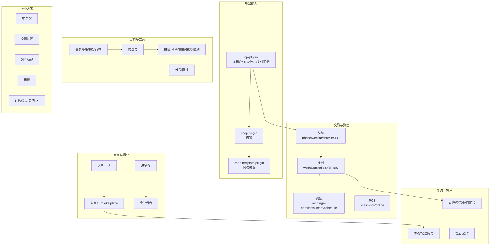
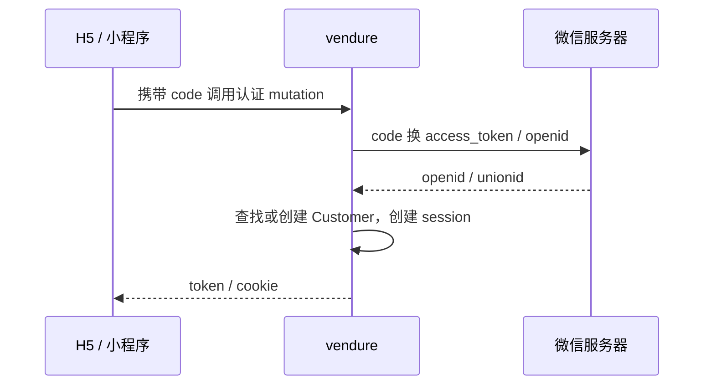
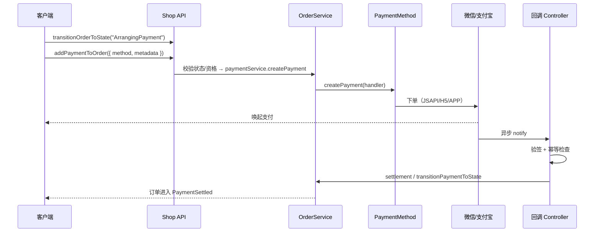
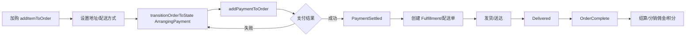
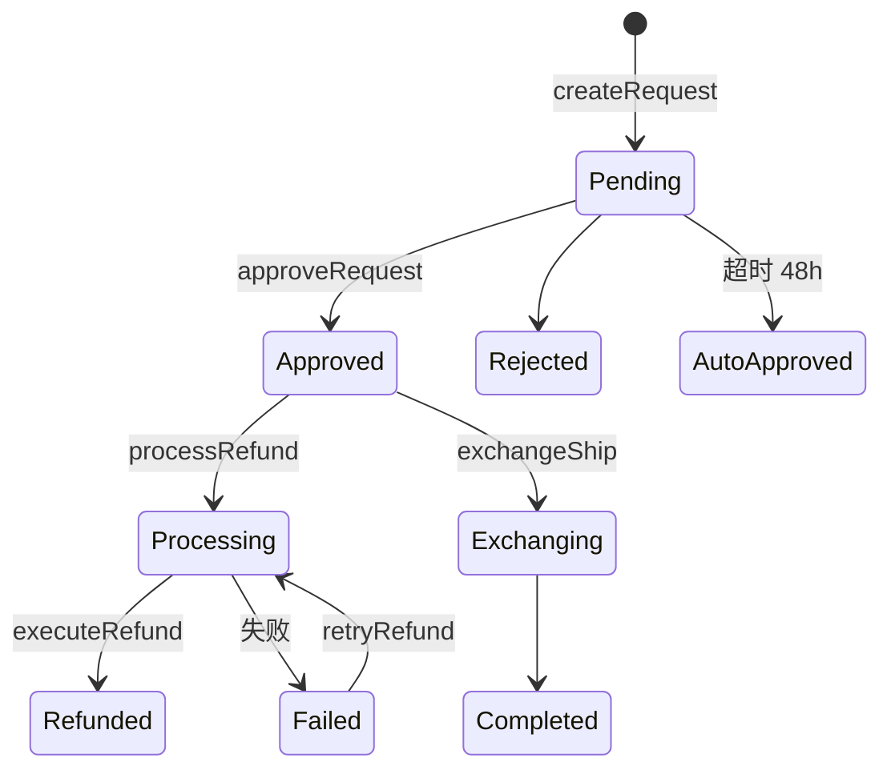
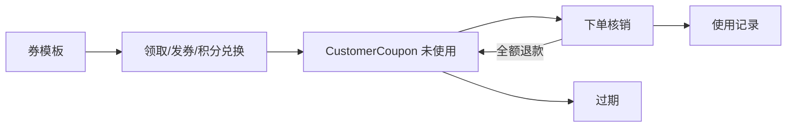

# 06 · 业务域详解

> 本文按业务域梳理本仓库二次开发的能力：每个域解决什么问题、核心实体与服务、关键流程、状态与事件、以及常见坑。
>
> 前置阅读：[03-data-model.md](./03-data-model.md)、[05-plugin-system.md](./05-plugin-system.md)

---

## 0. 业务全景



---

## 1. 多租户与国际化（`cjk-plugin`）

### 1.1 定位

`cjk-plugin` 是本仓库的**基础平台插件**（241 文件 / 31k+ 行），把 Vendure 原生 Channel 扩展为「租户」，并补齐中国本地化能力。它是其他业务插件的前置依赖。

源码入口：[plugin.ts](file:///d:/zhao/vendure/packages/cjk-plugin/src/plugin.ts)、[types.ts](file:///d:/zhao/vendure/packages/cjk-plugin/src/types.ts)

### 1.2 子模块

| 目录 | 职责 |
|---|---|
| `tenant/` | 租户成员、租户配置、域名解析 |
| `i18n/` | 多语言扩展 |
| `regions/` | 省市区数据与地址 |
| `payment/` | 支付配置（渠道级加密） |
| `shipping/` | 配送档案（ShippingProfile） |
| `delivery/` | 配送相关扩展 |
| `pickup/` `picking/` | 自提点、拣货 |
| `inventory/` `stocktake/` | 库存、盘点 |
| `wallet/` | 钱包/余额相关 |
| `hotel/` | 酒店预订扩展 |
| `map/` | 地图/坐标/距离 |
| `tax/` | 税务 |
| `storage/` `asset/` | 存储与资源 |
| `order/` `order-scope/` | 订单作用域（用户/租户） |
| `customer/` | 客户扩展 |
| `promotion/` | 促销策略 |
| `reconcile/` | 对账 |
| `redemption/` | 核销 |
| `admin/` | 后台管理 |

### 1.3 关键机制

- **域名 → 租户/渠道**：`DomainResolverService` 根据请求域名解析 `Channel`，找不到时回退 `defaultPublicDomain`。
- **租户成员**：`TenantMember`（见 [tenant-member.entity.ts](file:///d:/zhao/vendure/packages/cjk-plugin/src/tenant/tenant-member.entity.ts)）关联 `Administrator × Channel`，支持启停、首登改密、可核销配送档案白名单。
- **租户级敏感配置**：`authConfig`、`payConfig`、`mapConfig` 存 Channel customFields，使用 **AES-256-GCM** 加密（密钥 `AUTH_SECRET`）。
- **支付配置按租户**：微信支付商户凭证、回调地址都在渠道 `payConfig`，因此 `WechatpayPlugin` 可无条件装配、运行时按渠道取配置。

### 1.4 多语言回退链

后端服务层：`当前 locale → en → 首个值 → 兜底`；前端 i18n 层：`当前 locale → defaultLocale → 首个值 → i18n 字典`。两层机制不同，注意不要把后端 `en` 兜底当成 defaultLocale。

---

## 2. 认证与登录

### 2.1 能力矩阵

| 方式 | 插件 | 关键点 |
|---|---|---|
| 手机验证码 | `phone-auth-plugin` | 阿里云短信；未配置凭据时仅落库不发送；`DEV_BYPASS_SMS=true` 固定码 `123456`；可选 Redis 限流 |
| 微信网页授权 | `wechat-auth-plugin` | `GET /wechat-auth/callback`；公众号消息 `GET/POST /wechat/message`；`GET /wechat-auth/jssdk-signature` |
| 抖音授权 | `douyin-auth-plugin` | `GET /douyin-auth/callback` |
| 医生工作台 SSO | `tcm-clinic-plugin` | `TcmSsoAuthenticationStrategy`，`SSO_MOCK=true` 支持 `mock-<手机号>` |
| 原生账号密码 | 核心 | `login` / `authenticate` |

### 2.2 微信登录 / 分享链路



JS-SDK 签名接口需要缓存 `access_token` 与 `jsapi_ticket`，否则会触发微信频率限制。多商城可共用同一签名接口（同一公众号可配多个「JS 接口安全域名」）。

### 2.3 常见坑

- 未配置短信凭据时不要误以为「登录坏了」，验证码只落库。
- 微信回调域名/JS 安全域名必须与前端实际域名一致。
- 前端 hash 路由（`/#/pages/...`）在拼接 `redirect_uri` 时必须带 `#/`，否则会落到首页。

---

## 3. 支付与资金

### 3.1 支付方式

| 插件 | 支付方式 | 回调 | 备注 |
|---|---|---|---|
| `wechatpay-plugin` | `wechatpay` + 额外 handler code | `POST /wechatpay/notify` | 按渠道 `payConfig` 支持多商户；支持 `extraHandlerCodes`（分端支付方案）与 `callbackMethodMap`（按回调 Host 路由验签凭证） |
| `alipay-plugin` | 支付宝 | `POST /alipay/notify` | 需 `ALIPAY_NOTIFY_URL` 或 `DEV_BYPASS_ALIPAY` |
| `bill-pay-plugin` | 代买单 | `BP-` 前缀订单 + 微信回调 | 独立表 `bill_pay_*`，不触碰既有业务 |
| `recharge-card-plugin` | 余额 | — | 余额可直接支付订单 |
| `vcash-pos-plugin` | 聚合支付 | — | 门店收银场景，支持现金/扫码/余额组合 |

### 3.2 一次支付的主流程



要点：

- **幂等**：回调必须按商户单号/outTradeNo 判重。
- **验签凭证**：多商户场景按回调域名选择对应渠道配置。
- **金额单位**：Vendure 内部为整数最小货币单位（分），跨境/多币种需确认汇率策略。
- **状态机**：支付状态与订单状态是两套状态机，不要混用。

### 3.3 分期 / 支付计划

- `installment-plugin`：**分期方案**（`InstallmentPlan`），面向「分几期、每期多少」的商品/订单能力。
- `payment-schedule-plugin`：**订单级付款计划**（`OrderPaymentSchedule` / `OrderScheduleItem`），面向「先付定金、后付尾款」的排期。
- `pre-sale-plugin`：定金预售 + 尾款 + 全款预售 + 分档定价。

### 3.4 余额与充值

`recharge-card-plugin` 实体：

| 实体 | 作用 |
|---|---|
| `RechargeCard` / `RechargeCardBatch` | 充值卡与批次 |
| `CustomerBalance` | 客户余额账户 |
| `BalanceTransaction` | 余额流水（充值/消费/退款/提现） |
| `BalanceWithdrawalRequest` | 余额提现申请 |
| `RechargeOrder` | 充值订单 |

---

## 4. 营销与会员

### 4.1 优惠券（`coupon-plugin`）

**能力**：券模板、领取、积分兑换、定向发券、下单核销、全额退款返还、过期、券销售、券结算对账。

核心服务与方法：

| 服务 | 关键方法 |
|---|---|
| `CouponService` | `createTemplate`、`claimCoupon`、`exchangeWithPoints`、`grantCoupon`、`applyCouponToOrder`、`returnCouponOnFullRefund`、`expireDueCoupons` |
| `CouponSaleService` | `createSaleOrder`、`paySaleOrderWithBalance`、`createWechatCouponPayment`、`settleCouponSaleOrderByOutTradeNo`、`refundSaleOrder` |
| `CouponSettlementService` | `registerFromBill`、`runSettlementCycle`、`promoteSettledRows`、`onSaleOrderRefunded` |

实体（14 个）包括：`CouponTemplate`、`CustomerCoupon`、`CouponBundle`、`CouponGrantBatch`、`CouponRedemption`、`CouponDailyClaimRecord`、`CouponFissionRecord`、`CouponSaleOrder`、`CouponSettlementOrder`、`InStoreBill`、`CouponStoreBinding`、`ProductCouponBinding` 等。

特殊玩法：分享裂变（`CouponFissionService`）、新客 1 元购（`CouponFrfService`）、沉睡召回（`CouponExpireReminderService`）。

### 4.2 拼团 / 秒杀 / 预售

| 插件 | 核心实体 | 超时策略 |
|---|---|---|
| `group-buy-plugin` | 团、参团记录 | 默认 60 分钟未成团自动退款 |
| `flash-sale-plugin` | 秒杀活动/库存 | 默认 15 分钟未支付释放 |
| `pre-sale-plugin` | `PreSaleActivity` | 定金/尾款阶段由计划任务推进 |

### 4.3 抽奖 / 签到

- `lottery-plugin`：`LotteryPrize`、`LotteryRecord`；每次抽奖可消耗固定积分或按奖品配置消耗。
- `checkin-plugin`：`CheckinRecord`、`TaskRecord`；渠道级签到规则，奖励积分。

### 4.4 会员与积分

`member-level-plugin`：

| 实体 | 作用 |
|---|---|
| `MemberTier` | 会员等级定义 |
| `MemberPointsHistory` | 积分流水 |

关键方法：`addPoints`、`spendPoints`、`calculateLevel`、`redeemPoints`、`releasePointsByOrder`、`refundPointsByOrder`、`expireEarnedPoints`。

`points-mall-plugin`：

| 实体 | 作用 |
|---|---|
| `ProductFavorite` | 商品收藏 |
| `PointsProduct` | 积分商品 |
| `PointsOrder` / `PointsOrderPayment` | 积分订单与支付 |

关键方法：`createPointsOrderExchange`、`createPointsOrderPayment`、`settlePointsOrderByOutTradeNo`、`cancelPointsOrder`、`refundLateSettledPayment`。支持「积分 + 现金」混合支付（依赖 `WechatpayPlugin`）。

### 4.5 分销与直播

- `distribution-plugin`：`Distributor`、`CommissionRecord`、`WithdrawalRequest`；服务 `DistributionService` / `CommissionService` / `WithdrawalService`。默认直推 10%、间推 5%，最低提现 ¥100，结算 7 天。
- `live-streaming-plugin`：`LiveRoom`、`LiveRoomPlatform`、`LiveRoomProduct`；服务 `LiveRoomService`、`LiveRoomShopService`、`LiveCommissionService`。直播归属佣金。
- `affiliate-plugin`（**未装配**）：`Affiliate`、`AffiliateRelation`、`AffiliateCommission`、`AffiliateWithdrawal`。

### 4.6 评价、反馈、圈子、调研、收藏

| 插件 | 能力 |
|---|---|
| `review-plugin` | 商品评价与回复 |
| `feedback-plugin` | `Feedback` + `FaqEntry`（意见反馈/FAQ） |
| `shopping-circle-plugin` | 购物圈子内容 |
| `product-survey-plugin` | 只读选品调研 REST 接口 |
| `favorite-plugin` | 商品收藏/店铺关注 |

---

## 5. 履约、配送与售后

### 5.1 自提（`pickup-plugin`）

- 实体：`PickupRedemption`
- 解析器：`PickupCustomerResolver`、`PickupOwnerResolver`、`PickupAdminResolver`、`PickupGuestOrderResolver`
- 订单自提字段自含（不依赖其他插件装配顺序）
- 流程：下单 → 选择自提点 → 生成核销码 → 到店核销 → 订单完成

### 5.2 同城配送（`delivery-plugin` + `delivery-gateway-plugin`）

`delivery-plugin` 负责**配送员与配送事件**；`delivery-gateway-plugin` 负责**第三方配送商抽象**：

| 实体/组件 | 作用 |
|---|---|
| `DeliveryOrder` | 统一配送单状态机 |
| `DeliveryGatewayService` | `registerProvider`、`createDelivery`、`syncDeliveryStatus`、`applyStatusEvent`、`getShopDelivery` |
| Provider | Mock、达达、美团（按环境变量注册，缺凭据不注册） |
| Webhook | `POST /delivery-gateway/dada/webhook`、`POST /delivery-gateway/meituan/webhook` |

### 5.3 校园配送（`campus-delivery-plugin`）

规模较大（99 文件 / 17k 行），覆盖完整校园跑腿平台：

| 能力 | 关键组件 |
|---|---|
| 分区/宿舍楼 | `CampusZone`、`CampusBuilding` |
| 履约配置 | `CampusFulfillmentConfig`、`CampusConfigService` |
| 配送时段/容量 | `DeliverySlot`、`CapacityService`、`DynamicPricing` |
| 骑手 | `CampusRiderShift`、`CampusRiderSession`、`CampusRiderLocation`、`CampusRiderReview`、`CampusRiderAppeal`、`CampusBlacklist` |
| 抢单大厅 | `HallService`、`HallGrabService` |
| 跑腿 | `ErrandService`、`ErrandShippingLineAssignment` |
| 收益/提现 | `RiderEarning`、`RiderCreditLog`、`RiderWithdrawalRequest` |
| 通知 | `CampusNotifyService`、`CampusSmsService`、飞书 `POST /feishu/event` |
| 其他 | `CampusAddressChange`、`CampusSupportTicket`、`PaymentTimeoutTask` |

### 5.4 物流与包裹（`logistics-plugin`）

| 实体 | 作用 |
|---|---|
| `LogisticsTrack` | 物流轨迹 |
| `OrderPackage` | 订单包裹 |

服务：

- `LogisticsService`：轨迹查询/更新
- `OrderPackageService`：包裹管理
- `AutoSplitPlanService`：自动拆包计划
- `ManualSplitAdjustService`：手动调整拆包
- `OrderCompleteAutoService`：Delivered 后 N 天自动完成
- 库存策略：`MatrixStockLocationStrategy`、`NearestStockLocationStrategy`、`ChannelStockAllocationStrategy`、`PhysicalAwareStockLocationStrategy`

`logistics-api-plugin`（条件装配）对接快递 100 等外部查询。

### 5.5 售后（`after-sales-plugin`）

| 实体 | 作用 |
|---|---|
| `AfterSalesRequest` | 售后单 |
| `AfterSalesStateHistory` | 状态历史 |
| `AfterSalesMessage` | 沟通消息 |
| `AfterSalesTimeoutTask` | 超时任务 |

关键方法：`createRequest`、`approveRequest`、`refundOnlyChain`、`processRefund`、`executeRefund`、`retryRefund`、`exchangeShip`。

配置示例（dev-config）：

```ts
AfterSalesPlugin.init({
    afterSalesWindowHours: 24,
    afterSalesAutoApproveHours: 48,
    afterSalesRefundAutoRetry: 1,
    allowedOrderStates: ['PaymentSettled', 'Delivered'],
    requireOrderCustomField: { field: 'deliveryStatus', value: 'delivered' },
})
```

### 5.6 订单超时（`order-timeout-plugin`）

- 默认 30 分钟未支付自动取消。
- 生产单进程部署时，`ScheduledTask` 必须在当前进程执行（`runTasksInWorkerOnly: false`），否则补偿扫描不会运行。
- 历史事故：待付款补偿缺失导致订单卡在 `ArrangingPayment` 11 天。

---

## 6. 商家、结算与进销存

### 6.1 商户与门店（`merchant-plugin`）

| 实体 | 作用 |
|---|---|
| `Merchant` | 商户 |
| `MerchantStore` | 门店 |
| `MerchantStoreChannel` | 门店 × 渠道 |
| `MerchantStoreStaff` | 门店员工 |

`MerchantStoreService`：`findNearby`、`claimStore`、`assertRedeemable`、`haversineDistance`。

### 6.2 多商户（`marketplace-plugin`）

- 模型：自营 + 第三方商家，商户自收结。
- 实体：`MarketplaceInventoryLedger`
- 服务：`MarketplaceService`（`submitForMarketplace`、`approveMarketplaceProduct`、`placeIntoTenantCategory`、`getPendingProducts`）、`MarketplaceSellerStrategy`
- 商户 API：`GET /merchant-api/settlement`、`GET /merchant-api/orders`
- **注意**：本仓库通过 `DisableSellerSplitPlugin` 关闭 Seller 拆单，避免租户渠道出现幽灵配送子单；`RelaxArrangingPaymentGuardPlugin` 放宽付款状态守卫。

### 6.3 结算（`settlement-plugin`，未装配）

| 实体 | 作用 |
|---|---|
| `MerchantAccount` | 商户账户 |
| `SettlementEntry` | 结算流水 |
| `WithdrawalRequest` | 提现申请 |

`SettlementService`：`handleOrderSettled`、`requestWithdrawal`、`approveWithdrawal`、`payWithdrawal`。

### 6.4 进销存（`inventory-plugin`）

入库、出库、调拨、盘点；面向多仓/门店库存管理。

### 6.5 运营后台（`operations-plugin`）

- 内容 CMS：`ContentItem` + `contentLifecycleTask`
- 营销总览：`FlashSaleMarketingService`、`GroupBuyMarketingService`、`MarketingOverviewService`
- 商品统计：`ProductStatsService` + `ProductStatsSubscriber` + `productStatsTask`

### 6.6 业务员与客服

- `sales-plugin`：业务员管理、客户/订单归属、角色同步、提成字段。
- `customer-service-plugin`：客服人员、角色同步、售后协作（依赖 `AfterSalesPlugin`）。

---

## 7. 行业方案

### 7.1 中医馆（`tcm-clinic-plugin`）

| 实体 | 作用 |
|---|---|
| `TcmClinic` | 医馆 |
| `TcmClinicStaff` | 员工 |
| `TcmEncounter` | 就诊 |
| `TcmMedicalRecord` / `TcmMedicalRecordRevision` | 病志与修订 |
| `TcmPatientProfile` | 患者档案 |
| `TcmWellnessPlan` / `TcmPlanItem` | 康养规划 |
| `TcmFollowUpTask` | 随访任务 |
| `TcmAuditLog` | 审计日志 |

服务：`TcmClinicService`、`TcmEncounterService`、`TcmMedicalRecordService`（含 `decryptView`）、`TcmWellnessService`、`TcmAuditService`、`TcmStaffService`、`TcmCryptoService`、`TcmSsoAuthenticationStrategy`。

敏感数据加密 + 查看解密留痕是核心合规点。

### 7.2 校园江湖（`campus-jianghu-plugin`）

- 内容来自 Strapi（`JIANGHU_STRAPI_URL`，默认 `https://h.joho.cn`）。
- 未配置或不可达时**优雅回退**实体内联文案。
- 集合：`jianghu-event-copies`。

### 7.3 DIY 商品（`diy-plugin`）

| 实体 | 作用 |
|---|---|
| `DiyCategory` | 素材分类 |
| `DiyMaterial` | 素材 |
| `DiyTemplate` | 玩法模板 |
| `DiyPlan` | 用户方案 |

三链路：`demo`（预览）/ `quote`（报价）/ `order`（下单）。`DiyOrderItemPriceCalculationStrategy` 包装原始价格策略，因此必须装配在设置价格策略的插件之后。

### 7.4 租赁（`rental-plugin`）

`RentalPlan` + `RentalService`，周期性租赁方案。

### 7.5 未装配的行业/能力插件

| 插件 | 能力 |
|---|---|
| `subscription-plugin` | 订阅计划/周期履约（`SubscriptionPlan` / `Subscription` / `SubscriptionOccurrence`） |
| `voucher-plugin` | 本地生活服务券到店核销（`ServiceVoucher` / `VoucherBooking`） |
| `community-plugin` | 社区活动/团长/参与/佣金 |
| `address-plugin` | 配送范围与地址（`DeliveryRange` / `DeliveryAddress`，范围运费计算器） |
| `operation-plugin` | 运营内容区块（`OperationSection` / `OperationItem`） |
| `affiliate-plugin` | 联盟推荐分销与佣金 |

---

## 8. 消息、搜索与基础设施

### 8.1 消息与通知

| 插件 | 能力 |
|---|---|
| `message-plugin` | 站内消息 `Message` / `MessageDelivery`、`MessagePushService`、`MessageJob` |
| `notification-plugin` | 通知中心 `InboxMessage`、Provider 机制、微信通知；监听订单/退款/售后/券到期事件 |
| `wechat-subscribe-message-plugin` | 微信订阅消息推送 |
| `wechat-shopping-assistant-plugin` | 微信购物助手：文本搜商品 → 客服卡片 → 回复编号下单 → H5 支付 |

购物助手关键方法：`onMessage`、`handleSearch`、`handleOrder`、`placeOrder`、`handlePaymentMethodsInfo`、`handleNearbyStores`、`handleSupport`。依赖 `WechatAuthPlugin` 与 `MeiliSearchPlugin`。

### 8.2 搜索（`meilisearch-plugin`）

- 索引按语言拆分：`kb-zh` / `kb-en`（前缀 `kb`）。
- 监听 `ProductEvent` / `ProductVariantEvent` 增量同步。
- 支持 `ZHAO_SEARCH_REINDEX_URL` 触发外部重建。
- Admin 路由挂载规则：`/<pluginName><route.path>`。

### 8.3 资源与库存基础设施

| 插件 | 能力 |
|---|---|
| `oss-plugin` | 阿里云 OSS 存储（按环境变量启用） |
| `redis-stock-plugin` | Redis 库存扣减/预占（按 `REDIS_URL` 启用，高并发场景） |
| `eco-plugin` | 生态行为回调（下单/分销/浏览事件上报，fire-and-forget + 2s 超时） |
| `invoice-plugin` / `invoice-pdf-plugin` | 发票与 PDF 生成 |
| `harden-plugin`（未装配） | 查询复杂度限制、隐藏校验细节、关闭 introspection/playground |

---

## 9. 关键业务流程图

### 9.1 下单 → 支付 → 履约



### 9.2 售后



### 9.3 优惠券生命周期



### 9.4 分销佣金


---

## 10. 跨域事件与后台任务

### 10.1 常用业务事件

| 事件 | 发布方 | 常见订阅方 |
|---|---|---|
| `OrderStateTransitionEvent` | 核心 | 分销、通知、售后、券、积分、生态上报 |
| `OrderPlacedEvent` | 核心 | 生态上报、消息 |
| `RefundStateTransitionEvent` | 核心 | 通知、券返还 |
| `ProductEvent` / `ProductVariantEvent` | 核心 | MeiliSearch 同步 |
| `AfterSalesStateTransitionEvent` | 售后 | 通知 |
| `CommissionRecordCreatedEvent` | 分销 | 生态上报 |

### 10.2 后台任务

| 任务 | 所属 |
|---|---|
| 待付款超时取消 | `order-timeout-plugin` |
| 拼团超时 | `group-buy-plugin` |
| 秒杀超时释放 | `flash-sale-plugin` |
| 售后超时自动同意 | `after-sales-plugin` |
| 券过期/到期提醒 | `coupon-plugin` |
| 内容生命周期 | `operations-plugin` |
| 商品统计聚合 | `operations-plugin` |
| 校园容量告警/黑名单扫描 | `campus-delivery-plugin` |
| 预售状态推进 | `pre-sale-plugin` |
| 自动订单完成 | `logistics-plugin` |

> 单进程生产部署时，务必确认 `runTasksInWorkerOnly: false`，否则所有 `ScheduledTask` 不会执行。

---

## 11. 代码索引

| 业务域 | 入口 |
|---|---|
| 多租户基础 | [cjk-plugin/src/plugin.ts](file:///d:/zhao/vendure/packages/cjk-plugin/src/plugin.ts) |
| 租户成员 | [tenant-member.entity.ts](file:///d:/zhao/vendure/packages/cjk-plugin/src/tenant/tenant-member.entity.ts) |
| 认证 | [phone-auth-plugin](file:///d:/zhao/vendure/packages/phone-auth-plugin/src)、[wechat-auth-plugin](file:///d:/zhao/vendure/packages/wechat-auth-plugin/src) |
| 支付 | [wechatpay.controller.ts](file:///d:/zhao/vendure/packages/wechatpay-plugin/src/wechatpay.controller.ts)、[alipay.controller.ts](file:///d:/zhao/vendure/packages/alipay-plugin/src/alipay.controller.ts) |
| 优惠券 | [coupon.service.ts](file:///d:/zhao/vendure/packages/coupon-plugin/src/coupon.service.ts)、[coupon-sale.service.ts](file:///d:/zhao/vendure/packages/coupon-plugin/src/coupon-sale.service.ts) |
| 会员积分 | [member-level.service.ts](file:///d:/zhao/vendure/packages/member-level-plugin/src/member-level.service.ts)、[points-mall-plugin](file:///d:/zhao/vendure/packages/points-mall-plugin/src) |
| 售后 | [after-sales.service.ts](file:///d:/zhao/vendure/packages/after-sales-plugin/src/after-sales.service.ts) |
| 物流 | [logistics.service.ts](file:///d:/zhao/vendure/packages/logistics-plugin/src/logistics.service.ts) |
| 配送网关 | [delivery-gateway.plugin.ts](file:///d:/zhao/vendure/packages/delivery-gateway-plugin/src/delivery-gateway.plugin.ts) |
| 校园配送 | [campus-delivery.plugin.ts](file:///d:/zhao/vendure/packages/campus-delivery-plugin/src/campus-delivery.plugin.ts) |
| 多商户 | [marketplace.plugin.ts](file:///d:/zhao/vendure/packages/marketplace-plugin/src/plugin.ts) |
| 中医馆 | [tcm-clinic-plugin/plugin.ts](file:///d:/zhao/vendure/packages/tcm-clinic-plugin/src/plugin.ts) |
| DIY | [diy-plugin.ts](file:///d:/zhao/vendure/packages/diy-plugin/src/diy-plugin.ts) |
| 搜索 | [meilisearch-plugin/plugin.ts](file:///d:/zhao/vendure/packages/meilisearch-plugin/src/plugin.ts) |
| 全量装配顺序 | [dev-config.ts](file:///d:/zhao/vendure/packages/dev-server/dev-config.ts) |

---

## 12. 本章要点回顾

1. **`cjk-plugin` 是平台底座**，租户/域名/加密配置/地区/配送档案都在这里。
2. **支付按渠道配置**，微信支付插件无条件装配，凭据从 Channel `payConfig` 取。
3. **营销插件普遍依赖会员/积分与事件**，跨域链路靠 `EventBus` 而非直接调用。
4. **履约存在多套模型**：自提、同城配送网关、校园配送、物流包裹，按业务场景选择。
5. **售后与超时任务强依赖 Scheduler**，单进程部署必须关闭 `runTasksInWorkerOnly`。
6. **未装配插件代表独立产品线**，启用前需评估实体冲突、迁移与后台界面。
