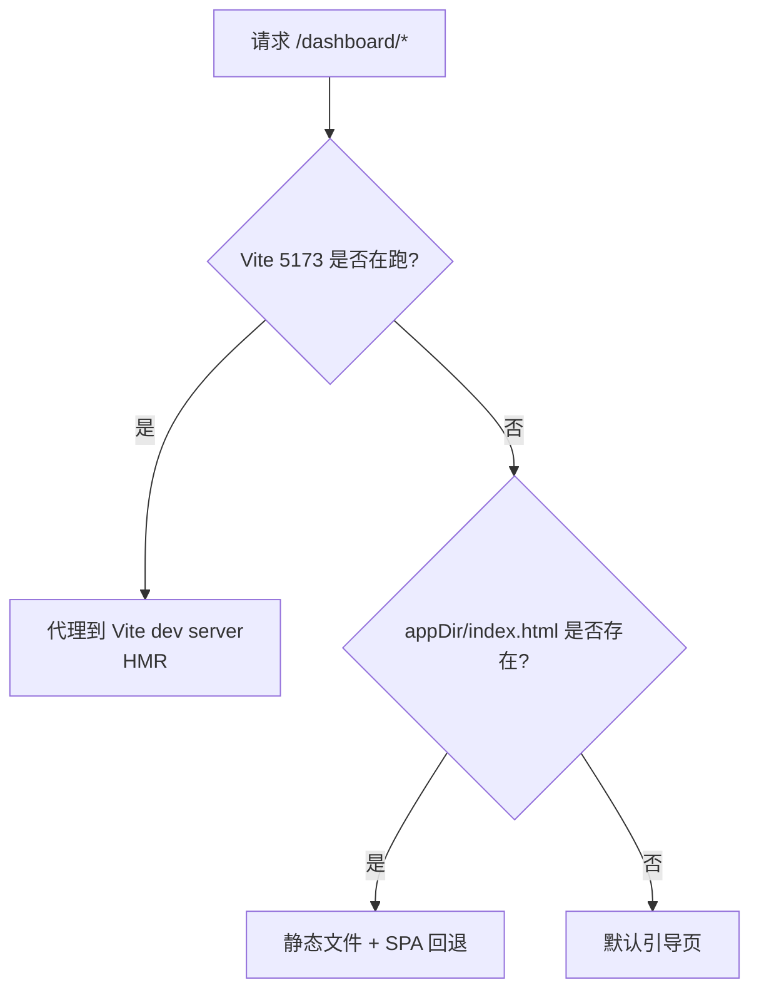

# 07 · 前端：React Dashboard 与 Admin UI

> 本文覆盖两套后台前端：新的 React Dashboard（主推）与旧的 Angular Admin UI（已弃用），以及前端扩展机制、开发/生产托管方式和构建命令。
>
> 前置阅读：[04-api-layer.md](./04-api-layer.md)、[05-plugin-system.md](./05-plugin-system.md)

---

## 1. 两套后台概览

| 维度 | React Dashboard（新） | Angular Admin UI（旧） |
|---|---|---|
| 包 | `packages/dashboard` | `packages/admin-ui` |
| 技术栈 | React 19 + Vite 7 + TanStack + Tailwind 4 + LingUI + gql.tada | Angular |
| 默认路径 | `/dashboard` | `/admin` |
| 托管插件 | `DashboardPlugin` | `AdminUiPlugin` |
| 开发态 | Vite dev server `5173`，插件自动代理 | 独立构建/端口 `5001` |
| 状态 | **主推** | **官方自 3.5 起弃用，维护至 2026-07** |
| 扩展方式 | `dashboard: '../dashboard/index.tsx'` + `defineDashboardExtension` | `ui-devkit` 编译扩展模块 |

> 新功能只做 Dashboard 扩展。Admin UI 仅维护既有功能。

---

## 2. Dashboard 技术栈

来自 [packages/dashboard/package.json](file:///d:/zhao/vendure/packages/dashboard/package.json)：

| 类别 | 依赖 |
|---|---|
| UI 框架 | `react@19`、`react-dom@19` |
| 构建 | `vite@7`、`@vitejs/plugin-react`、`@tailwindcss/vite`、`tailwindcss@4` |
| 路由 | `@tanstack/react-router` + `@tanstack/router-plugin` |
| 数据 | `@tanstack/react-query`、`awesome-graphql-client`、`gql.tada` |
| 表格 | `@tanstack/react-table` |
| 表单 | `react-hook-form`、`zod`、`@hookform/resolvers` |
| i18n | `@lingui/core`、`@lingui/react`、`@lingui/vite-plugin`、`@lingui/cli` |
| 富文本 | TipTap |
| 组件/样式 | `@vendure-io/ui`、`@vendure-io/design-tokens`、`clsx`、`tailwind-merge`、`motion` |
| 拖拽 | `@dnd-kit` |
| 图标 | `lucide-react` |
| 图表 | `recharts` |
| 测试 | `vitest`、`playwright`、`storybook` |

---

## 3. 目录结构

```text
packages/dashboard/
├── src/
│   ├── app/
│   │   ├── routes/                 # TanStack Router 文件式路由
│   │   │   ├── __root.tsx
│   │   │   ├── login.tsx
│   │   │   ├── _authenticated.tsx
│   │   │   └── _authenticated/     # 各业务页面
│   │   ├── common/
│   │   └── ...
│   ├── i18n/                       # LingUI 语言包
│   └── lib/
│       ├── components/             # 通用业务组件
│       ├── framework/              # 扩展框架（重点）
│       ├── graphql/                # gql.tada 生成的查询
│       ├── hooks/
│       ├── providers/
│       ├── types/
│       └── utils/
├── plugin/                         # DashboardPlugin（服务端托管）
├── vite/                           # 自定义 Vite 插件集合
├── e2e/                            # Playwright e2e
├── scripts/                        # 构建/翻译脚本
└── vite.config.mts
```

### 3.1 已内置的路由

`src/app/routes/_authenticated/` 下按资源组织，例如：

```text
_products/  _product-variants/  _orders/  _customers/  _customer-groups/
_collections/ _facets/ _assets/ _channels/ _administrators/ _roles/
_promotions/ _shipping-methods/ _payment-methods/ _tax-categories/ _tax-rates/
_countries/ _zones/ _stock-locations/ _sellers/ _api-keys/ _global-settings/
_tenant-settings/ _system/ _profile/
```

新增页面通常由插件通过 `routes` 扩展注册，而不是直接改 Dashboard 源码。

---

## 4. Dashboard 扩展框架（`src/lib/framework`）

| 目录 | 职责 |
|---|---|
| `extension-api/` | `defineDashboardExtension` 入口与类型、扩展注册执行 |
| `component-registry/` | 组件注册表（按名称替换/扩展） |
| `nav-menu/` | 导航分组与菜单项扩展 |
| `page/` | 列表页/详情页路由装载器、页面 API |
| `dashboard-widget/` | 首页 Widget（指标、最新订单、订单汇总） |
| `data-table/` | 列表表格列/单元格扩展 |
| `form-engine/` | 表单引擎与字段渲染 |
| `layout-engine/` | 页面布局/区块（page blocks、action bar） |
| `document-extension/` | 文档级扩展 |
| `document-introspection/` | 运行时 schema 内省 |
| `history-entry/` | 历史记录条目组件 |
| `toolbar/` | 工具栏扩展 |
| `alert/` | 全局告警扩展 |
| `registry/` | 全局注册表 |

### 4.1 插件如何扩展 Dashboard

1. 插件 `package.json` 暴露 Dashboard 入口（通常 `../dashboard/index.tsx`）。
2. `@VendurePlugin({ dashboard: '../dashboard/index.tsx' })` 声明。
3. Dashboard 构建时由 Vite 插件扫描已安装的 Vendure 插件并收集扩展。
4. 入口文件调用 `defineDashboardExtension({...})` 注册扩展。

```tsx
// packages/my-plugin/dashboard/index.tsx
import { defineDashboardExtension } from '@vendure/dashboard';

defineDashboardExtension({
    navSections: [
        {
            id: 'marketing',
            title: '营销',
            items: [{ id: 'my-page', title: '我的页面', url: '/my-page' }],
        },
    ],
    routes: [
        { path: '/my-page', component: () => import('./my-page.js') },
    ],
    pageBlocks: [],
    actionBarItems: [],
});
```

> 实际 `defineDashboardExtension` 支持的类型以 [extension-api-types.ts](file:///d:/zhao/vendure/packages/dashboard/src/lib/framework/extension-api/extension-api-types.ts) 为准；仓库中 13 个插件提供了 Dashboard 扩展。

### 4.2 扩展注册的两个阶段

`executeDashboardExtensionCallbacks()`：

1. **Phase 1**：执行注册回调（数组形式的 navSections/routes 等）。
2. **Phase 2**：应用函数形式的导航修饰器（`navSections` 可以是 `config => config`）。

函数式修饰器返回非法结果会被跳过并打印警告。

---

## 5. Vite 集成：`vendureDashboardPlugin`

`packages/dev-server/vite.config.mts` 使用：

```ts
vendureDashboardPlugin({
    vendureConfigPath: pathToFileURL('./dev-config.ts'),
    api: { host: 'auto', port: 'auto' },
    gqlOutputPath: path.resolve(__dirname, './graphql/'),
    pluginPackageScanner: {
        nodeModulesRoot: path.resolve(__dirname, '../../node_modules'),
    },
})
```

| 选项 | 作用 |
|---|---|
| `vendureConfigPath` | 加载 Vendure 配置，读取插件与 schema |
| `api.host/port` | `auto` 表示运行时用 `window.location` 推导 admin-api（同源/nginx 反代），**生产不能硬编码 localhost** |
| `gqlOutputPath` | gql.tada 生成类型输出 |
| `pluginPackageScanner.nodeModulesRoot` | 扫描工作区插件包，收集 Dashboard 扩展 |

内置 Vite 插件还负责：

- Admin API schema 类型生成（`vite-plugin-admin-api-schema`）
- gql.tada 类型生成（`vite-plugin-gql-tada`）
- Dashboard 元数据收集（`vite-plugin-dashboard-metadata`）
- 配置加载（`vite-plugin-config-loader` / `vite-plugin-config`）
- HMR（`vite-plugin-hmr`）
- LingUI Babel（`vite-plugin-lingui-babel`）
- Tailwind 源扫描（`vite-plugin-tailwind-source`）
- 主题（`vite-plugin-theme`）
- index.html 转换（`vite-plugin-transform-index`）
- 翻译（`vite-plugin-translations`）
- UI 配置（`vite-plugin-ui-config`）

---

## 6. Dashboard 的托管方式（`DashboardPlugin`）

源码：[dashboard.plugin.ts](file:///d:/zhao/vendure/packages/dashboard/plugin/dashboard.plugin.ts)

### 6.1 三种运行模式

`configure()` 注册一个动态 middleware，每次请求按优先级判断：



- **vite 模式**：开发态，代理到 `localhost:5173`，支持 HMR。
- **built 模式**：生产态，服务 `appDir` 下的静态文件。
- **default 模式**：未构建时显示 `default-page.html` 引导页。

### 6.2 关键细节

- `/assets/*` 使用 **1 年 immutable 缓存**，且显式 404，避免缺失 chunk 回退到 `index.html` 导致 `Unexpected token '<'`。
- 限流：生产 500 req/min，开发 100000 req/min；`/assets/*` 跳过限流（单页加载约 190 个 chunk）。
- `/dashboard/__status` 仅 localhost 可访问，返回 `{ viteRunning, hasBuiltFiles, mode }`。
- Worker 进程不注册该中间件（`processContext.isWorker` 直接 return）。
- `metricSummary` 查询由 `MetricsResolver` / `MetricsService` 提供。
- 通过 `SettingsStore` 注册 `vendure.dashboard` 字段：`userSettings`、`globalSavedViews`、`userSavedViews`，并新增 `manageDashboardGlobalViews` 权限。

### 6.3 静态托管与反代

生产推荐：nginx 将 `/dashboard` 反代到 Vendure，或直接由 `DashboardPlugin` 服务静态文件。**不要**把 `api.host` 写死为 `localhost`，否则浏览器会请求用户本机。

---

## 7. 构建与开发命令

### 7.1 Dashboard 包内脚本

| 命令 | 作用 |
|---|---|
| `bun run dev`（或 `npm run dev`） | 启动 Vite 开发服务器（5173） |
| `npm run build:standalone` | 只构建独立 Dashboard 应用（`vite build`） |
| `npm run build` | 类型检查 + 构建 Vite 插件 + 构建插件包 |
| `npm run check-types` | `tsc --noEmit` |
| `npm run build:vite` | 编译 `vite/` 下的 Vite 插件 |
| `npm run build:plugin` | 编译 `plugin/`（服务端托管插件） |
| `npm run i18n:extract` / `i18n:apply` / `i18n:check` | LingUI 翻译提取/应用/校验 |
| `npm run e2e:pw` | Playwright e2e |
| `npm run storybook` | Storybook（6006） |

### 7.2 生产构建（本仓库约定）

```bash
# 在 packages/dashboard 下
bunx vite build --base /dashboard/ --outDir ../dev-server/dist
```

- `base` 必须是 `/dashboard/`（与 DashboardPlugin 的 `route` 一致）。
- 输出到 `packages/dev-server/dist`，由 `DashboardPlugin({ appDir: './dist' })` 托管。

### 7.3 已知坑：stale dist

Vite 不会清理旧的 hash 文件。跨分支切换后 `packages/dev-server/dist/` 可能残留旧 chunk，导致：

- `window.schemaInfo` 被旧 chunk 覆盖
- 页面白屏 / 资源 404 / MIME 错误

处理：

```bash
rm -rf packages/dev-server/dist
# 再重新 vite build
```

同时确认没有残留的 Vite dev server 占用 `5173` —— `DashboardPlugin` 会优先代理到它，而不是服务静态文件。

---

## 8. Angular Admin UI（旧）

### 8.1 托管

[AdminUiPlugin](file:///d:/zhao/vendure/packages/admin-ui-plugin/src/plugin.ts)：

```ts
AdminUiPlugin.init({
    route: 'admin',
    port: 5001,
    adminUiConfig: {},
})
```

- 服务静态资源到 `/admin`。
- 开发态可代理到 Angular dev server（`5001`），并处理 `sockjs-node` 代理。
- 同样提供 `metricSummary` 查询（`MetricsResolver` / `MetricsService`）。
- Worker 进程不注册。

### 8.2 状态

- 官方自 **v3.5** 起弃用 Angular Admin UI，维护到 **2026-07**。
- 新扩展不要再用 `ui-devkit`。

### 8.3 `ui-devkit`

`packages/ui-devkit` 提供：

- `client`：Admin UI 扩展运行时 API
- `compiler`：扩展模块编译（Angular 构建）

仅用于维护旧扩展。

---

## 9. i18n（Dashboard）

- 使用 **LingUI**：源码中用宏标注文案，`lingui extract` 生成 `.po`，`lingui compile` 打包。
- 语言包位于 `src/i18n/`。
- 插件 Dashboard 扩展也可以提供自己的翻译，由 Vite 插件 `vite-plugin-translations` 合并。
- 多语言回退遵循前端 i18n 规则：当前 locale → defaultLocale → 首个值 → key。

---

## 10. 前端 e2e 测试

- 配置：`packages/dashboard/e2e/playwright.config.ts`
- 命令（在 `packages/dashboard` 下）：

```bash
CI=true VITE_TEST_PORT=5176 bunx playwright test --config e2e/playwright.config.ts <test-path> --reporter=list
```

- 测试套件组织见 [09-testing.md](./09-testing.md)。

---

## 11. 代码索引

| 关注点 | 文件 |
|---|---|
| Dashboard 包配置 | [package.json](file:///d:/zhao/vendure/packages/dashboard/package.json) |
| Vite 配置（dev-server） | [vite.config.mts](file:///d:/zhao/vendure/packages/dev-server/vite.config.mts) |
| Dashboard 服务端插件 | [dashboard.plugin.ts](file:///d:/zhao/vendure/packages/dashboard/plugin/dashboard.plugin.ts) |
| 扩展入口 | [define-dashboard-extension.ts](file:///d:/zhao/vendure/packages/dashboard/src/lib/framework/extension-api/define-dashboard-extension.ts) |
| 扩展类型 | [extension-api-types.ts](file:///d:/zhao/vendure/packages/dashboard/src/lib/framework/extension-api/extension-api-types.ts) |
| 页面框架 | [page/](file:///d:/zhao/vendure/packages/dashboard/src/lib/framework/page) |
| 导航扩展 | [nav-menu-extensions.ts](file:///d:/zhao/vendure/packages/dashboard/src/lib/framework/nav-menu/nav-menu-extensions.ts) |
| Widget 扩展 | [widget-extensions.tsx](file:///d:/zhao/vendure/packages/dashboard/src/lib/framework/dashboard-widget/widget-extensions.tsx) |
| 路由根 | [src/app/routes](file:///d:/zhao/vendure/packages/dashboard/src/app/routes) |
| Vite 插件集合 | [packages/dashboard/vite](file:///d:/zhao/vendure/packages/dashboard/vite) |
| Admin UI 插件 | [admin-ui-plugin/src/plugin.ts](file:///d:/zhao/vendure/packages/admin-ui-plugin/src/plugin.ts) |
| ui-devkit | [packages/ui-devkit/src](file:///d:/zhao/vendure/packages/ui-devkit/src) |

---

## 12. 本章要点回顾

1. **Dashboard 是主推后台**，Admin UI 已弃用。
2. **插件通过 `dashboard` 元数据 + `defineDashboardExtension` 扩展**，无需改 Dashboard 源码。
3. **`vendureDashboardPlugin` 负责 schema/gql.tada/扩展扫描/HMR/翻译**。
4. **托管有三种模式**：Vite 代理 → 静态文件 → 默认引导页。
5. **`/assets/*` immutable 缓存 + 404 兜底**，避免 SPA 回退导致 MIME 错误。
6. **构建必须 `--base /dashboard/`，输出到 dev-server/dist**；跨分支先清 dist。
7. **生产 `api.host` 用 `auto`**，禁止硬编码 localhost。
