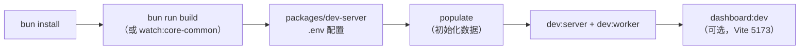
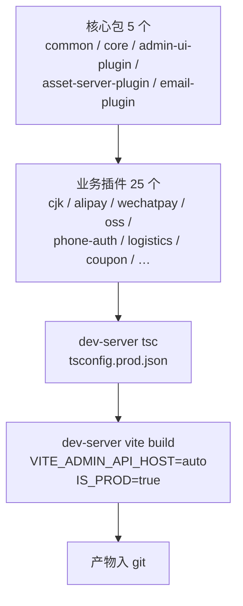
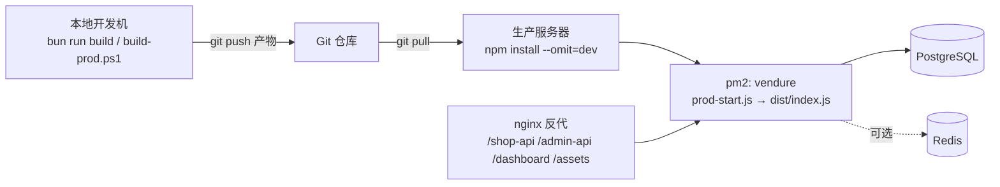

# 08 · 构建、运行与部署

> 一句话理解：本仓库是**本地构建、产物入库、服务器只拉取运行**的部署模型 —— 服务器上永远不执行 `build`。

---

## 1. 环境前置条件

| 依赖 | 版本要求 | 说明 |
| --- | --- | --- |
| Node.js | `^20.19.0 \|\| >=22.12.0` | 根 `package.json` 的 `engines` 硬约束 |
| Bun | 与 lockfile 匹配 | 仓库主包管理器（`bun run …`、`bun install`） |
| PostgreSQL | `>=12`（生产） | 主数据库；开发可用 SQLite |
| npm | `>=10` | 服务器侧运行时安装 |
| Git | 任意 | 服务器拉取预编译产物 |
| pm2 | 最新 | 生产进程守护 |

服务器内存建议 ≥ 2GB；1GB 机器需严格限制 Node 堆内存。

> 注意：仓库里同时存在 `bun.lock`、`package-lock.json`、`pnpm-lock.yaml`，并有 `packageManager: pnpm@11.9.0` 字段。**开发机统一按 AGENTS.md 使用 Bun**；服务器部署按 [INSTALL.md](../../INSTALL.md) 使用 npm `--omit=dev`。

---

## 2. 首次安装

```bash
# 仓库根目录
bun install

# 全量构建（lerna 按包拓扑顺序执行）
bun run build
```

常用根脚本：

| 脚本 | 作用 |
| --- | --- |
| `bun run build` | `lerna run build`，按依赖拓扑构建全部包 |
| `bun run watch` | `lerna run watch --parallel`，全包并行 watch |
| `bun run watch:core-common` | 只 watch `@vendure/common` + `@vendure/core`（改 core 时的标准做法） |
| `bun run build:core-common` | 只构建 common + core |
| `bun run test` | `lerna run test --stream --no-bail`（Vitest 单测） |
| `bun run e2e` | `lerna run e2e --stream --no-bail`（各包 e2e） |
| `bun run codegen` | 生成 GraphQL 类型 + gql.tada 类型 |
| `bun run lint` / `bun run format` | ESLint --fix / Prettier |
| `bun run check-imports` | 检查跨包 import 合法性 |
| `bun run check-core-type-defs` | 校验 core 类型定义完整性 |

---

## 3. 开发运行

### 3.1 启动链路

`packages/dev-server` 是唯一可运行的「应用层」，它 import 各 `@vendure/*` 包源码（经 TS paths 映射），因此**改包后需重新 build 或保持 watch，再重启 dev-server**。



### 3.2 dev-server 脚本

| 脚本 | 实际命令 | 说明 |
| --- | --- | --- |
| `populate` | `node -r ts-node/register -r dotenv/config populate-dev-server.ts` | 初始化开发数据（内置示例商品/订单） |
| `populate:china` | 追加 `tsconfig-paths/register` | 中国区业务种子数据（多租户/中文商品等） |
| `dev:server` | `node -r ts-node/register … index.ts` | 启动 **server 进程** |
| `dev:worker` | `node -r ts-node/register … index-worker.ts` | 启动 **worker 进程**（JobQueue/Scheduler） |
| `dev` | `concurrently npm:dev:server npm:dev:worker` | 同时起两个进程（推荐） |
| `dev:instrumented` | 同上 + `IS_INSTRUMENTED=true` + `instrumentation.ts` | 开启 OpenTelemetry 追踪 |
| `dashboard:dev` | `vite dev` | Dashboard 前端 HMR（默认 5173） |
| `e2e:marketplace` | `e2e-marketplace-test.ts` | Marketplace 场景 e2e |
| `e2e:tenant-inventory` | `node e2e-tenant-inventory.mjs` | 多租户库存场景 e2e |
| `load-test:1k/10k/100k` | `load-testing/run-load-test.ts <N>` | 压测脚本 |

**启动入口** [packages/dev-server/index.ts](../../packages/dev-server/index.ts)：

```ts
runMigrations(devConfig)          // 先跑迁移（synchronize 场景下等价于建表）
    .then(() => bootstrap(devConfig))
    .then(app => {
        if (process.env.RUN_JOB_QUEUE === '1') {
            return app.get(JobQueueService).start();
        }
    });
```

> Worker 进程（`index-worker.ts`）不监听 HTTP，只消费 JobQueue 与 Scheduler；`ProcessContext.isWorker` 为 `true`，Dashboard 等插件会在 `configure()` 里直接 return，不注册静态服务。

### 3.3 数据库切换

```bash
# Windows PowerShell
$env:DB="sqlite"; bun run populate      # 或 DB=postgres
```

- `DB=postgres`：生产/接近生产的开发。
- `DB=sqlite`（better-sqlite3）：最快，适合跑 e2e。
- 支持 `mysql` / `mariadb`。

### 3.4 默认访问地址

| 入口 | 默认地址 | 说明 |
| --- | --- | --- |
| Shop API | `http://localhost:3000/shop-api` | 商城端 GraphQL |
| Admin API | `http://localhost:3000/admin-api` | 管理端 GraphQL |
| GraphiQL Admin | `http://localhost:3000/graphiql/admin` | GraphQL 调试 |
| Dashboard | `http://localhost:3000/dashboard` | React 新版后台 |
| Admin UI | `http://localhost:3000/admin` | Angular 旧版后台（3.5 起弃用） |
| Asset Server | `http://localhost:3000/assets` | 静态资源 |

端口由 `API_PORT` 决定（默认 `3000`；生产部署实例常用 `3020`）。默认管理员：`superadmin / superadmin`，**首次登录必须改密**。

### 3.5 Dashboard 开发

```bash
# 终端 A：后端
cd packages/dev-server; bun run dev

# 终端 B：Dashboard Vite dev server
cd packages/dev-server; bun run dashboard:dev
```

`DashboardPlugin` 会探测 `localhost:5173`：探测到 Vite 就**反向代理**（获得 HMR），否则回落到 `appDir` 静态文件。因此开发时**先起 Vite 再访问 `/dashboard`**，顺序反了会看到构建产物或「Build your dashboard」提示。

Vite 配置 [packages/dev-server/vite.config.mts](../../packages/dev-server/vite.config.mts)：

- `base: '/dashboard/'`
- `api.host / api.port = 'auto'`：运行时用 `window.location` 推导 admin-api 地址（生产同源反代必需，**不要硬编码 localhost**）
- `gqlOutputPath: ./graphql/`
- `pluginPackageScanner.nodeModulesRoot = ../../node_modules`：自动扫描 node_modules 中带 `dashboard` 扩展的插件包

---

## 4. 环境变量

配置文件位置：`packages/dev-server/.env`（模板见 [.env.example](../../packages/dev-server/.env.example)）。

### 4.1 数据库与端口

| 变量 | 示例 | 说明 |
| --- | --- | --- |
| `DB` | `postgres` | `postgres` / `mysql` / `mariadb` / `sqlite` |
| `DB_HOST` | `127.0.0.1` | — |
| `DB_PORT` | `5432` | — |
| `DB_USERNAME` | `postgres` | — |
| `DB_PASSWORD` | `change_me` | 生产必填 |
| `DB_NAME` | `vendure` | — |
| `API_PORT` | `3000` | HTTP 端口 |
| `DB_SYNC` | `true` | 见 §4.4 |
| `SQL_LOG` | `true` | 打印 SQL（调试） |

### 4.2 第三方能力（均为可选）

| 分组 | 变量 | 用途 |
| --- | --- | --- |
| 短信 | `SMS_ACCESS_KEY_ID`、`SMS_ACCESS_KEY_SECRET`、`SMS_SIGN_NAME`、`SMS_TEMPLATE_CODE`；备用通道 `SMS_GATEWAY_URL`、`SMS_GATEWAY_KEY` | 手机号验证码登录 |
| 微信登录 | `WECHAT_AUTH_APP_ID`、`WECHAT_AUTH_APP_SECRET`、`WECHAT_AUTH_MINI_APP_ID`、`WECHAT_AUTH_MINI_APP_SECRET` | 公众号 / 小程序登录 |
| 微信消息 | `WECHAT_MESSAGE_TOKEN`、`WECHAT_MESSAGE_AES_KEY` | 微信推送回调校验 |
| 抖音登录 | `DOUYIN_AUTH_APP_ID`、`DOUYIN_AUTH_APP_SECRET` | 抖音授权登录 |
| 支付 | `ALIPAY_NOTIFY_URL`、`ALIPAY_PUBLIC_KEY`；`WECHATPAY_NOTIFY_URL`、`WECHATPAY_CALLBACK_METHOD_MAP` | 支付回调地址与验签 |
| Redis | `REDIS_URL` / `PHONE_AUTH_REDIS_URL` | 库存原子扣减、验证码 |
| 对象存储 | `OSS_REGION`、`OSS_BUCKET`、`OSS_ACCESS_KEY_ID`、`OSS_ACCESS_KEY_SECRET`；`MINIO_ENDPOINT`、`MINIO_ACCESS_KEY_ID`、`MINIO_SECRET_ACCESS_KEY` | 图片/文件存储 |
| 物流查询 | `KUAIDI100_CUSTOMER`、`KUAIDI100_KEY` | 快递 100 轨迹 |
| 同城配送 | `DADA_*`（达达）、`MEITUAN_*`（美团） | 第三方运力下单/回调 |
| 生态上报 | `GAME_ECO_URL`、`GAME_ECO_SECRET` | 游戏服务器生态事件回调（与 game-server 共享密钥） |
| 遥测 | `IS_INSTRUMENTED`、`OTEL_EXPORTER_OTLP_ENDPOINT`、`OTEL_LOGS_EXPORTER` | 开启 OTel；Jaeger/Loki/Grafana 见 §5 |
| 搜索 | `MEILI_HOST`、`MEILI_ADMIN_KEY`；`ZHAO_SEARCH_REINDEX_URL`、`ZHAO_SEARCH_SHARED_SECRET` | MeiliSearch 检索与重建索引 |
| 直播 | `LIVE_WS_URL`、`LIVE_WS_SECRET`、`LIVE_PUSH_DOMAIN`、`LIVE_PLAY_DOMAIN`、`LIVE_COMMISSION_RATE` | 直播推拉流与佣金 |
| SSO | `ZHAO_SSO_BASE_URL`、`SSO_CHANNEL_SYNC_URL`、`SSO_CHANNEL_SYNC_TOKEN` | 单点登录与渠道同步 |
| 内容 | `JIANGHU_STRAPI_URL`、`JIANGHU_STRAPI_TOKEN` | 江湖内容源 |
| 密钥 | `AUTH_SECRET`、`BALANCE_ACCOUNT_SECRET`、`DISTRIBUTION_ACCOUNT_SECRET`、`RECHARGE_CARD_PIN_KEY`、`REDEMPTION_KEY`、`TCM_RECORD_KEY` | 各业务加密/签名密钥 |
| 公网地址 | `DEFAULT_PUBLIC_DOMAIN`、`PUBLIC_ASSET_URL`、`PUBLIC_STOREFRONT_URL`、`PUBLIC_LOGIN_URL_TEMPLATE`、`PUBLIC_PAY_URL_TEMPLATE`、`PUBLIC_PRODUCT_URL_TEMPLATE` | 生成对外链接（分享/支付/登录） |

### 4.3 调试旁路（生产必须全 false）

| 变量 | 本地开发 | 生产 |
| --- | --- | --- |
| `DEV_BYPASS_SMS` | `true`（固定验证码） | `false` |
| `DEV_BYPASS_WECHAT` | `true` | `false` |
| `DEV_BYPASS_ALIPAY` | `true` | `false` |
| `DEV_BYPASS_WECHATPAY` | `true` | `false` |
| `DEV_BYPASS_DOUYIN` | `true` | `false` |

`prod-start.js` 会**强制**把 `DEV_BYPASS_SMS` / `DEV_BYPASS_WECHAT` 覆盖成 `'false'`，这是最后一道闸门。

> 租户级配置（支付密钥、地图密钥、SSO Provider、渠道主题等）**不写 `.env`**，而是通过 Dashboard「租户配置中心」按 Channel 配置，落库加密存储（见 [03-data-model.md](./03-data-model.md)）。

### 4.4 关于 `synchronize`

`dev-config.ts` 中 `dbConnectionOptions.synchronize` 按环境与 `DB_SYNC` 开关决定。开启时首次启动自动建表/补列，无需手工 migration；生产建议以迁移 + 备份为准（见 [03-data-model.md](./03-data-model.md) 迁移约定）。

---

## 5. 本地依赖服务（docker-compose）

[docker-compose.yml](../../docker-compose.yml) 提供开发/测试用的基础设施：

| 服务 | 端口 | 用途 |
| --- | --- | --- |
| `postgres_12` / `postgres_16` | 5432 | 主库（含 `pg_stat_statements`） |
| `mysql_8` / `mysql_5` / `mariadb` | 3306 | 多数据库兼容测试 |
| `redis` | 6379 | 库存/缓存 |
| `elasticsearch` | 9200 | 搜索（单节点，512MB 堆） |
| `keycloak` | 9000→8080 | Keycloak 认证策略测试 |
| `jaeger` | 4318 / 16686 | OTLP 接收 + Web UI |
| `loki` | 3100 | 日志聚合 |
| `grafana` | 3200→3000 | 日志/指标面板（匿名 Admin） |

> 同端口服务（3306、5432）互斥，按需 `docker compose up <service>` 单独启动。

---

## 6. 生产部署模型

### 6.1 核心原则

> **本地构建 → 提交产物到 Git → 服务器 `git pull` + `pm2 restart`。服务器禁止 build、禁止装 devDependencies。**

原因：生产服务器内存不足，`lerna run build` 会 OOM；且原生依赖（better-sqlite3/sharp）在服务器编译易失败。

### 6.2 本地生产构建

Windows PowerShell（仓库根目录）：

```powershell
.\build-prod.ps1
```

[build-prod.ps1](../../build-prod.ps1) 的执行顺序：



关键点：
- `VITE_ADMIN_API_HOST=auto` / `VITE_ADMIN_API_PORT=auto` 必须设置，否则 Dashboard 会硬编码 `http://localhost` 连不上 admin-api。
- `IS_PROD=true` 让 `devOnlyPlugins` 变为空数组，跳过 Reviews/FloorBuilder/NavModifier 三个 Angular 演示插件。
- 脚本实际只构建 **5 个核心包**（common/core/admin-ui-plugin/asset-server-plugin/email-plugin）+ **25 个业务插件**。`dashboard`、`telemetry-plugin`、`graphiql-plugin` 若未改动则复用已入库产物；改动过需先单独 `cd packages/<pkg> && bun run build`（或先跑一次根 `bun run build`）。
- 产物目录：`packages/*/lib`、`packages/*/dist`、`packages/dev-server/dist`（含 `index.html` + `assets/` + `test-plugins/`）。

提交并推送：

```bash
git add -A
git commit -m "build: production artifacts"
git push
```

### 6.3 可选：独立打包

[deploy-pack.js](../../deploy-pack.js) 生成一个自包含的 `vendure-prod/` 目录（用于不分发整个 monorepo 的场景）：

```bash
node deploy-pack.js
tar -czf vendure-prod.tar.gz vendure-prod/
```

它会：
1. 按 `PLUGINS` 清单拷贝各包 `lib`/`dist`/`templates`/`package.json`/`index.js`；
2. 用临时 `tsconfig.deploy-pack.json`（extends dev-server 配置以保留 paths）编译 `index.ts` / `index-worker.ts` / `migration.ts` 到 `vendure-prod/dist`；
3. 生成 `vendure-prod/package.json`（`start: node dist/index.js`、`start:worker`、workspaces、仅 `dotenv` + `pg` 依赖）；
4. 生成占位 `.env`。

> `PLUGINS` 清单为「宁多勿漏」策略，需与 `dev-config.ts` 实际注册的包对齐。

### 6.4 服务器首次安装（摘要）

完整步骤见 [INSTALL.md](../../INSTALL.md)。要点：

```bash
git clone <repo> vendure && cd vendure

# 2GB 内存服务器
NODE_OPTIONS="--max-old-space-size=512" npm install --omit=dev --no-optional --ignore-scripts

# 补装 sharp 平台二进制（必须）
npm install --os=linux --cpu=x64 @img/sharp-linux-x64
node -e "require('sharp'); console.log('sharp OK')"

cp packages/dev-server/.env.example packages/dev-server/.env   # 再编辑
psql -U postgres -c "CREATE DATABASE vendure OWNER postgres;"
```

`npm install` 参数含义：`--max-old-space-size=512` 限制 npm 堆内存防 OOM；`--omit=dev` 跳过 devDeps；`--no-optional` 跳过 optionalDeps（含 sharp 平台包，后续单独补装）；`--ignore-scripts` 跳过 postinstall（避免 better-sqlite3 原生编译触发 Python 版本问题）。

### 6.5 启动

前台验证：

```bash
cd packages/dev-server
NODE_OPTIONS="--max-old-space-size=768" node prod-start.js
```

pm2 守护：

```bash
pm2 delete vendure 2>/dev/null; pm2 kill; pm2 clear

pm2 start /www/apps/vendure/packages/dev-server/prod-start.js \
  --name vendure \
  --cwd /www/apps/vendure/packages/dev-server \
  --max-memory-restart 1G \
  --node-args="--max-old-space-size=768"

pm2 logs vendure --lines 80
pm2 save && pm2 startup
```

**必须**：`script` 用绝对路径指向 `prod-start.js`（不是目录），`--cwd` 指向 `packages/dev-server`（让 dotenv 找到 `.env`、`require('./dist/index')` 能解析）。

[prod-start.js](../../packages/dev-server/prod-start.js) 行为：

```js
process.env.NODE_ENV = 'production';
require('dotenv').config();                                   // 读当前 cwd 的 .env
require('dotenv').config({ path: resolve(__dirname, '../../.env') }); // 兜底读根 .env
if (!process.env.DB) process.env.DB = 'postgres';
if (!process.env.DB_HOST) process.env.DB_HOST = '127.0.0.1';
process.env.DEV_BYPASS_SMS = 'false';
process.env.DEV_BYPASS_WECHAT = 'false';
require('./dist/index');
```

### 6.6 更新流程

```bash
cd /www/apps/vendure
git pull
pm2 restart vendure
```

`package.json` 依赖未变时**不需要**重新 `npm install`。

### 6.7 部署拓扑



---

## 7. 常见故障排查（Q1–Q11）

| # | 现象 | 根因 | 解决 |
| --- | --- | --- | --- |
| Q1 | `ENOENT: directory not empty, rename … @eslint/eslintrc` | 残留嵌套 `packages/*/node_modules` | 清理所有层级 `node_modules` + 各 `package-lock.json`，`npm cache clean --force` 后重装 |
| Q2 | `gyp ERR! configure error` / better-sqlite3 编译失败 | 未加 `--ignore-scripts`，触发原生编译且服务器 Python 过旧 | 加 `--ignore-scripts`；生产用 PG 可忽略 |
| Q3 | `Could not load the "sharp" module using the linux-x64 runtime` | `--no-optional` 跳过平台二进制 | `npm install --os=linux --cpu=x64 @img/sharp-linux-x64` |
| Q4 | `Cannot find module '/www/apps/vendure'` | pm2 入口指向目录 | 清理 pm2 后用绝对 `prod-start.js` 路径 + `--cwd` 重建 |
| Q5 | `Cannot find module './test-plugins/floor-builder'` | `dev-config.ts` 静态 import 3 个 Angular 演示插件 | 确保 `dist/test-plugins/` 已随产物提交；生产下这些插件不实际加载，但 require 需文件存在 |
| Q6 | `ENOENT: … email-plugin/templates/partials` | prod 下 `__dirname` 变成 `dist`，相对路径错位 | 已用 `devServerDir` 统一解析；确认拉取最新代码 |
| Q7 | `Cannot find module … lib/index.js` | 产物缺失或被 `.gitignore` 误伤 | 检查 `git status` 是否跟踪 `packages/*/lib` 与 `dev-server/dist` |
| Q8 | Dashboard 显示「Build your dashboard or run in development mode」 | `dev-server/dist` 缺 `index.html`/`assets` | 本地 `.\build-prod.ps1` 重建并推送 |
| Q9 | `ECONNREFUSED 127.0.0.1:5432` | PostgreSQL 未启动或 `.env` 错 | 启动 PG / 修正配置 |
| Q10 | 启动 OOM | Node 默认堆不足 | `--max-old-space-size=768`，pm2 `--max-memory-restart 1G` |
| Q11 | Dashboard 打开白屏 / `Unexpected token '<'` | 陈旧 Vite 产物互相覆盖（Vite 不清理旧 hash 文件） | `rm -rf packages/dev-server/dist` 后重新构建；并确认 5173 上没有残留 Vite dev server（否则会被反代） |

---

## 8. 运维命令速查

```bash
pm2 logs vendure --lines 100       # 日志
pm2 restart vendure                # 重启
pm2 stop vendure                   # 停止
pm2 status / pm2 describe vendure  # 状态
pm2 monit                          # 实时资源
```

数据库备份（建议）：

```bash
pg_dump -U postgres -d vendure -Fc -f /backup/vendure_$(date +%F).dump
```

---

## 9. 构建产物与 Git 约定

| 路径 | 内容 | 是否入库 |
| --- | --- | --- |
| `packages/core/dist` | Vendure 核心编译产物 | 是 |
| `packages/common/lib` | 公共类型库 | 是 |
| `packages/dashboard/dist` | Dashboard 框架 | 是 |
| `packages/admin-ui-plugin/lib` | Angular Admin UI | 是 |
| `packages/asset-server-plugin/lib` | 资产服务 | 是 |
| `packages/email-plugin/lib` + `templates` | 邮件 + 模板 | 是 |
| `packages/<业务插件>/lib` | 各业务插件产物 | 是 |
| `packages/dev-server/dist` | 入口 + Dashboard 静态资源 + `test-plugins/` | 是 |

> `.gitignore` 中 `dist` / `lib` 必须处于注释状态，否则产物不会被提交，服务器启动即 `Cannot find module`。

---

## 10. 代码索引

| 主题 | 位置 |
| --- | --- |
| 根脚本 / engines | [package.json](../../package.json) |
| 应用入口 | [packages/dev-server/index.ts](../../packages/dev-server/index.ts) |
| Worker 入口 | [packages/dev-server/index-worker.ts](../../packages/dev-server/index-worker.ts) |
| 运行时配置 | [packages/dev-server/dev-config.ts](../../packages/dev-server/dev-config.ts) |
| 环境变量模板 | [packages/dev-server/.env.example](../../packages/dev-server/.env.example) |
| Dashboard Vite 配置 | [packages/dev-server/vite.config.mts](../../packages/dev-server/vite.config.mts) |
| 生产启动包装 | [packages/dev-server/prod-start.js](../../packages/dev-server/prod-start.js) |
| 本地生产构建 | [build-prod.ps1](../../build-prod.ps1) |
| 独立打包 | [deploy-pack.js](../../deploy-pack.js) |
| 依赖服务 | [docker-compose.yml](../../docker-compose.yml) |
| 部署手册 | [INSTALL.md](../../INSTALL.md) |
| Dashboard 托管逻辑 | [packages/dashboard/plugin/dashboard.plugin.ts](../../packages/dashboard/plugin/dashboard.plugin.ts) |

---

## 11. 要点回顾

1. 开发 = `bun install` → `bun run build`（或 `watch:core-common`）→ `populate` → `dev`。
2. dev-server 是唯一可运行应用，通过 TS paths 直接引用包源码，改包必须重新构建。
3. `dev` 会同时起 server 与 worker；worker 不监听 HTTP。
4. Dashboard 开发必须先起 Vite（5173），否则拿到静态产物。
5. 生产 = 本地 `build-prod.ps1` 产物入库 → 服务器 `npm install --omit=dev` → `git pull` + `pm2 restart`。
6. 服务器**永不构建**；产物目录（`lib`/`dist`）必须入库。
7. 生产必须 `DEV_BYPASS_* = false`，`prod-start.js` 会强制关掉 SMS/WECHAT 旁路。
8. 端口由 `API_PORT` 控制；`synchronize` 开启时自动建表。
