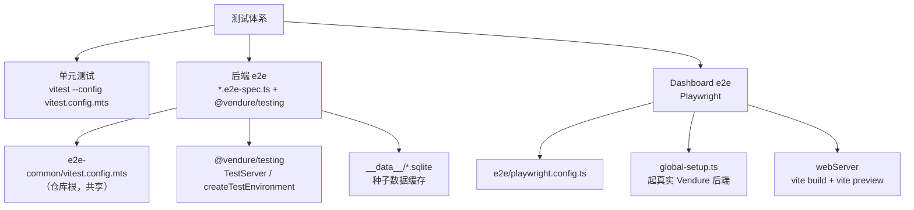

# 09 · 测试体系

> 一句话理解：三层测试 —— **Vitest 单测**（纯函数/服务）、**Vitest + 真实 Vendure 实例 e2e**（GraphQL 打到真服务器）、**Playwright 浏览器 e2e**（Dashboard UI）。

---

## 1. 总览



| 层 | 位置 | 运行命令 | 特点 |
| --- | --- | --- | --- |
| 单元测试 | 各包 `src/**/*.spec.ts`（`vitest.config.mts`） | `bun run test` | 无需数据库 |
| 后端 e2e | 各包 `e2e/*.e2e-spec.ts` | `bun run e2e` | 起真实 Nest 应用 + 真实 DB |
| Dashboard e2e | `packages/dashboard/e2e/tests/**/*.spec.ts` | `e2e:pw` / 见 §5 | Chromium + Vite 预览 + 真实后端 |

---

## 2. 单元测试

每个包基本都有一个 `vitest.config.mts`：

```ts
import swc from 'unplugin-swc';
import { defineConfig } from 'vitest/config';

export default defineConfig({
    plugins: [swc.vite({ jsc: { transform: { useDefineForClassFields: false } } })],
});
```

关键点：**必须用 SWC 插件**，因为 Vendure 大量使用装饰器（`@Injectable`、`@VendurePlugin`）。`useDefineForClassFields: false` 是兼容 class 字段初始化的已知修复。

运行：

```bash
# 全量
bun run test

# 单包
cd packages/core && bun run test
cd packages/coupon-plugin && bun run test
```

`lerna run test --stream --no-bail` 会并行跑所有声明了 `test` 脚本的包，单包失败不阻塞其余包。

---

## 3. 后端 e2e

### 3.1 共享配置（仓库根 `e2e-common/`）

[e2e-common/vitest.config.mts](../../e2e-common/vitest.config.mts)：

| 配置 | 值 | 说明 |
| --- | --- | --- |
| `test.include` | `**/*.e2e-spec.ts` | 只认 e2e 后缀 |
| `testTimeout` | `CI ? 30s : 15s`（`E2E_DEBUG` 时 1800s） | 首次建库较慢 |
| `typecheck.tsconfig` | `tsconfig.e2e.json` | — |
| `allowOnly` | `true` | 允许 `.only`（仅 CI 场景下的 job-queue 测试需要） |
| `plugins` | `swc.vite({ useDefineForClassFields: false })` | 支持装饰器 |

[e2e-common/test-config.ts](../../e2e-common/test-config.ts) 做三件事：

1. **注册 DB initializer**：
   ```ts
   registerInitializer('sqljs',    new SqljsInitializer(path.join(packageDir, '__data__')));
   registerInitializer('postgres', new PostgresInitializer());
   registerInitializer('mysql',    new MysqlInitializer());
   registerInitializer('mariadb',  new MysqlInitializer());
   ```
2. **分配唯一端口**，避免 Lerna 并行跑包时端口冲突：
   ```ts
   core: 3010–3199
   asset-server-plugin: 3220
   graphiql-plugin: 3230
   cli: 3240
   其他包: 3250+
   同一目录内第 index 个测试文件 → port = base + index
   ```
3. **按 `DB` 环境变量选择连接**（默认 `sqljs`）：
   ```ts
   const dbType = process.env.DB || 'sqljs';
   ```

`TEST_SETUP_TIMEOUT_MS`：`CI` 或首次运行 120s（`E2E_DEBUG` 时 1800s）。

### 3.2 `@vendure/testing` 核心 API

[packages/testing/src/index.ts](../../packages/testing/src/index.ts) 导出：

| 导出 | 作用 |
| --- | --- |
| `createTestEnvironment(config)` | 返回 `{ server, adminClient, shopClient }` |
| `TestServer` | `.init(options)` / `.bootstrap()` / `.destroy()` |
| `SimpleGraphQLClient` | `.asSuperAdmin()` / `.query()` / `.mutate()` / `.setChannelToken()` |
| `testConfig` | 默认测试配置（sqljs、`T_` 前缀 ID、NoopLogger、Testing 资产策略） |
| `registerInitializer` / `SqljsInitializer` / `PostgresInitializer` / `MysqlInitializer` | DB 初始化策略 |
| `populateCustomers` / `clearAllTables` | 数据准备工具 |
| `errorResultGuard` | 断言 `ErrorResult` 联合类型 |
| `TestingLogger` | 测试用日志 |

`testConfig` 的约定（[packages/testing/src/config/test-config.ts](../../packages/testing/src/config/test-config.ts)）：

- `defaultChannelToken = 'e2e-default-channel'`
- `apiOptions.port = 3050`（会被 `testConfig()` 覆盖）
- `NoopLogger` 静默日志；`LOG=true` 可打开
- `TestingEntityIdStrategy`：ID 编码为 `T_1`、`T_2`…
- `TestingAssetStorageStrategy` 不落盘、`TestingAssetPreviewStrategy` 空实现

### 3.3 种子数据缓存 `__data__`

`TestServer.init()` 会：

```ts
const testFilename = this.getCallerFilename(1);          // 当前 *.e2e-spec.ts 文件名
await initializer.init(testFilename, dbConnectionOptions);
await initializer.populate(populateFn);                  // 仅当 sqlite 文件不存在时才真正 populate
await initializer.destroy();
await this.bootstrap();
```

`SqljsInitializer.getDbFilePath()` 产出 `packages/<pkg>/e2e/__data__/<文件名>.sqlite`。

**重要**：改动实体/自定义字段/schema 后必须**删除对应 `__data__` 缓存**，否则会用旧库跑新代码，出现缺列等诡异错误。

```bash
# Windows
Remove-Item -Recurse -Force packages\<pkg>\e2e\__data__
```

### 3.4 单个 e2e 的骨架

```ts
import { createTestEnvironment } from '@vendure/testing';
import { testConfig, TEST_SETUP_TIMEOUT_MS } from '../../e2e-common/test-config';

describe('coupon sale', () => {
    const { server, adminClient, shopClient } = createTestEnvironment(testConfig());

    beforeAll(async () => {
        await server.init({ initialData: { ... }, productsCsvPath: ... });
        await adminClient.asSuperAdmin();
    }, TEST_SETUP_TIMEOUT_MS);

    afterAll(async () => {
        await server.destroy();
    });
});
```

### 3.5 运行命令

```bash
# 全量后端 e2e（lerna 并行）
bun run e2e

# 单包（PACKAGE 决定端口段）
cd packages/core && bun run e2e
cd packages/coupon-plugin && bun run e2e   # cross-env PACKAGE=coupon-plugin vitest --config vitest.config.mts --run

# 换数据库
$env:DB="postgres"; cd packages/core; bun run e2e

# 调试（超时放宽到 30 分钟）
$env:E2E_DEBUG="true"; bun run e2e

# 只看日志
$env:LOG="true"; bun run e2e
```

### 3.6 聚合 e2e 包

`packages/cjk-plugins-e2e` 专门聚合中国区业务插件的 e2e（依赖 cjk / alipay / wechatpay / oss / phone-auth / tcm-clinic / wechat-auth / order-timeout / invoice / logistics / group-buy / flash-sale / distribution 等）：

```bash
cd packages/cjk-plugins-e2e && bun run test
```

### 3.7 dev-server 场景 e2e

| 命令 | 内容 |
| --- | --- |
| `bun run e2e:marketplace` | Marketplace 拆单/多商家场景 |
| `bun run e2e:tenant-inventory` | 多租户库存场景 |

---

## 4. 核心 e2e 覆盖面（`packages/core/e2e`）

约 98 个 `*.e2e-spec.ts`，可作为「Vendure 能力清单」使用。按域分类：

| 域 | 代表文件 |
| --- | --- |
| 目录 | `product.e2e-spec.ts`、`collection.e2e-spec.ts`、`facet.e2e-spec.ts`、`product-option.e2e-spec.ts`、`product-prices.e2e-spec.ts`、`slug.e2e-spec.ts` |
| 订单 | `order.e2e-spec.ts`、`draft-order.e2e-spec.ts`、`order-modification.e2e-spec.ts`、`order-promotion.e2e-spec.ts`、`order-taxes.e2e-spec.ts`、`order-merge.e2e-spec.ts`、`order-multiple-shipping.e2e-spec.ts` |
| 履约/支付 | `fulfillment-process.e2e-spec.ts`、`payment-process.e2e-spec.ts`、`order-fulfillment.e2e-spec.ts`、`shipping-method-eligibility.e2e-spec.ts` |
| 认证/权限 | `auth.e2e-spec.ts`、`shop-auth.e2e-spec.ts`、`role.e2e-spec.ts`、`session-management.e2e-spec.ts`、`custom-permissions.e2e-spec.ts`、`entity-access-control.e2e-spec.ts` |
| 多租户 | `channel.e2e-spec.ts`、`product-channel.e2e-spec.ts`、`order-channel.e2e-spec.ts`、`customer-channel.e2e-spec.ts`、`asset-channel.e2e-spec.ts` |
| CustomFields | `custom-fields.e2e-spec.ts`、`custom-field-struct.e2e-spec.ts`、`custom-field-relations.e2e-spec.ts`、`custom-field-permissions.e2e-spec.ts` |
| 基础设施 | `job-queue.e2e-spec.ts`、`default-scheduler-plugin.e2e-spec.ts`、`cache-service-*.e2e-spec.ts`、`settings-store.e2e-spec.ts`、`list-query-builder.e2e-spec.ts` |
| 事务 | `database-transactions.e2e-spec.ts`、`parallel-transactions.e2e-spec.ts` |
| 插件 | `plugin.e2e-spec.ts`、`apollo-server-plugin.e2e-spec.ts`、`lifecycle.e2e-spec.ts` |

另有 `default-search-plugin.bench.ts`（`bun run bench`，tinybench）。

---

## 5. Dashboard Playwright e2e

### 5.1 双服务器架构

| 服务器 | 配置 | 作用 |
| --- | --- | --- |
| Vendure 后端 | `e2e/global-setup.ts`（引用 `e2e-shared-config.ts`） | 真实 API + 测试库 + 自定义字段 + 服务端专用插件 |
| Vite 前端 | Playwright `webServer`：`vite build && vite preview --port <VITE_TEST_PORT>` | 被测的 Dashboard |

- 后端端口：`e2e/constants.ts` 的 `VENDURE_PORT`。
- 前端端口：`process.env.VITE_TEST_PORT || 5174`。
- `use.baseURL = http://localhost:${VITE_PORT}`。
- `webServer.env`：`VITE_ADMIN_API_PORT`、`VITE_ADMIN_API_HOST=http://localhost`、`VENDURE_CONFIG_PATH=e2e/fixtures/e2e-vendure-config.ts`。
- `build.external` 排除 `packages/core`、`packages/common`、`packages/testing`（workspace symlink 会让 Playwright 的 Babel 重复处理已编译 JS，破坏 CJS 初始化顺序）。
- 两个 project：`setup`（跑 `auth.setup.ts` 登录并落 `storageState`）→ `chromium`（依赖 setup）。

### 5.2 运行

```bash
cd packages/dashboard

# AGENTS.md 推荐方式
CI=true VITE_TEST_PORT=5176 bunx playwright test --config e2e/playwright.config.ts --reporter=list

# 单个文件
CI=true VITE_TEST_PORT=5176 bunx playwright test --config e2e/playwright.config.ts \
  e2e/tests/catalog/product-list.spec.ts --reporter=list

# 包脚本
bun run e2e:pw
bun run e2e:ui      # Playwright UI 模式
```

`CI=true` 会启用：1 次重试、4 workers、`github` + `list` reporter、`forbidOnly`。本地不加 `CI` 时 reporter 为 html。

### 5.3 套件组织（写新测试前必读）

```
e2e/tests/
├── auth/login.spec.ts
├── catalog/          # product-list / products / custom-fields / assets / collections / facets / option-groups / product-variants
├── components/       # 通用 UI 组件行为（form-inputs）
├── customers/
├── dashboard/        # insights（仪表盘指标）
├── marketing/        # promotions
├── regression/       # 仅“确实不属于任何既有套件”的回归用例
├── sales/            # orders（草稿订单、订单详情、订单修改）
├── settings/         # channels / roles / payment-methods / shipping-methods / zones / tax-* / countries / sellers / profile …
└── system/           # job-queue / scheduled-tasks
```

规则（来自 AGENTS.md）：

- **先找既有套件**，能放进去就不要新建文件：
  - `catalog/product-list.spec.ts` — 商品列表（排序、列设置、筛选）
  - `catalog/products.spec.ts` — 商品详情页
  - `catalog/custom-fields.spec.ts` — 自定义字段渲染/编辑/持久化
  - `sales/orders.spec.ts` — 草稿订单、订单详情、订单修改
  - `tests/regression/` — **仅** 确实归不进任何套件的用例
- 测试上方必须写注释引用 issue：

```ts
// #4393 — 商品列表默认应按 updatedAt 降序
test('should apply descending updatedAt sort by default', async ({ page }) => { … });
```

### 5.4 测试专用页面

若要测试某个 UI 组件而不污染生产代码，走 **dashboard extension** 机制（见 [e2e/README.md](../../packages/dashboard/e2e/README.md)）：

1. 在 `e2e/fixtures/` 建 `MyTestPlugin`，声明 `dashboard: './my-test-dashboard/index.tsx'`；
2. 扩展入口调用 `defineDashboardExtension({ routes: [...] })`；
3. 页面组件从 `@vendure/dashboard` 导入 `Page` / `PageLayout` / `PageTitle` / `FullWidthPageBlock`；
4. 在 `e2e/fixtures/e2e-vendure-config.ts` 注册插件（Vite 插件会自动发现扩展）；
5. 测试里 `page.goto('/my-test-page')`。

**反例**：直接把测试页复制进 `src/app/routes/` —— 会污染 `routeTree.gen.ts`、可能被打包进生产，且清理依赖 `globalTeardown` 很脆弱。

**注意**：自定义字段只能放 `global-setup.ts` / `e2e-shared-config.ts`，**不能**放 `e2e-vendure-config.ts`（Vite 插件用它生成 schema，struct 自定义字段会导致商品创建 mutation 失败；Dashboard 运行时会从后端 API 发现自定义字段）。

---

## 6. 测试数据与夹具

| 位置 | 内容 |
| --- | --- |
| `e2e-common/e2e-initial-data.ts` | 通用初始数据 |
| `packages/testing/src/config/test-config.ts` | 测试配置 |
| `packages/core/mock-data/` | CSV + 图片（`data-sources/products.csv`、`assets/`） |
| `packages/<pkg>/e2e/fixtures/` | 插件专属夹具 |
| `packages/<pkg>/e2e/__data__/` | sqlite 种子缓存（可删可重建） |
| `packages/dashboard/e2e/fixtures/` | Dashboard e2e 配置、测试插件、初始数据 |

---

## 7. 常见问题

| 现象 | 原因 | 解决 |
| --- | --- | --- |
| e2e 报缺列 / 类型不匹配 | `__data__` 是旧 schema 的缓存 | 删除对应包的 `e2e/__data__` 重跑 |
| 多个包并行 e2e 端口冲突 | 未用 `e2e-common` 的端口分配 | 确保通过 `testConfig()` 取配置，并用 `PACKAGE` 环境变量区分 |
| 装饰器报错 / `design:paramtypes` 缺失 | 未启用 SWC | vitest 配置里必须加 `swc.vite(...)` |
| Playwright 报 CJS 初始化顺序错误 | 未排除 symlink 包 | `build.external` 必须含 core/common/testing |
| Dashboard e2e 白屏 | 未构建前端或端口被占用 | 清理 5174/5176 端口；确认 `vite build` 成功 |
| 首个 e2e 超时 | 首次建库 | 增大 `TEST_SETUP_TIMEOUT_MS` 或先单独跑一次预热 |

---

## 8. 代码索引

| 主题 | 位置 |
| --- | --- |
| 共享 e2e 配置 | [e2e-common/vitest.config.mts](../../e2e-common/vitest.config.mts)、[e2e-common/test-config.ts](../../e2e-common/test-config.ts) |
| 测试运行时 | [packages/testing/src/test-server.ts](../../packages/testing/src/test-server.ts)、[packages/testing/src/create-test-environment.ts](../../packages/testing/src/create-test-environment.ts) |
| DB 初始化器 | [packages/testing/src/initializers/](../../packages/testing/src/initializers/) |
| 默认测试配置 | [packages/testing/src/config/test-config.ts](../../packages/testing/src/config/test-config.ts) |
| 核心 e2e | [packages/core/e2e/](../../packages/core/e2e/) |
| 聚合业务 e2e | [packages/cjk-plugins-e2e/](../../packages/cjk-plugins-e2e/) |
| Dashboard e2e | [packages/dashboard/e2e/](../../packages/dashboard/e2e/) |
| Playwright 配置 | [packages/dashboard/e2e/playwright.config.ts](../../packages/dashboard/e2e/playwright.config.ts) |
| Dashboard e2e 说明 | [packages/dashboard/e2e/README.md](../../packages/dashboard/e2e/README.md) |

---

## 9. 要点回顾

1. 单测 = Vitest + SWC（装饰器必需）。
2. 后端 e2e = `createTestEnvironment(testConfig())` + `server.init()`，端口按包/文件序号自动分配。
3. 种子数据缓存在 `e2e/__data__/*.sqlite`，**schema 变更后必须删缓存**。
4. `DB` 环境变量切换 sqljs/postgres/mysql/mariadb。
5. Dashboard e2e = 真实后端（global-setup）+ Vite preview（webServer）+ 登录态复用（`setup` project）。
6. 新增 Dashboard 测试先找既有套件，只有真归不进去才放 `tests/regression/`，并用注释引用 issue。
7. 测试专用页面走 dashboard extension，不要往 `src/app/routes/` 里塞。
