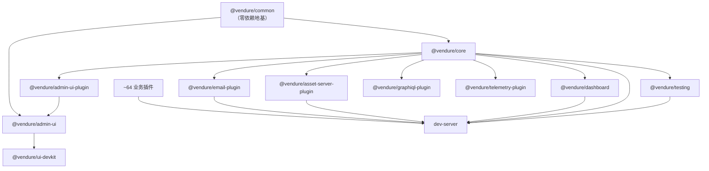
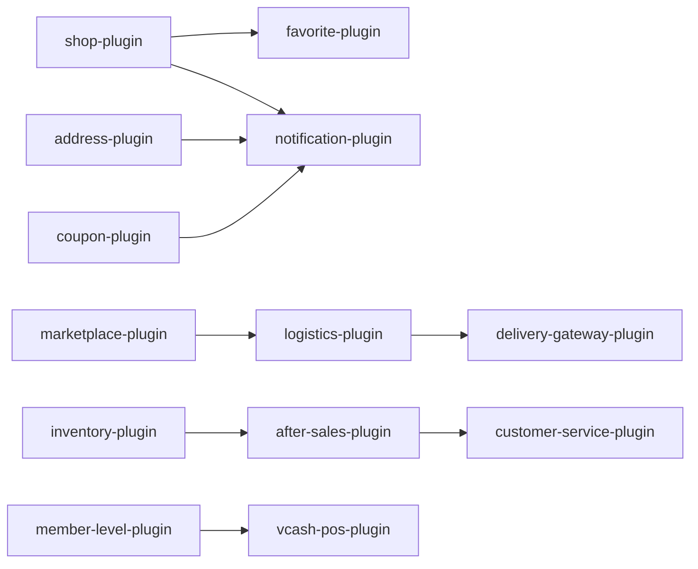
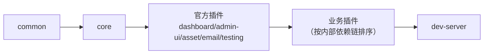

# 10 · 依赖关系与模块边界

> 一句话理解：`@vendure/common` 是零依赖的地基，`@vendure/core` 是唯一的框架内核，其余 70+ 包全部是「插件」或「工具」，业务插件之间形成若干条**硬依赖链**。

---

## 1. 包分类总表

| 类别 | 包 | 数量 | 说明 |
| --- | --- | --- | --- |
| 基础 | `@vendure/common` | 1 | 纯类型/常量/工具，**零运行时依赖** |
| 内核 | `@vendure/core` | 1 | NestJS + TypeORM + GraphQL 框架本体 |
| 官方核心插件 | `dashboard`、`admin-ui-plugin`、`admin-ui`、`asset-server-plugin`、`email-plugin`、`testing`、`graphiql-plugin`、`telemetry-plugin`、`job-queue-plugin`、`harden-plugin`、`ui-devkit`、`cli`、`create` | 13 | Vendure 官方能力 |
| 业务插件 | 其余 `*-plugin`（约 64 个） | ~64 | 中国区电商二开 |
| 应用 | `dev-server` | 1 | 唯一可运行的装配层 |
| 聚合测试 | `cjk-plugins-e2e` | 1 | 业务插件联合 e2e |

> 版本策略：官方包固定 `3.6.4`（Lerna fixed versioning）；业务插件多为 `0.0.1` / `1.0.0` / `0.1.0`，用 `workspace:*` 引用。

---

## 2. 内部依赖总图



**关键规则**：

- 业务插件只允许依赖 `@vendure/core` + `@vendure/common`（peerDependency 写 `^3.6.0`）。
- 业务插件之间可以互相依赖，但**不得反向依赖 `dev-server`**。
- `@vendure/common` 永远不能 import `@vendure/core`（`bun run check-imports` 会检查）。

---

## 3. 业务插件依赖链

从各包 `package.json` 的实际 `dependencies` / `peerDependencies` 提取（已省略 `common` / `core` 这两个公共依赖）。

### 3.1 支付 / 认证

| 插件 | 依赖 | 说明 |
| --- | --- | --- |
| `alipay-plugin` | `cjk` | 依赖 cjk 的支付配置与订单工具 |
| `wechatpay-plugin` | `cjk` | 同上 |
| `douyin-auth-plugin` | `cjk` | — |
| `phone-auth-plugin` | `cjk` | — |
| `wechat-auth-plugin` | `cjk` | — |
| `wechat-shopping-assistant-plugin` | `cjk`、`meilisearch`、`wechat-auth` | 购物助手需要检索 + 登录 |
| `bill-pay-plugin` | `recharge-card`、`wechatpay` | 账单支付复用储值卡 + 微信支付 |
| `recharge-card-plugin` | `wechatpay` | 储值卡充值走微信 |
| `points-mall-plugin` | `wechatpay` | 积分商城支付 |

### 3.2 交易 / 营销

| 插件 | 依赖 | 说明 |
| --- | --- | --- |
| `coupon-plugin` | `merchant`、`recharge-card`、`wechatpay`、`shop` | 券销售、门店核销 |
| `cjk-plugin` | `after-sales`、`coupon`、`distribution`、`logistics` | **聚合型插件**，把售后/券/分销/物流编排进中国区能力 |
| `after-sales-plugin` | `inventory` | 退货回补库存 |
| `customer-service-plugin` | `after-sales` | 客服直接处理售后 |
| `eco-plugin` | `distribution` | 生态行为上报触发佣金 |
| `live-streaming-plugin` | `distribution` | 直播带货佣金 |
| `shop-plugin` | `review` | 店铺页含评价 |
| `notification-plugin` | `address`、`coupon`、`shop` | 通知模板聚合 |
| `operations-plugin` | `delivery`、`flash-sale`、`group-buy`、`coupon` | 运营工作台聚合促销能力 |
| `marketplace-plugin` | `logistics` | 多商家拆单 + 物流 |
| `message-plugin` | `delivery` | 消息携带配送信息 |

### 3.3 会员 / 储值

| 插件 | 依赖 | 说明 |
| --- | --- | --- |
| `member-level-plugin` | — | 会员等级 + 积分 |
| `checkin-plugin` | `member-level` | 签到发积分 |
| `lottery-plugin` | `member-level` | 抽奖扣积分 |
| `vcash-pos-plugin` | — | 储值 POS |
| `vcash-offline-plugin` | `vcash-pos` | 离线储值（依赖 POS） |
| `subscription-plugin` | `settlement`、`shop` | 订阅制结算 |

### 3.4 未装配/独立插件

`address-plugin`（依赖 `shop`）、`affiliate-plugin`（`shop`）、`community-plugin`（`shop`）、`settlement-plugin`（`shop`）、`voucher-plugin`（`shop`）—— 这些包存在但 **未在 `dev-config.ts` 注册**，属于预留/下线能力。详见 [05-plugin-system.md](./05-plugin-system.md)。

### 3.5 硬顺序约束（依赖链决定）



这些依赖不仅是代码 import，还体现在**插件装配顺序**上：被依赖者必须先在 `plugins` 数组中出现（`VendurePlugin` 的 `configuration()` 与实体收集按数组顺序执行）。

---

## 4. 外部关键依赖

### 4.1 `@vendure/core`

| 依赖 | 版本 | 用途 |
| --- | --- | --- |
| `@nestjs/common` / `core` / `platform-express` | `^11.x` | 应用框架、DI、HTTP |
| `@nestjs/graphql` / `@nestjs/apollo` | `~13.1.0` | GraphQL 集成 |
| `@apollo/server` | `^4.12.2` | GraphQL 服务器 |
| `graphql` | `^16.11.0` | 根 `overrides` 强制统一版本 |
| `typeorm` | `^0.3.21` | ORM |
| `express` | `^5.1.0` | HTTP 层（注意是 Express 5） |
| `graphql-upload` | `^17.0.0` | 文件上传 |
| `cookie-session` | `^2.1.0` | 会话 Cookie |
| `bcrypt` | `^6.0.0` | 密码哈希 |
| `i18next` + `i18next-fs-backend` + `i18next-http-middleware` + `i18next-icu` | — | 多语言 |
| `intl-messageformat` | `^10.5.11` | 错误消息插值 |
| `croner` / `cronstrue` / `cron-time-generator` | — | 调度表达式 |
| `csv-parse` / `progress` / `fs-extra` | — | 数据导入 |
| `http-proxy-middleware` | `^3.0.3` | Vite/Admin UI 代理 |
| `rxjs` | `^7.8.1` | Nest 拦截器/事件 |
| `semver` | `^7.6.0` | 插件 `compatibility` 校验 |

### 4.2 `@vendure/dashboard`

| 依赖 | 版本 | 用途 |
| --- | --- | --- |
| `react` / `react-dom` | `^19.2.4` | UI |
| `vite` | `^7.3.1` | 构建 |
| `@tanstack/react-router` | `^1.166.0` | 文件式路由 |
| `@tanstack/react-query` | `^5.91.0` | 服务端状态 |
| `@tanstack/react-table` | `^8.21.2` | 数据表格 |
| `tailwindcss` + `@tailwindcss/vite` | `^4.2.2` | 样式 |
| `@lingui/*` | `^5.9.3` | i18n（编译期提取） |
| `gql.tada` | `^1.8.13` | 类型安全 GraphQL |
| `@vendure-io/ui` / `@vendure-io/design-tokens` | `^1.1.x` | 设计系统 |
| `@tiptap/*` | `^3.20.0` | 富文本编辑器 |
| `recharts` | `^2.15.4` | 图表 |
| `react-hook-form` + `@hookform/resolvers` + `zod` | — | 表单与校验 |
| `motion` / `sonner` / `vaul` / `lucide-react` | — | 动效、Toast、抽屉、图标 |
| `@dnd-kit/*` | — | 拖拽排序 |
| `express-rate-limit` | `^7.5.0` | `/dashboard` 限流 |

### 4.3 其他官方包

| 包 | 关键依赖 |
| --- | --- |
| `asset-server-plugin` | `sharp@~0.34.5`、`file-type` |
| `email-plugin` | `nodemailer`、`mjml`、`handlebars` |
| `admin-ui` | Angular 19、`@clr/angular` 17、Apollo Angular、ProseMirror |
| `telemetry-plugin` | OpenTelemetry SDK + OTLP exporter |
| `testing` | `sql.js`、`faker`、`graphql-tag`、`node-fetch` |

### 4.4 业务插件常见外部依赖

Redis（`ioredis`）、微信/支付宝/抖音 SDK 或直接 `fetch`、`sharp`（图片）、`meilisearch`、`pdfkit`/`puppeteer`（发票 PDF）、`dayjs`。

---

## 5. 依赖管理与版本对齐

### 5.1 根级硬约束

```jsonc
// package.json
"engines": { "node": "^20.19.0 || >=22.12.0" },
"overrides": {
  "graphql": "^16.11.0",
  "@graphql-tools/stitch": "10.1.16"
},
"trustedDependencies": ["husky", "better-sqlite3"],
"workspaces": ["packages/*"]
```

为什么 `graphql` 要 override：传递依赖（如 `@types/graphql-upload`）会带一份嵌套 `graphql`，导致 `TS2742` 类型不可移植，`@vendure/core` 构建失败。对应 issue #4701。

`@graphql-tools/stitch` 锁定 `10.1.16` 是 Apollo/Nest 组合下的兼容版本。

### 5.2 workspace 协议

- `bun` / `pnpm` 用 `workspace:*`，保证本地包软链；
- `npm` 侧 `package-lock.json` 存在，但服务器只装 `--omit=dev`，运行时依赖已随产物提交。

### 5.3 构建顺序

`bun run build` = `lerna run build`，Lerna 依据 workspace 依赖拓扑自动排序：



若顺序出错（如先构建 `coupon-plugin` 再构建 `merchant-plugin`），会因 `lib/` 缺失报 TS 找不到模块。手工构建务必按 `build-prod.ps1` 的顺序。

### 5.4 类型检查与导入校验

| 脚本 | 作用 |
| --- | --- |
| `bun run check-imports` | 校验包之间 import 合法（禁止跨层反向引用） |
| `bun run check-core-type-defs` | 校验 core 公开类型定义 |
| `bun run check-angular-versions` | 校验 Angular 包版本一致 |
| `bun run lint` | ESLint |
| `bun run format` | Prettier |

---

## 6. GraphQL 代码生成

```bash
bun run codegen
```

分三步：

1. `tsc -p scripts/codegen/plugins` —— 编译 codegen 脚本；
2. `ts-node scripts/codegen/generate-graphql-types.ts` —— 从 schema 生成 type definitions；
3. `bun run codegen:gql-tada` —— 生成 gql.tada 类型（Dashboard 用）。

输入 schema 来源：

- `schema-shop.json` / `schema-admin.json`（仓库根，已导出的完整 schema）
- `graphql.config.yml`
- Dashboard 的 `gqlOutputPath`（`packages/dev-server/graphql/`）

> Dashboard 开发时，`vendureDashboardPlugin` 会依据 `VENDURE_CONFIG_PATH` 指向的配置现场生成 schema，因此**改了插件 SDL 后需重启 Vite 或重新 codegen**。

---

## 7. 依赖变更的影响面

| 变更 | 需要做的事 |
| --- | --- |
| 升级 `@vendure/core` | 全量重建 + 检查各插件 `compatibility` semver |
| 新增业务插件 | 加 `dev-config.ts` import + `plugins` 数组 + `dev-server/package.json` 依赖 + 构建清单（`build-prod.ps1` / `deploy-pack.js`） |
| 新增插件间依赖 | 调整 `plugins` 数组顺序（被依赖者靠前） |
| 升级 `graphql` | 必须同时维护根 `overrides`，否则 TS2742 |
| 升级 React/Vite | 只在 `@vendure/dashboard` 内，同步检查 `vite.config.mts` 与 e2e `build.external` |
| 换数据库驱动 | 检查 `better-sqlite3` / `pg` / `mysql2` 的 optionalDependencies 与服务器安装方式 |

---

## 8. 代码索引

| 主题 | 位置 |
| --- | --- |
| 基础常量 | [packages/common/src/shared-constants.ts](../../packages/common/src/shared-constants.ts) |
| 核心依赖 | [packages/core/package.json](../../packages/core/package.json) |
| Dashboard 依赖 | [packages/dashboard/package.json](../../packages/dashboard/package.json) |
| 应用依赖清单 | [packages/dev-server/package.json](../../packages/dev-server/package.json) |
| 版本/overrides | [package.json](../../package.json) |
| Lerna 配置 | [lerna.json](../../lerna.json) |
| 导入校验 | [scripts/check-imports.ts](../../scripts/check-imports.ts) |
| codegen | [scripts/codegen/](../../scripts/codegen/) |
| GraphQL 配置 | [graphql.config.yml](../../graphql.config.yml) |

---

## 9. 要点回顾

1. 依赖方向是单向的：`common → core → 官方插件 → 业务插件 → dev-server`。
2. 业务插件之间有四条主要链条：支付链（cjk/wechatpay/alipay）、售后链（inventory→after-sales→customer-service）、分销链（distribution→eco/live-streaming）、店铺链（shop→favorite/notification/voucher）。
3. `cjk-plugin` 是业务聚合层，支付/认证类插件几乎都依赖它。
4. `graphql` 必须走根 `overrides` 统一版本，否则 core 构建失败（#4701）。
5. 构建顺序由 Lerna 拓扑决定；手工构建按 `build-prod.ps1`。
6. 新增插件要同步四处：`dev-config.ts`、`dev-server/package.json`、`build-prod.ps1`、`deploy-pack.js`。
